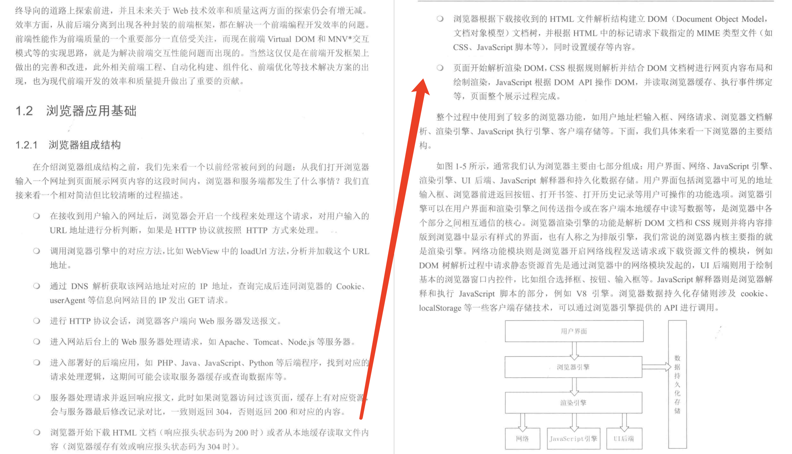
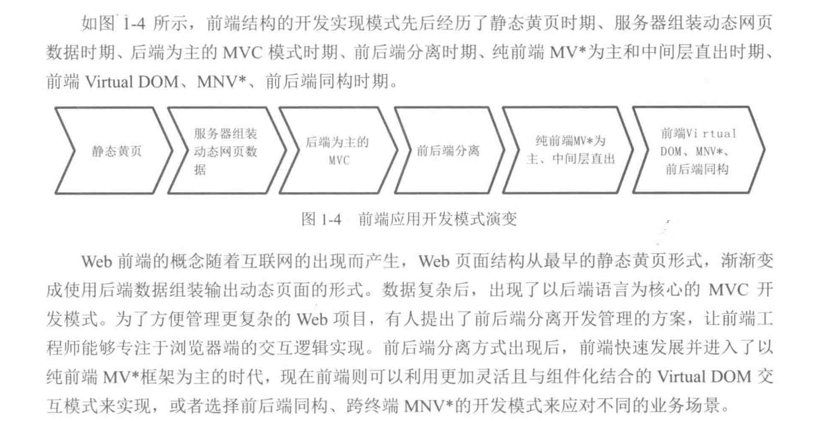
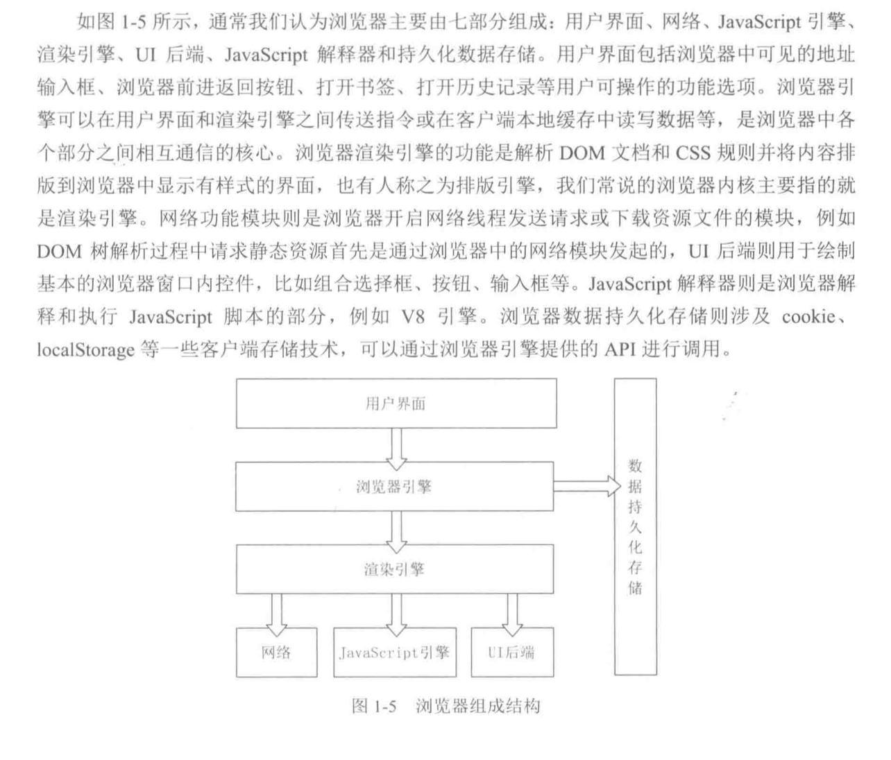
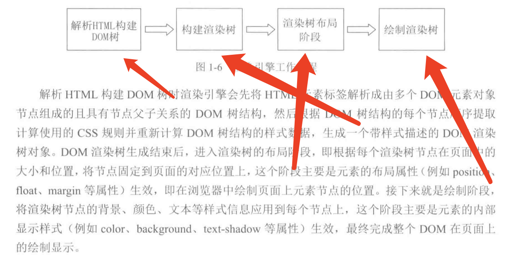
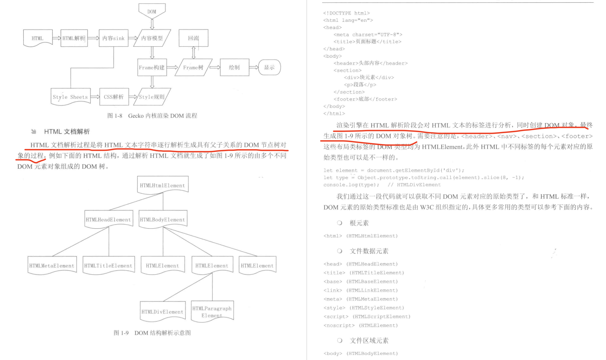
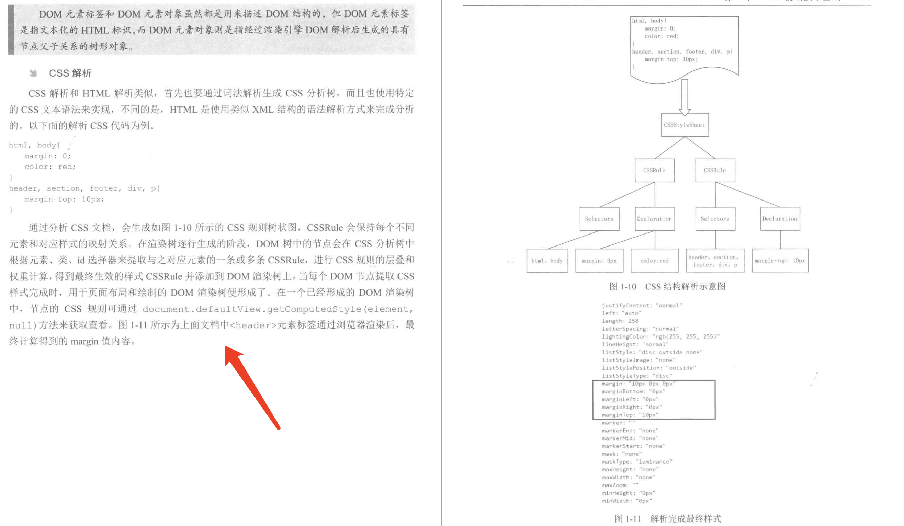

## 1、浏览器基础

### 1、从输入 url 到页面显示经历的过程

> 1、浏览器接收 url，开启线程对 URL 使用的协议进行判断
> 2、分析加载 URL
> 3、DNS 解析、获取 IP、连同浏览器信息进行 get 请求（对 IP 发起）
> 4、http 会话、发送报文
> 5、web 服务器处理请求
> 6、服务器处理逻辑（查询数据库或缓存等）
> 7、服务器返回报文（304 或 200）
> 8、浏览器下载 HTML 文档
> 9、浏览器解析 HTML，建立 DOM 树
> 10、解析渲染 DOM、css 树、读取缓存、js 事件操作等
> 

### 2、前端应用开发模式演变

> 1、静态页面
> 2、服务器组装数据
> 3、后端为主的 mvc
> 4、前后端分离
> 5、纯前端的 mv\*
> 6、前端 vvirtual DOM
> 

### 3、浏览器组成结构

### 4、浏览器渲染

> 1、解析 HTML、构建 DOM
> 2、构建渲染树
> 3、渲染树布局
> 4、绘制渲染树
> 
> `注意重排和重绘：重排是dom发生变化，会在布局阶段开始重新渲染；重绘是只改变样式，不改变dom，是在绘制阶段`
> **由于重排是在布局阶段，所以重排后一定会发生重绘**

### 5、HTML 解析

### 6、CSS 解析

