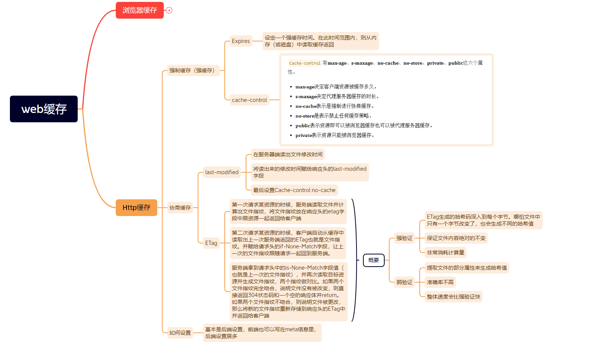
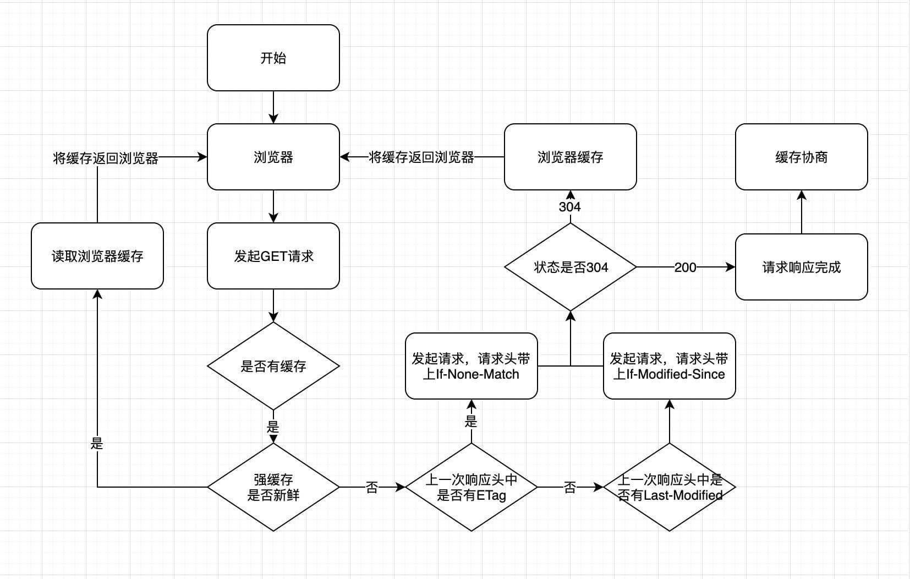
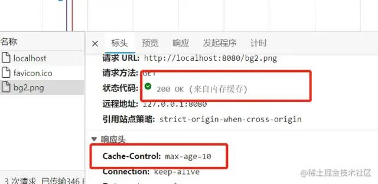
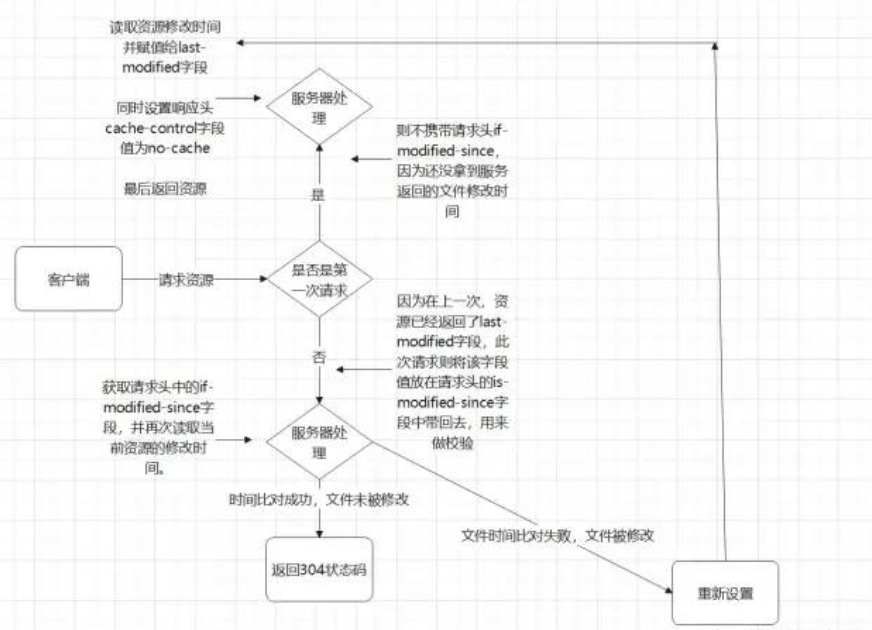
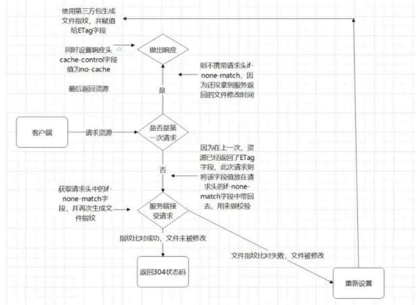

## 1、缓存

### 1.1 为什么需要缓存

服务器需要处理 http 的请求，并且 http 去传输数据，需要带宽。而我们缓存，就是为了让服务器不去处理这个请求，客户端也可以拿到数据。

### 1.2 什么资源需要缓存

> 我们的缓存主要是针对 html,css,img 等静态资源，常规情况下，我们不会去缓存一些动态资源，因为缓存动态资源的话，数据的实时性就不会不太好，所以我们一般都只会去缓存一些不太容易被改变的静态资源。

### 1.3 缓存优缺点

`优点`

- 减少不必要的网络传输，节约宽带
- 更快的加载页面
- 减少服务器负载，避免服务器过载的情况出现

`缺点`

- 占内存

## 2、Http 缓存



### 2.1 强制缓存（简称强缓存）

从强制缓存的角度出发，判断浏览器请求的目标资源是否有效命中，如果命中，则可以直接从内存（硬盘）中读取目标资源，无需与服务器做任何通讯。

#### 2.1.1 基于 Expires 字段实现的强缓存

Expires 可以设置资源的过期时间（本地时间），如果请求在资源有效期内，直接从本地读取，反之，则重新在服务器拉取。

比如说将某一资源设置响应头为:Expires:new Date("2022-7-30 23:59:59")；
那么，该资源在 2022-7-30 23:59:59 之前，都会去本地的磁盘（或内存）中读取，不会去服务器请求。

**`Expires 已经被废弃了，不是强缓存的首选，另外，Expires 过度依赖本地时间，如果本地与服务器时间不同步，就会出现资源无法被缓存或者资源永远被缓存的情况。所以，Expires 字段几乎不被使用了。现在的项目中，我们并不推荐使用 Expires，强缓存功能通常使用 cache-control 字段来代替 Expires 字段`**

#### 2.1.2 基于 Cache-control 实现的强缓存（代替 Expires 的强缓存实现方法）

`Cache-control完美解决了Expires本地时间和服务器时间不同步的问题。是当下的项目中实现强缓存的最常规方法`

```javascript
//往响应头中写入需要缓存的时间
res.writeHead(200, {
	"Cache-Control": "max-age=10",
});
```



- no-cache 的意思是强制进行协商缓存。如果某一资源的 Cache-control 中设置了 no-cache，那么该资源会直接跳过强缓存的校验，直接去服务器进行协商缓存
- no-store 就是禁止所有的缓存策略
  > no-cache 和 no-store 是一组互斥属性，这两个属性不能同时出现在 Cache-Control 中
- public 表示资源在客户端和代理服务器都可以被缓存
- private 则表示资源只能在客户端被缓存，拒绝资源在代理服务器缓存
  > public 和 private 就是决定资源是否可以在代理服务器进行缓存的属性
  > 如果这两个属性值都没有被设置，则默认为 private
  > public 和 private 也是一组互斥属性。他们两个不能同时出现在响应头的 cache-control 字段中
- max-age 表示的时间资源在客户端缓存的时长
- s-maxage 表示的是资源在代理服务器可以缓存的时长
  > s-maxage 因为是代理服务端的缓存时长，他必须和上面说的 public 属性一起使用（public 属性表示资源可以在代理服务器中缓存）
  > max-age 和 s-maxage 并不互斥。他们可以一起使用

`Cache-control多值写法`

```javascript
Cache-control:max-age=10000,s-maxage=200000,public
```

### 2.2 协商缓存

#### 2.2.1 基于 last-modified 的协商缓存

1. 首先需要在服务器端读出文件修改时间
2. 将读出来的修改时间赋给响应头的 last-modified 字段
3. 最后设置 Cache-control:no-cache



`使用以上方式的协商缓存已经存在两个非常明显的漏洞。这两个漏洞都是基于文件是通过比较修改时间来判断是否更改而产生的。`
`1.因为是更具文件修改时间来判断的，所以，在文件内容本身不修改的情况下，依然有可能更新文件修改时间（比如修改文件名再改回来），这样，就有可能文件内容明明没有修改，但是缓存依然失效了。`
`2.当文件在极短时间内完成修改的时候（比如几百毫秒）。因为文件修改时间记录的最小单位是秒，所以，如果文件在几百毫秒内完成修改的话，文件修改时间不会改变，这样，即使文件内容修改了，依然不会 返回新的文件。`

#### 2.2.2 基础 ETag 的协商缓存

`ETag就是将原先协商缓存的比较时间戳的形式修改成了比较文件指纹`
**文件指纹:根据文件内容计算出的唯一哈希值。文件内容一旦改变则指纹改变。**

1. 第一次请求某资源的时候，服务端读取文件并计算出文件指纹，将文件指纹放在响应头的 etag 字段中跟资源一起返回给客户端
2. 第二次请求某资源的时候，客户端自动从缓存中读取出上一次服务端返回的 ETag 也就是文件指纹。并赋给请求头的 if-None-Match 字段，让上一次的文件指纹跟随请求一起回到服务端。
3. 服务端拿到请求头中的 is-None-Match 字段值（也就是上一次的文件指纹），并再次读取目标资源并生成文件指纹，两个指纹做对比。如果两个文件指纹完全吻合，说明文件没有被改变，则直接返回 304 状态码和一个空的响应体并 return。如果两个文件指纹不吻合，则说明文件被更改，那么将新的文件指纹重新存储到响应头的 ETag 中并返回给客户端



> 从校验流程上来说，协商缓存的修改时间比对和文件指纹比对，几乎是一样的

`ETag也有缺点`
`1. ETag需要计算文件指纹这样意味着，服务端需要更多的计算开销。。如果文件尺寸大，数量多，并且计算频繁，那么ETag的计算就会影响服务器的性能。显然，ETag在这样的场景下就不是很适合。`
`2. ETag有强验证和弱验证，所谓将强验证，ETag生成的哈希码深入到每个字节。哪怕文件中只有一个字节改变了，也会生成不同的哈希值，它可以保证文件内容绝对的不变。但是，强验证非常消耗计算量。ETag还有一个弱验证，弱验证是提取文件的部分属性来生成哈希值。因为不必精确到每个字节，所以他的整体速度会比强验证快，但是准确率不高。会降低协商缓存的有效性。`

> 值得注意的一点是，不同于 cache-control 是 expires 的完全替代方案(说人话:能用 cache-control 就不要用 expiress)。ETag 并不是 last-modified 的完全替代方案。而是 last-modified 的补充方案（项目中到底是用 ETag 还是 last-modified 完全取决于业务场景）。
