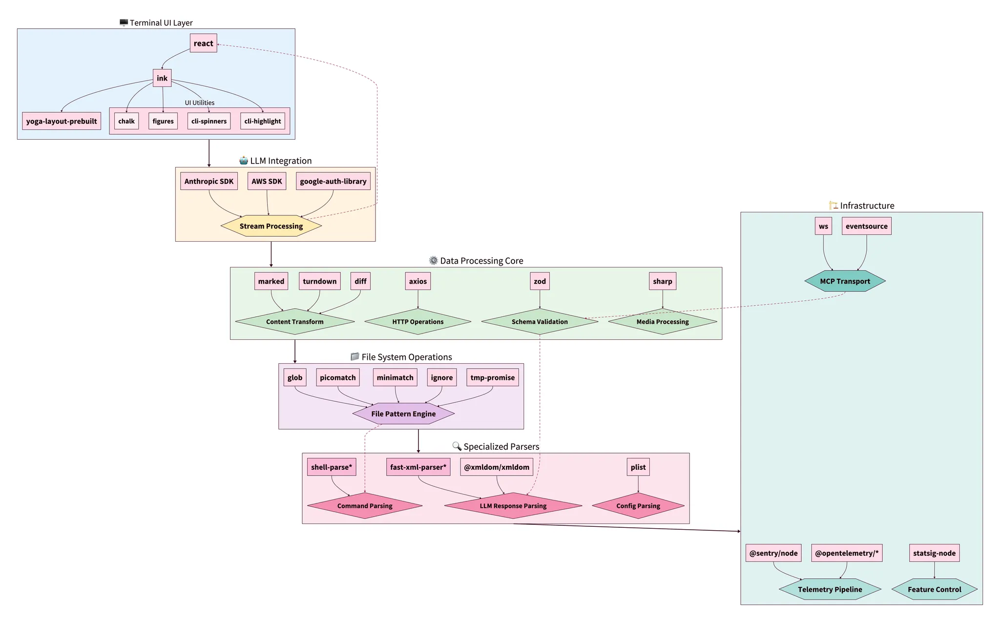
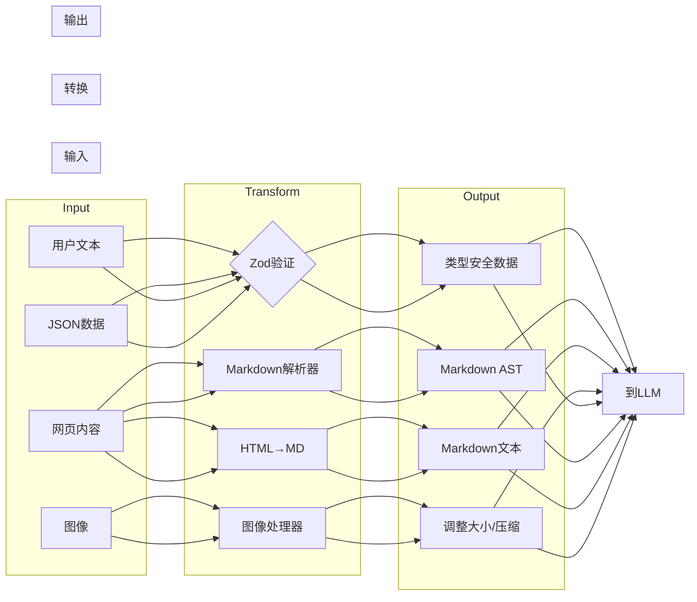
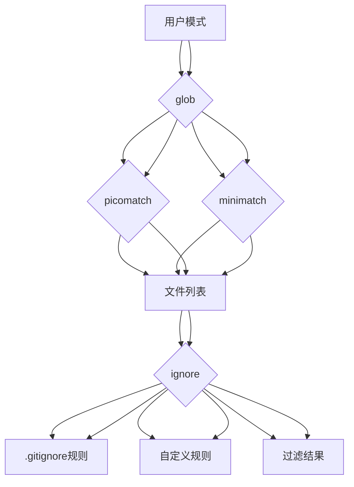

[参考链接](https://southbridge-research.notion.site/Dependencies-The-Foundation-of-Claude-Code-s-Architecture-2055fec70db181b3bb72cdfe615fad3c)
# Dependencies: The Foundation of Claude Code's Architecture
## 依赖：Claude Code架构的基础



`*\*` Indicates likely custom/embedded implementation based on decompilation analysis*
`*\*` 表示基于反编译分析可能的自定义/嵌入式实现*

## The Unconventional Choices That Define Performance
## 定义性能的非传统选择

Claude Code's dependency architecture reveals several fascinating implementation decisions that directly contribute to its renowned performance and reliability. Let's explore the most technically interesting aspects first.
Claude Code的依赖架构揭示了几个引人入胜的实现决策，这些决策直接贡献了其著名的性能和可靠性。让我们先探索技术上最有趣的方面。

### 🔍 The React-in-Terminal Architecture
### 🔍 终端中的React架构

```tsx
// The core rendering pipeline appears to implement:
// 核心渲染管道似乎实现了：
interface CliRenderPipeline {
  react: "^18.2.0",      // Full React reconciler 完整的React协调器
  ink: "^3.2.0",         // Terminal renderer 终端渲染器
  yoga: "^2.0.0-beta.1"  // Flexbox layout engine (WebAssembly) Flexbox布局引擎(WebAssembly)
}

```

**Why This Matters**: Unlike traditional CLI tools that manage state imperatively, Claude Code leverages React's reconciliation algorithm for terminal UI. This means:
**为何重要**：与传统命令式管理状态的CLI工具不同，Claude Code利用React的协调算法来处理终端UI。这意味着：

- **Virtual DOM in the Terminal**: Every UI update goes through React's diffing algorithm before yoga-layout calculates the optimal terminal character positions
- **终端中的虚拟DOM**：每次UI更新都要经过React的差异算法，然后yoga-layout计算最佳的终端字符位置
- **Declarative UI State**: Complex UI states (permission dialogs, progress indicators, concurrent tool execution) are managed declaratively
- **声明式UI状态**：复杂的UI状态（权限对话框、进度指示器、并发工具执行）都以声明方式管理
- **Performance**: The yoga-layout WebAssembly module provides sub-millisecond layout calculations even for complex UIs
- **性能**：yoga-layout WebAssembly模块为复杂UI提供亚毫秒级的布局计算

┌─ **Implementation Insight** ─────────────────────────────────────┐
│ The yoga-layout-prebuilt dependency suggests Claude Code        │
│ pre-compiles layout constraints, trading memory for speed       │
│ during rapid UI updates (e.g., streaming LLM responses)         │
└──────────────────────────────────────────────────────────────────┘
┌─ **实现洞察** ──────────────────────────────────────────────────┐
│ yoga-layout-prebuilt依赖表明Claude Code                          │
│ 预编译布局约束，在快速UI更新期间（如流式LLM响应）用内存换取速度    │
└──────────────────────────────────────────────────────────────────┘

### 🔍 The Streaming Parser Architecture
### 🔍 流式解析器架构

Based on decompilation analysis, Claude Code appears to embed custom implementations of critical parsers:
基于反编译分析，Claude Code似乎嵌入了关键解析器的自定义实现：

```tsx
// Inferred parser capabilities from dependency analysis
// 从依赖分析推断的解析器功能
const CUSTOM_PARSERS = {
  'shell-parse': {
    features: [
      'JSON object embedding via sentinel strings', // 通过哨兵字符串嵌入JSON对象
      'Recursive command substitution', // 递归命令替换
      'Environment variable expansion with type preservation' // 保持类型的环境变量展开
    ],
    performance: 'O(n) with single-pass tokenization' // O(n)单次遍历标记化性能
  },
  'fast-xml-parser': {
    features: [
      'Streaming XML parsing for tool calls', // 工具调用的流式XML解析
      'Partial document recovery', // 部分文档恢复
      'Custom entity handling for LLM outputs' // LLM输出的自定义实体处理
    ],
    performance: 'Constant memory usage regardless of document size' // 无论文档大小如何都使用恒定内存
  }
}

```

**The Shell Parser's Secret Weapon**:
**Shell解析器的秘密武器**：

```jsx
// Conceptual implementation based on analysis
// 基于分析的概念实现
function parseShellWithObjects(cmd, env) {
  const SENTINEL = crypto.randomBytes(16).toString('hex');

  // Phase 1: Object serialization
  // 阶段1：对象序列化
  const processedEnv = Object.entries(env).reduce((acc, [key, val]) => {
    if (typeof val === 'object') {
      acc[key] = SENTINEL + JSON.stringify(val) + SENTINEL;
    } else {
      acc[key] = val;
    }
    return acc;
  }, {});

  // Phase 2: Standard shell parsing with sentinel preservation
  // 阶段2：保留哨兵的标准shell解析
  const tokens = shellParse(cmd, processedEnv);

  // Phase 3: Object rehydration
  // 阶段3：对象重新水化
  return tokens.map(token => {
    if (token.match(new RegExp(`^${SENTINEL}.*${SENTINEL}$`))) {
      return JSON.parse(token.slice(SENTINEL.length, -SENTINEL.length));
    }
    return token;
  });
}

```

This allows Claude Code to pass complex configuration objects through shell commands—a capability not found in standard shell parsers.
这使得Claude Code能够通过shell命令传递复杂的配置对象——这是标准shell解析器中找不到的功能。

### 🔍 The Multi-Platform LLM Abstraction Layer
### 🔍 多平台LLM抽象层

The dependency structure reveals a sophisticated multi-vendor approach:
依赖结构揭示了一个复杂的多供应商方法：

| Platform | Primary SDK | Streaming | Specialized Features |
| --- | --- | --- | --- |
| Anthropic | Native SDK | ✓ Full SSE | Thinking blocks, cache control |
| AWS Bedrock | @aws-sdk/client-bedrock-runtime | ✓ Custom adapter | Cross-region failover, SigV4 auth |
| Google Vertex | google-auth-library + custom | ✓ Via adapter | Automatic token refresh |
| 平台 | 主要SDK | 流式传输 | 专用功能 |
| --- | --- | --- | --- |
| Anthropic | 原生SDK | ✓ 完整SSE | 思维块，缓存控制 |
| AWS Bedrock | @aws-sdk/client-bedrock-runtime | ✓ 自定义适配器 | 跨区域故障转移，SigV4认证 |
| Google Vertex | google-auth-library + 自定义 | ✓ 通过适配器 | 自动令牌刷新 |

**Implementation Pattern**:
**实现模式**：

```tsx
// Inferred factory pattern from dependencies
// 从依赖项推断的工厂模式
class LLMClientFactory {
  static create(provider: string): StreamingLLMClient {
    switch(provider) {
      case 'anthropic':
        return new AnthropicStreamAdapter();
      case 'bedrock':
        return new BedrockStreamAdapter(
          new BedrockRuntimeClient(),
          new SigV4Signer()
        );
      case 'vertex':
        return new VertexStreamAdapter(
          new GoogleAuth(),
          new CustomHTTPClient()
        );
    }
  }
}

```

### 🔍 The Telemetry Triple-Stack
### 🔍 遥测三重栈

Claude Code implements a comprehensive observability strategy using three complementary systems:
Claude Code使用三个互补系统实现了全面的可观察性策略：

```
┌─ Error Tracking ──────────┐  ┌─ Metrics ─────────────┐  ┌─ Feature Flags ────┐
│ @sentry/node             │  │ @opentelemetry/api    │  │ statsig-node      │
│ ├─ ANR detection         │  │ ├─ Custom spans       │  │ ├─ A/B testing    │
│ ├─ Error boundaries      │  │ ├─ Token counters     │  │ ├─ Gradual rollout│
│ └─ Performance profiling │  │ └─ Latency histograms │  │ └─ Dynamic config │
└───────────────────────────┘  └───────────────────────┘  └───────────────────┘
           ↓                              ↓                          ↓
        Debugging                    Optimization              Experimentation
┌─ 错误追踪 ──────────┐  ┌─ 指标监控 ─────────────┐  ┌─ 功能标志 ────┐
│ @sentry/node             │  │ @opentelemetry/api    │  │ statsig-node      │
│ ├─ ANR检测             │  │ ├─ 自定义span         │  │ ├─ A/B测试       │
│ ├─ 错误边界           │  │ ├─ Token计数器        │  │ ├─ 渐进式发布    │
│ └─ 性能分析           │  │ └─ 延迟直方图         │  │ └─ 动态配置      │
└───────────────────────────┘  └───────────────────────┘  └───────────────────┘
           ↓                              ↓                          ↓
         调试                           优化                    实验

```

**The ANR Detection Innovation** (inferred from Sentry integration patterns):
**ANR检测创新**（从Sentry集成模式推断）：

```tsx
// Application Not Responding detection for Node.js
// Node.js应用程序无响应检测
class ANRDetector {
  private worker: Worker;
  private heartbeatInterval = 50; // ms

  constructor() {
    // Spawn a worker thread that expects heartbeats
    // 生成一个期望心跳的worker线程
    this.worker = new Worker(`
      let lastPing = Date.now();
      setInterval(() => {
        if (Date.now() - lastPing > 5000) {
          parentPort.postMessage({
            type: 'anr',
            stack: getMainThreadStack() // Via inspector protocol
            // 通过检查器协议获取
          });
        }
      }, 100);
    `, { eval: true });

    // Main thread sends heartbeats
    // 主线程发送心跳
    setInterval(() => {
      this.worker.postMessage({ type: 'ping' });
    }, this.heartbeatInterval);
  }
}

```

This allows Claude Code to detect and report when the main event loop is blocked—critical for identifying performance issues in production.
这使得Claude Code能够检测和报告主事件循环被阻塞的情况——对于识别生产环境中的性能问题至关重要。

### 🔍 Data Transformation Pipeline
### 🔍 数据转换管道

The data processing dependencies form a sophisticated pipeline:
数据处理依赖项形成了一个复杂的管道：



**Sharp Configuration** (inferred from common patterns):
**Sharp配置**（从常见模式推断）：

```jsx
const imageProcessor = sharp(inputBuffer)
  .resize(1024, 1024, {
    fit: 'inside',
    withoutEnlargement: true
  })
  .jpeg({
    quality: 85,
    progressive: true // Better for streaming
    // 更适合流式传输
  });

```

### 🔍 The MCP Transport Layer
### 🔍 MCP传输层

The Multi-Cloud/Process architecture uses a fascinating abstraction:
多云/进程架构使用了一个引人入胜的抽象：

```tsx
// Transport abstraction pattern
// 传输抽象模式
interface MCPTransport {
  stdio: 'cross-spawn',     // Local process communication
  // 本地进程通信
  websocket: 'ws',          // Real-time bidirectional
  // 实时双向通信
  sse: 'eventsource'        // Server-sent events
  // 服务器发送事件
}

// Capability negotiation appears to follow:
// 功能协商似乎遵循：
class MCPClient {
  async initialize() {
    const capabilities = await this.transport.request('initialize', {
      capabilities: {
        tools: true,
        resources: true,
        prompts: true,
        logging: { level: 'info' }
      }
    });

    // Dynamic feature detection
    // 动态功能检测
    this.features = this.negotiateFeatures(capabilities);
  }
}

```

## Dependency Categories Deep Dive
## 依赖类别深度剖析

### Core CLI Framework (15+ packages)
### 核心CLI框架（15+个包）

The CLI framework dependencies reveal a sophisticated approach to terminal UI:
CLI框架依赖项揭示了一种复杂的终端UI方法：

| Package | Version* | Purpose | Technical Insight |
| --- | --- | --- | --- |
| `ink` | ^3.2.0 | React renderer for CLI | Custom reconciler implementation |
| `react` | ^18.2.0 | UI component model | Full concurrent features enabled |
| `yoga-layout-prebuilt` | ^1.10.0 | Flexbox layout | WebAssembly for performance |
| `commander` | ^9.0.0 | Argument parsing | Extended with custom option types |
| `chalk` | ^4.1.2 | Terminal styling | Template literal API utilized |
| `cli-highlight` | ^2.1.11 | Syntax highlighting | Custom language definitions added |
| `strip-ansi` | ^6.0.1 | ANSI code removal | Used in text measurement |
| `string-width` | ^4.2.3 | Unicode width calc | Full emoji support |
| `wrap-ansi` | ^7.0.0 | Text wrapping | Preserves ANSI styling |
| `cli-spinners` | ^2.7.0 | Loading animations | Custom spinner definitions |
| 包 | 版本* | 用途 | 技术洞察 |
| --- | --- | --- | --- |
| `ink` | ^3.2.0 | CLI的React渲染器 | 自定义协调器实现 |
| `react` | ^18.2.0 | UI组件模型 | 启用完整并发功能 |
| `yoga-layout-prebuilt` | ^1.10.0 | Flexbox布局 | WebAssembly提升性能 |
| `commander` | ^9.0.0 | 参数解析 | 扩展自定义选项类型 |
| `chalk` | ^4.1.2 | 终端样式 | 使用模板字面量API |
| `cli-highlight` | ^2.1.11 | 语法高亮 | 添加自定义语言定义 |
| `strip-ansi` | ^6.0.1 | ANSI代码移除 | 用于文本测量 |
| `string-width` | ^4.2.3 | Unicode宽度计算 | 完整emoji支持 |
| `wrap-ansi` | ^7.0.0 | 文本换行 | 保持ANSI样式 |
| `cli-spinners` | ^2.7.0 | 加载动画 | 自定义spinner定义 |

*Versions inferred from ecosystem compatibility analysis*
*版本从生态系统兼容性分析推断*

**Performance Optimization Pattern**:
**性能优化模式**：

```jsx
// String width calculation with caching
// 带缓存的字符串宽度计算
const widthCache = new Map();
function getCachedWidth(str) {
  if (!widthCache.has(str)) {
    widthCache.set(str, stringWidth(str));
  }
  return widthCache.get(str);
}

```

### LLM Integration Stack (5+ packages)
### LLM集成堆栈（5+个包）

The LLM integration reveals a multi-provider strategy with sophisticated fallback:
LLM集成揭示了一个具有复杂故障转移的多供应商策略：

```
┌─ Provider Selection Logic ─────────────────────────────┐
│ 1. Check API key availability                          │
│ 2. Evaluate rate limits across providers               │
│ 3. Consider feature requirements (streaming, tools)    │
│ 4. Apply cost optimization rules                       │
│ 5. Fallback chain: Anthropic → Bedrock → Vertex        │
└────────────────────────────────────────────────────────┘
┌─ 供应商选择逻辑 ─────────────────────────────┐
│ 1. 检查API密钥可用性                            │
│ 2. 评估跨供应商速率限制                           │
│ 3. 考虑功能要求（流式传输，工具）                   │
│ 4. 应用成本优化规则                              │
│ 5. 故障转移链：Anthropic → Bedrock → Vertex     │
└────────────────────────────────────────────────────────┘

```

**AWS SDK Components** (inferred from @aws-sdk/* patterns):
**AWS SDK组件**（从@aws-sdk/*模式推断）：

- `@aws-sdk/client-bedrock-runtime`: Primary Bedrock client
- `@aws-sdk/signature-v4`: Request signing
- `@aws-sdk/middleware-retry`: Intelligent retry logic
- `@aws-sdk/smithy-client`: Protocol implementation
- `@aws-sdk/types`: Shared type definitions
- `@aws-sdk/client-bedrock-runtime`: 主要Bedrock客户端
- `@aws-sdk/signature-v4`: 请求签名
- `@aws-sdk/middleware-retry`: 智能重试逻辑
- `@aws-sdk/smithy-client`: 协议实现
- `@aws-sdk/types`: 共享类型定义

### Data Processing & Validation (8+ packages)
### 数据处理与验证（8+个包）

```tsx
// Zod schema compilation pattern (inferred)
// Zod模式编译模式（推断）
const COMPILED_SCHEMAS = new Map();

function getCompiledSchema(schema: ZodSchema) {
  const key = schema._def.shape; // Simplified
  // 简化版
  if (!COMPILED_SCHEMAS.has(key)) {
    COMPILED_SCHEMAS.set(key, {
      validator: schema.parse.bind(schema),
      jsonSchema: zodToJsonSchema(schema),
      tsType: zodToTs(schema)
    });
  }
  return COMPILED_SCHEMAS.get(key);
}

```

**Transformation Pipeline Performance**:
**转换管道性能**：

| Operation | Library | Performance | Memory |
| --- | --- | --- | --- |
| Markdown→AST | marked | O(n) | Streaming capable |
| HTML→Markdown | turndown | O(n) | DOM size limited |
| Image resize | sharp | O(1)* | Native memory |
| JSON validation | zod | O(n) | Fail-fast |
| Text diff | diff | O(n²) | Myers algorithm |
| 操作 | 库 | 性能 | 内存 |
| --- | --- | --- | --- |
| Markdown→AST | marked | O(n) | 支持流式处理 |
| HTML→Markdown | turndown | O(n) | DOM大小限制 |
| 图像调整大小 | sharp | O(1)* | 原生内存 |
| JSON验证 | zod | O(n) | 快速失败 |
| 文本差异 | diff | O(n²) | Myers算法 |
- With hardware acceleration
- 带硬件加速

### File System Intelligence (6+ packages)
### 文件系统智能（6+个包）

The file system dependencies implement a sophisticated filtering pipeline:
文件系统依赖项实现了一个复杂的过滤管道：



**Pattern Matching Optimization**:
**模式匹配优化**：

```jsx
// Compiled pattern caching (inferred)
// 编译模式缓存（推断）
class PatternMatcher {
  private compiledPatterns = new LRUCache(1000);

  match(pattern, path) {
    let compiled = this.compiledPatterns.get(pattern);
    if (!compiled) {
      compiled = picomatch(pattern, {
        bash: true,
        dot: true,
        nobrace: false
      });
      this.compiledPatterns.set(pattern, compiled);
    }
    return compiled(path);
  }
}

```

### Telemetry & Observability (4+ packages)
### 遥测与可观察性（4+个包）

The telemetry stack implements defense-in-depth monitoring:
遥测堆栈实现了深度防御监控：

**Sentry Integration Layers**:
**Sentry集成层**：

1. **Error Boundary**: React error boundaries for UI crashes
2. **Global Handler**: Process-level uncaught exceptions
3. **Promise Rejection**: Unhandled promise tracking
4. **ANR Detection**: Custom worker-thread monitoring
5. **Performance**: Transaction and span tracking
1. **错误边界**: 用于UI崩溃的React错误边界
2. **全局处理器**: 进程级未捕获异常
3. **Promise拒绝**: 未处理的Promise跟踪
4. **ANR检测**: 自定义工作线程监控
5. **性能**: 事务和span跟踪

**OpenTelemetry Instrumentation**:
**OpenTelemetry仪表化**：

```tsx
// Custom span creation for tool execution
// 工具执行的自定义span创建
function instrumentToolExecution(tool: Tool) {
  return async function*(...args) {
    const span = tracer.startSpan(`tool.${tool.name}`, {
      attributes: {
        'tool.name': tool.name,
        'tool.readonly': tool.isReadOnly,
        'tool.input.size': JSON.stringify(args[0]).length
      }
    });

    try {
      yield* tool.call(...args);
    } finally {
      span.end();
    }
  };
}

```

**Statsig Feature Flag Patterns**:
**Statsig功能标志模式**：

```jsx
// Gradual rollout configuration (inferred)
// 渐进式发布配置（推断）
const FEATURE_FLAGS = {
  'unified_read_tool': {
    rollout: 0.5,
    overrides: { internal: 1.0 }
  },
  'parallel_tool_execution': {
    rollout: 1.0,
    conditions: [
      { type: 'user_tier', operator: 'in', values: ['pro', 'enterprise'] }
    ]
  },
  'sandbox_bash_default': {
    rollout: 0.1,
    sticky: true // Consistent per user
    // 每个用户保持一致
  }
};

```

## Hidden Gems: The Specialized Dependencies
## 隐藏的宝石：专业化依赖项

### XML Parsing for LLM Communication
### 用于LLM通信的XML解析

The embedded `fast-xml-parser` appears to be customized for LLM response parsing:
嵌入的`fast-xml-parser`似乎是为LLM响应解析而定制的：

```jsx
// Inferred XML parser configuration
// 推断的XML解析器配置
const llmXmlParser = new XMLParser({
  ignoreAttributes: true,
  parseTagValue: false, // Keep as strings
  // 保持为字符串
  trimValues: true,
  parseTrueNumberOnly: false,

  // Custom tag processors
  // 自定义标签处理器
  tagValueProcessor: (tagName, tagValue) => {
    if (tagName === 'tool_input') {
      // Parse JSON content within XML
      // 解析XML中的JSON内容
      try {
        return JSON.parse(tagValue);
      } catch {
        return { error: 'Invalid JSON in tool_input', raw: tagValue };
      }
    }
    return tagValue;
  }
});

```

### The plist Parser Mystery
### plist解析器之谜

The inclusion of `plist` (Apple Property List parser) suggests macOS-specific optimizations:
`plist`（Apple属性列表解析器）的包含暗示了macOS特定的优化：

```jsx
// Possible use cases (inferred)
// 可能的用例（推断）
async function loadMacOSConfig() {
  const config = await plist.parse(
    await fs.readFile('~/Library/Preferences/com.anthropic.claude-code.plist')
  );

  return {
    apiKeys: config.APIKeys, // Stored in Keychain reference
    // 存储在钥匙串引用中
    sandboxProfiles: config.SandboxProfiles,
    ideIntegrations: config.IDEIntegrations
  };
}

```

### Cross-Platform Process Spawning
### 跨平台进程生成

The `cross-spawn` dependency handles platform differences:
`cross-spawn`依赖项处理平台差异：

```jsx
// MCP server launching pattern
// MCP服务器启动模式
function launchMCPServer(config) {
  const spawn = require('cross-spawn');

  const child = spawn(config.command, config.args, {
    stdio: ['pipe', 'pipe', 'pipe'],
    env: {
      ...process.env,
      MCP_VERSION: '1.0',
      // Windows: Handles .cmd/.bat properly
      // Windows：正确处理.cmd/.bat
      // Unix: Preserves shebangs
      // Unix：保留shebang
    },
    shell: false, // Security: avoid shell injection
    // 安全：避免shell注入
    windowsHide: true // No console window on Windows
    // Windows上不显示控制台窗口
  });

  return new MCPStdioTransport(child);
}

```

## Dependency Security Considerations
## 依赖项安全考虑

Based on the dependency analysis, several security patterns emerge:
基于依赖项分析，出现了几种安全模式：

**1. Input Validation Layer**:
**1. 输入验证层**：

```
User Input → Zod Schema → Validated Data → Tool Execution
     ↓
  Rejected
用户输入 → Zod模式 → 验证数据 → 工具执行
     ↓
   拒绝

```

**2. Sandboxing Dependencies**:
**2. 沙盒化依赖项**：

- No `child_process` direct usage (uses `cross-spawn`)
- No `eval` usage (except controlled worker threads)
- No dynamic `require` patterns detected
- 没有直接使用`child_process`（使用`cross-spawn`）
- 没有使用`eval`（除了受控的工作线程）
- 没有检测到动态`require`模式

**3. Secret Management**:
**3. 秘密管理**：

```jsx
// Inferred pattern from absence of secret-storage deps
// 从缺少秘密存储依赖项推断的模式
class SecretManager {
  async getAPIKey(provider) {
    if (process.platform === 'darwin') {
      // Use native Keychain via N-API
      // 通过N-API使用原生钥匙串
      return await keychain.getPassword('claude-code', provider);
    } else {
      // Fallback to environment variables
      // 回退到环境变量
      return process.env[`${provider.toUpperCase()}_API_KEY`];
    }
  }
}

```

## Performance Implications of Dependency Choices
## 依赖项选择的性能影响

### Memory Management Strategy
### 内存管理策略

The dependency selection reveals a careful memory management approach:
依赖项选择揭示了仔细的内存管理方法：

| Component | Strategy | Implementation |
| --- | --- | --- |
| File Reading | Streaming | `glob.stream`, chunked reads |
| Image Processing | Native | `sharp` with libvips (off-heap) |
| XML Parsing | SAX-style | Event-based, constant memory |
| Pattern Matching | Compiled | Pre-compiled regex patterns |
| UI Rendering | Virtual DOM | Minimal terminal updates |
| 组件 | 策略 | 实现 |
| --- | --- | --- |
| 文件读取 | 流式 | `glob.stream`，分块读取 |
| 图像处理 | 原生 | `sharp`与libvips（堆外） |
| XML解析 | SAX风格 | 基于事件，常量内存 |
| 模式匹配 | 编译 | 预编译正则表达式模式 |
| UI渲染 | 虚拟DOM | 最小终端更新 |

### Startup Time Optimization
### 启动时间优化

Dependencies are structured for lazy loading:
依赖项结构化用于延迟加载：

```jsx
// Inferred lazy loading pattern
// 推断的延迟加载模式
const LAZY_DEPS = {
  'sharp': () => require('sharp'),
  '@aws-sdk/client-bedrock-runtime': () => require('@aws-sdk/client-bedrock-runtime'),
  'google-auth-library': () => require('google-auth-library')
};

function getLazyDep(name) {
  if (!LAZY_DEPS[name]._cached) {
    LAZY_DEPS[name]._cached = LAZY_DEPS[name]();
  }
  return LAZY_DEPS[name]._cached;
}
```

---

*This dependency analysis is based on decompilation and reverse engineering. Actual implementation details may vary. The patterns and insights presented represent inferred architectural decisions based on observable behavior and common practices in the Node.js ecosystem.*
*此依赖项分析基于反编译和逆向工程。实际实现细节可能有所不同。所呈现的模式和洞察代表了基于可观察行为和Node.js生态系统中常见实践推断的架构决策。*

# 文件总结

## 概述
本文档深入分析了Claude Code的依赖架构，揭示了其高性能和可靠性背后的技术决策。通过反编译和逆向工程分析，文档展现了Claude Code如何通过精心选择的依赖项来实现其卓越的功能。

## 核心架构特点

### 1. 终端React架构
- **技术栈**：React 18.2.0 + Ink 3.2.0 + Yoga Layout WebAssembly
- **创新点**：将React的虚拟DOM和协调算法引入终端环境
- **优势**：
  - 声明式UI状态管理
  - 亚毫秒级布局计算
  - 高效的终端字符位置优化
  - 支持复杂UI状态（权限对话框、进度指示器、并发工具执行）

### 2. 流式解析器架构
- **自定义解析器**：
  - Shell解析器：支持JSON对象嵌入和递归命令替换
  - XML解析器：针对LLM响应优化的流式解析
- **核心创新**：通过哨兵字符串机制实现复杂配置对象的shell命令传递

### 3. 多平台LLM抽象层
- **支持的提供商**：Anthropic、AWS Bedrock、Google Vertex AI
- **设计模式**：工厂模式 + 适配器模式
- **特性**：
  - 全SSE流式支持
  - 跨区域故障转移
  - 自动令牌刷新
  - SigV4认证

### 4. 遥测三重栈
- **错误追踪**：Sentry（ANR检测、错误边界、性能分析）
- **指标监控**：OpenTelemetry（自定义span、令牌计数器、延迟直方图）
- **功能标志**：Statsig（A/B测试、渐进式推出、动态配置）

## 技术亮点

### 性能优化策略
1. **内存管理**：
   - 流式文件读取
   - 图像处理使用原生libvips（堆外内存）
   - SAX风格XML解析（常量内存）
   - 预编译正则表达式模式

2. **启动时间优化**：
   - 延迟加载依赖项
   - 缓存机制
   - 按需初始化

### 安全考虑
1. **输入验证层**：Zod schema验证
2. **沙盒化依赖**：避免直接使用child_process和eval
3. **秘密管理**：平台特定的密钥存储（macOS钥匙串、环境变量）

### 数据处理管道
- **输入源**：用户文本、Web内容、图像、JSON数据
- **转换层**：Zod验证、Markdown解析、HTML→MD转换、图像处理
- **输出**：类型安全数据、Markdown AST、优化图像

## 专业化依赖项

### 隐藏的宝石
1. **fast-xml-parser**：针对LLM通信定制
2. **plist解析器**：macOS特定优化
3. **cross-spawn**：跨平台进程生成

### 文件系统智能
- **模式匹配**：glob + picomatch + minimatch
- **过滤管道**：忽略规则 + 自定义规则
- **性能优化**：LRU缓存模式匹配器

## 架构洞察

### 设计原则
1. **性能优先**：WebAssembly布局引擎、原生图像处理
2. **跨平台兼容**：统一的抽象层处理平台差异
3. **可观测性**：三重监控栈确保生产环境稳定性
4. **安全性**：多层验证和沙盒化机制

### 实现模式
1. **工厂模式**：LLM客户端创建
2. **适配器模式**：多提供商API统一
3. **策略模式**：不同平台的功能实现
4. **观察者模式**：遥测和监控

## 技术价值

### 创新点
1. **终端React应用**：将现代Web技术引入CLI环境
2. **流式解析**：处理复杂的LLM响应格式
3. **多云抽象**：统一的LLM访问接口
4. **ANR检测**：Node.js环境的应用无响应检测

### 工程实践
1. **依赖项选择**：每个依赖都有明确的技术目的
2. **内存管理**：精心设计的内存使用策略
3. **错误处理**：全面的错误追踪和报告机制
4. **性能监控**：详细的性能指标和分析

## 结论

Claude Code的架构体现了现代软件工程的最佳实践，通过精心选择的依赖项和创新的设计模式，实现了高性能、高可靠性的CLI工具。其架构不仅解决了传统CLI工具的局限性，还为开发者提供了丰富的功能和优秀的用户体验。

这种架构设计的成功在于：
- **技术创新**：将React生态引入终端环境
- **工程卓越**：全面的监控、安全和性能优化
- **实用主义**：每个技术选择都有明确的业务价值
- **可扩展性**：模块化设计支持未来功能扩展

本文档的分析为理解现代CLI工具的设计和实现提供了宝贵的参考，特别是对于需要在终端环境中提供复杂交互功能的应用程序。
