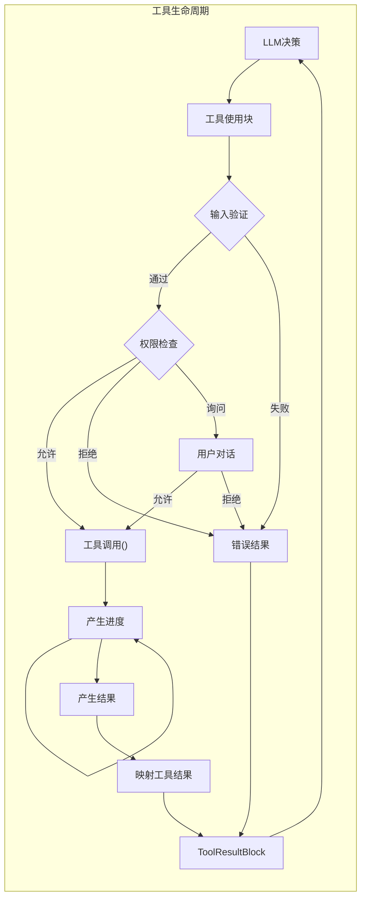

[参考链接](https://southbridge-research.notion.site/Tools-The-Execution-Engine-2055fec70db181088a53cb43ae9168dc)
# Tools & The Execution Engine
# 工具与执行引擎



## The Tool Execution Pipeline: Async Generators All The Way Down
## 工具执行管道：异步生成器贯穿始终

Claude Code工具系统最引人入胜的方面是在整个执行管道中使用异步生成器。这允许在保持清晰错误边界的同时进行流式进度更新：

```tsx
// 核心工具执行函数（重构）
// The core tool execution function (reconstructed)
async function* executeTool(
  toolUse: ToolUseBlock,
  toolDef: ToolDefinition,
  context: ToolUseContext,
  permissionFn: PermissionGranter,
  assistantMessage: CliMessage
): AsyncGenerator<CliMessage, void, void> {
  // 阶段1：使用Zod进行输入验证
  // Phase 1: Input validation with Zod
  const validationStart = performance.now();
  const validation = toolDef.inputSchema.safeParse(toolUse.input);

  if (!validation.success) {
    // 格式化Zod错误供LLM使用
    // Format Zod errors for LLM consumption
    const errorMessage = formatZodError(validation.error);
    yield createToolResultMessage({
      tool_use_id: toolUse.id,
      content: [{
        type: 'text',
        text: `输入验证失败：\\n${errorMessage}` // Input validation failed:\n${errorMessage}
      }],
      is_error: true
    });
    return;
  }

  // 阶段2：权限检查
  // Phase 2: Permission check
  const permissionResult = await checkToolPermission(
    toolDef,
    validation.data,
    context.getToolPermissionContext(),
    permissionFn
  );

  if (permissionResult.behavior === 'deny') {
    yield createToolResultMessage({
      tool_use_id: toolUse.id,
      content: [{
        type: 'text',
        text: `权限被拒绝：${permissionResult.message}` // Permission denied: ${permissionResult.message}
      }],
      is_error: true
    });
    return;
  }

  if (permissionResult.behavior === 'ask') {
    // 为权限对话框生成UI事件
    // Yield UI event for permission dialog
    yield {
      type: 'permission_request',
      toolName: toolDef.name,
      input: validation.data,
      suggestions: permissionResult.ruleSuggestions
    };

    // 等待用户决定（由外层循环处理）
    // Wait for user decision (handled by outer loop)
    const decision = await permissionFn(
      toolDef,
      validation.data,
      permissionResult
    );

    if (!decision.allowed) {
      yield createToolResultMessage({
        tool_use_id: toolUse.id,
        content: [{
          type: 'text',
          text: '工具执行被用户取消' // Tool execution cancelled by user
        }],
        is_error: true
      });
      return;
    }
  }

  // 阶段3：带进度跟踪的工具执行
  // Phase 3: Tool execution with progress tracking
  try {
    const executeStart = performance.now();
    let progressCount = 0;
    let finalResult = null;

    // 调用工具的异步生成器
    // Call the tool's async generator
    for await (const output of toolDef.call(
      validation.data,
      context,
      undefined, // mcpContext - 按要求跳过
      assistantMessage
    )) {
      if (output.type === 'progress') {
        progressCount++;
        yield {
          type: 'progress',
          uuid: `progress-${toolUse.id}-${progressCount}`,
          timestamp: new Date().toISOString(),
          progress: {
            toolUseID: toolUse.id,
            data: output.data
          }
        };
      } else if (output.type === 'result') {
        finalResult = output.data;
      }
    }

    // 阶段4：结果转换
    // Phase 4: Result transformation
    if (finalResult !== null) {
      const content = toolDef.mapToolResultToToolResultBlockParam(
        finalResult,
        toolUse.id
      );

      yield createToolResultMessage({
        tool_use_id: toolUse.id,
        content: Array.isArray(content) ? content : [content],
        is_error: false,
        executionTime: performance.now() - executeStart
      });
    }
  } catch (error) {
    // 带有丰富上下文的错误处理
    // Error handling with rich context
    yield createToolResultMessage({
      tool_use_id: toolUse.id,
      content: formatToolError(error, toolDef),
      is_error: true
    });
  }
}

```

**Performance Characteristics**:
**性能特征**：

- Input validation: O(n) where n is input complexity, typically <1ms
  - 输入验证：O(n)，其中n是输入复杂度，通常<1ms
- Permission check: O(rules) + potential user interaction time
  - 权限检查：O(规则数) + 潜在的用户交互时间
- Tool execution: Varies wildly by tool (10ms to 30s)
  - 工具执行：因工具而异（10ms到30s）
- Result transformation: O(output size), typically <5ms
  - 结果转换：O(输出大小)，通常<5ms

## The Shell Parser: Claude Code's Secret Weapon
## Shell解析器：Claude Code的秘密武器

One of the most innovative components is the custom shell parser that enables passing JavaScript objects through shell commands:
最创新的组件之一是自定义shell解析器，它支持通过shell命令传递JavaScript对象：

```tsx
// Shell解析器实现（从反编译重构）
// The shell parser implementation (reconstructed from decompilation)
class ShellParser {
  private static OPERATORS = /(\\|\\||&&|;;|\\|&|\\||<|>|>>|&|\\(|\\))/;
  private static SINGLE_QUOTE = /^'([^']*)'$/;
  private static DOUBLE_QUOTE = /^"([^"\\\\]*(\\\\.[^"\\\\]*)*)"$/;

  // 魔术：用于对象嵌入的随机哨兵
  // The magic: random sentinel for object embedding
  private static SENTINEL = crypto.randomBytes(16).toString('hex');

  static parse(
    command: string,
    env: Record<string, any>,
    opts?: (token: string) => any
  ): ParsedCommand {
    // 阶段1：带对象序列化的变量扩展
    // Phase 1: Variable expansion with object serialization
    const expandedCommand = this.expandVariables(command, env);

    // 阶段2：标记化
    // Phase 2: Tokenization
    const tokens = this.tokenize(expandedCommand);

    // 阶段3：如果提供了opts，进行对象重新水合
    // Phase 3: Object rehydration if opts provided
    if (opts && typeof opts === 'function') {
      return tokens.map(token => {
        if (this.isSerializedObject(token)) {
          return this.deserializeObject(token);
        }
        return token;
      });
    }

    return tokens;
  }

  private static expandVariables(
    command: string,
    env: Record<string, any>
  ): string {
    return command.replace(
      /\\$\\{?(\\w+)\\}?/g,
      (match, varName) => {
        const value = env[varName];

        // 创新：使用哨兵序列化对象
        // The innovation: serialize objects with sentinel
        if (typeof value === 'object' && value !== null) {
          return this.SENTINEL + JSON.stringify(value) + this.SENTINEL;
        }

        return String(value || '');
      }
    );
  }

  private static tokenize(command: string): string[] {
    const tokens: string[] = [];
    let current = '';
    let inSingleQuote = false;
    let inDoubleQuote = false;
    let escape = false;

    for (let i = 0; i < command.length; i++) {
      const char = command[i];
      const next = command[i + 1];

      // 处理引号和转义字符
      // Handle quotes and escapes
      if (!escape) {
        if (char === "'" && !inDoubleQuote) {
          inSingleQuote = !inSingleQuote;
          current += char;
          continue;
        }
        if (char === '"' && !inSingleQuote) {
          inDoubleQuote = !inDoubleQuote;
          current += char;
          continue;
        }
        if (char === '\\\\') {
          escape = true;
          current += char;
          continue;
        }
      } else {
        escape = false;
        current += char;
        continue;
      }

      // 在非引号内处理操作符
      // Handle operators when not in quotes
      if (!inSingleQuote && !inDoubleQuote) {
        const remaining = command.slice(i);
        const operatorMatch = remaining.match(/^(\\|\\||&&|;;|\\|&|\\||<|>|>>|&|\\(|\\))/);

        if (operatorMatch) {
          if (current) {
            tokens.push(current);
            current = '';
          }
          tokens.push(operatorMatch[1]);
          i += operatorMatch[1].length - 1;
          continue;
        }

        // 处理空白字符
        // Handle whitespace
        if (/\\s/.test(char)) {
          if (current) {
            tokens.push(current);
            current = '';
          }
          continue;
        }
      }

      current += char;
    }

    if (current) {
      tokens.push(current);
    }

    return tokens;
  }

  private static isSerializedObject(token: string): boolean {
    return token.startsWith(this.SENTINEL) &&
           token.endsWith(this.SENTINEL);
  }

  private static deserializeObject(token: string): any {
    const json = token.slice(
      this.SENTINEL.length,
      -this.SENTINEL.length
    );

    try {
      return JSON.parse(json);
    } catch {
      return token; // Fallback to string
    }
  }
}

```

This parser enables commands like:
此解析器支持如下命令：

```bash
# Where $CONFIG is a JavaScript object
# 其中$CONFIG是一个JavaScript对象
mytool --config=$CONFIG --name="test"

# Becomes after parsing with rehydration:
# 经过解析和重新水合后变成：
['mytool', '--config', {setting: true, values: [1,2,3]}, '--name', 'test']

```

## Core File Operation Tools
## 核心文件操作工具

### ReadTool: The Multimodal File Reader
### ReadTool：多模态文件读取器

```tsx
// ReadTool implementation (reconstructed)
// ReadTool实现（重构）
const ReadToolDefinition: ToolDefinition = {
  name: 'ReadFileTool',
  description: 'Read file contents with line numbers, supporting text and images',
  // description: '读取文件内容并支持行号，支持文本和图像',

  inputSchema: z.object({
    file_path: z.string().describe('Absolute path to the file'),
    // file_path: z.string().describe('文件的绝对路径'),
    offset: z.number().optional().describe('Starting line number (1-based)'),
    // offset: z.number().optional().describe('起始行号（从1开始）'),
    limit: z.number().optional().default(2000).describe('Maximum lines to read')
    // limit: z.number().optional().default(2000).describe('最大读取行数')
  }),

  async *call(input, context) {
    const { file_path, offset = 1, limit = 2000 } = input;

    // 进度：开始读取
    // Progress: Starting read
    yield {
      type: 'progress',
      toolUseID: context.currentToolUseId,
      data: { status: `Reading ${path.basename(file_path)}...` }
    };

    // 检查文件是否存在
    // Check if file exists
    const stats = await fs.stat(file_path).catch(() => null);
    if (!stats) {
      throw new Error(`File not found: ${file_path}`);
    }

    // 检测文件类型
    // Detect file type
    const mimeType = await detectMimeType(file_path);

    if (mimeType.startsWith('image/')) {
      // 处理图像文件
      // Handle image files
      const imageData = await this.readImage(file_path, context);
      yield { type: 'result', data: imageData };
      return;
    }

    if (file_path.endsWith('.ipynb')) {
      // 处理Jupyter笔记本
      // Handle Jupyter notebooks
      const notebookData = await this.readNotebook(file_path, offset, limit);
      yield { type: 'result', data: notebookData };
      return;
    }

    // 使用流处理文本文件
    // Handle text files with streaming
    const content = await this.readTextFile(file_path, offset, limit);

    // 更新文件缓存
    // Update file cache
    context.readFileState.set(file_path, {
      content: content.fullContent,
      timestamp: stats.mtimeMs
    });

    yield { type: 'result', data: content };
  },

  async readTextFile(filePath: string, offset: number, limit: number) {
    const stream = createReadStream(filePath, { encoding: 'utf8' });
    const lines: string[] = [];
    let lineNumber = 0;
    let truncated = false;

    for await (const chunk of stream) {
      const chunkLines = chunk.split('\\n');

      for (const line of chunkLines) {
        lineNumber++;

        if (lineNumber >= offset && lines.length < limit) {
          // 截断长行
          // Truncate long lines
          const truncatedLine = line.length > 2000
            ? line.substring(0, 2000) + '... (truncated)'
            : line;

          // 使用行号格式化（cat -n风格）
          // Format with line numbers (cat -n style)
          lines.push(`${lineNumber}\\t${truncatedLine}`);
        }

        if (lines.length >= limit) {
          truncated = true;
          stream.destroy();
          break;
        }
      }
    }

    return {
      formattedContent: lines.join('\\n'),
      fullContent: await fs.readFile(filePath, 'utf8'),
      lineCount: lineNumber,
      truncated
    };
  },

  async readImage(filePath: string, context: ToolUseContext) {
    const buffer = await fs.readFile(filePath);
    const metadata = await sharp(buffer).metadata();

    // 如果太大则调整大小
    // Resize if too large
    let processedBuffer = buffer;
    if (metadata.width > 1024 || metadata.height > 1024) {
      processedBuffer = await sharp(buffer)
        .resize(1024, 1024, {
          fit: 'inside',
          withoutEnlargement: true
        })
        .toBuffer();
    }

    return {
      type: 'image',
      mimeType: `image/${metadata.format}`,
      base64: processedBuffer.toString('base64'),
      dimensions: {
        original: { width: metadata.width, height: metadata.height },
        processed: { width: 1024, height: 1024 }
      }
    };
  },

  mapToolResultToToolResultBlockParam(result, toolUseId) {
    if (result.type === 'image') {
      return [{
        type: 'image',
        source: {
          type: 'base64',
          media_type: result.mimeType,
          data: result.base64
        }
      }];
    }

    // 空文件处理
    // Empty file handling
    if (!result.formattedContent || result.formattedContent.trim() === '') {
      return [{
        type: 'text',
        text: '<system-reminder>Warning: the file exists but the contents are empty.</system-reminder>'
      }];
    }

    // 正常文本结果
    // Normal text result
    return [{
      type: 'text',
      text: result.formattedContent +
            (result.truncated ? '\\n... (content truncated)' : '')
    }];
  },

  isReadOnly: true
};

```

**Performance Profile**:
**性能分析**：

| File Size | Read Time | Memory Usage | Bottleneck |
| --- | --- | --- | --- |
| <1MB | <10ms | O(file) | Disk I/O |
| <1MB | <10ms | O(文件) | 磁盘I/O |
| 1-10MB | 10-50ms | O(file) | Memory allocation |
| 1-10MB | 10-50ms | O(文件) | 内存分配 |
| 10-100MB | 50-500ms | O(limit) | Line processing |
| 10-100MB | 50-500ms | O(限制) | 行处理 |
| >100MB | 500ms+ | O(limit) | Streaming chunks |
| >100MB | 500ms+ | O(限制) | 流式块处理 |

### EditTool: Surgical File Modifications
### EditTool：精准文件修改

```tsx
// EditTool implementation with validation pipeline
// 带验证管道的EditTool实现
const EditToolDefinition: ToolDefinition = {
  name: 'EditFileTool',
  description: 'Perform exact string replacement in files with validation',
  // description: '在文件中执行精确字符串替换并进行验证',

  inputSchema: z.object({
    file_path: z.string(),
    old_string: z.string().min(1),
    new_string: z.string(),
    expected_replacements: z.number().optional().default(1)
    // expected_replacements: z.number().optional().default(1) // 期望替换次数
  }),

  async *call(input, context) {
    const { file_path, old_string, new_string, expected_replacements } = input;

    // Validation 1: File was read
    // 验证1：文件已被读取
    const cachedFile = context.readFileState.get(file_path);
    if (!cachedFile) {
      throw new Error('File must be read with ReadFileTool before editing');
      // throw new Error('编辑前必须使用ReadFileTool读取文件');
    }

    // Validation 2: File hasn't changed
    // 验证2：文件未被修改
    const currentStats = await fs.stat(file_path);
    if (currentStats.mtimeMs !== cachedFile.timestamp) {
      throw new Error('File has been modified externally since last read');
      // throw new Error('文件自上次读取以来已被外部修改');
    }

    // Validation 3: No-op check
    // 验证3：无操作检查
    if (old_string === new_string) {
      throw new Error('old_string and new_string cannot be identical');
      // throw new Error('old_string和new_string不能相同');
    }

    yield {
      type: 'progress',
      toolUseID: context.currentToolUseId,
      data: { status: 'Validating edit...' }
      // data: { status: '正在验证编辑...' }
    };

    // Count occurrences
    // 计算出现次数
    const occurrences = this.countOccurrences(
      cachedFile.content,
      old_string
    );

    if (occurrences === 0) {
      throw new Error(`old_string not found in file`);
    }

    if (occurrences !== expected_replacements) {
      throw new Error(
        `Expected ${expected_replacements} replacements but found ${occurrences}`
      );
    }

    // Perform replacement
    const newContent = this.performReplacement(
      cachedFile.content,
      old_string,
      new_string,
      expected_replacements
    );

    // Generate diff for preview
    const diff = this.generateDiff(
      cachedFile.content,
      newContent,
      file_path
    );

    yield {
      type: 'progress',
      toolUseID: context.currentToolUseId,
      data: {
        status: 'Applying edit...',
        preview: diff
      }
    };

    // Write file
    await this.writeFileWithBackup(file_path, newContent);

    // Update cache
    context.readFileState.set(file_path, {
      content: newContent,
      timestamp: Date.now()
    });

    // Generate result snippet
    const snippet = this.getContextSnippet(
      newContent,
      new_string,
      5 // lines of context
    );

    yield {
      type: 'result',
      data: {
        success: true,
        diff,
        snippet,
        replacements: expected_replacements
      }
    };
  },

  countOccurrences(content: string, searchString: string): number {
    // Escape special regex characters
    const escaped = searchString.replace(/[.*+?^${}()|[\\]\\\\]/g, '\\\\$&');
    const regex = new RegExp(escaped, 'g');
    return (content.match(regex) || []).length;
  },

  performReplacement(
    content: string,
    oldString: string,
    newString: string,
    limit: number
  ): string {
    // Special handling for certain characters during replacement
    const tempOld = oldString.replace(/\\$/g, '$$$$');
    const tempNew = newString.replace(/\\$/g, '$$$$');

    let result = content;
    let count = 0;
    let lastIndex = 0;

    while (count < limit) {
      const index = result.indexOf(oldString, lastIndex);
      if (index === -1) break;

      result = result.slice(0, index) +
               newString +
               result.slice(index + oldString.length);

      lastIndex = index + newString.length;
      count++;
    }

    return result;
  },

  mapToolResultToToolResultBlockParam(result, toolUseId) {
    return [{
      type: 'text',
      text: `Successfully edited file. ${result.replacements} replacement(s) made.\\n\\n` +
            `Preview of changes:\\n${result.snippet}`
    }];
  },

  isReadOnly: false
};

```

### MultiEditTool: Atomic Sequential Edits

```tsx
// MultiEditTool - Complex sequential edit orchestration
const MultiEditToolDefinition: ToolDefinition = {
  name: 'MultiEditFileTool',
  description: 'Apply multiple edits to a file atomically',

  inputSchema: z.object({
    file_path: z.string(),
    edits: z.array(z.object({
      old_string: z.string(),
      new_string: z.string(),
      expected_replacements: z.number().optional().default(1)
    })).min(1)
  }),

  async *call(input, context) {
    const { file_path, edits } = input;

    // Load file content
    const cachedFile = context.readFileState.get(file_path);
    if (!cachedFile) {
      throw new Error('File must be read before editing');
    }

    yield {
      type: 'progress',
      toolUseID: context.currentToolUseId,
      data: {
        status: `Planning ${edits.length} edits...`,
        editCount: edits.length
      }
    };

    // Simulate all edits to check for conflicts
    let workingContent = cachedFile.content;
    const editResults = [];

    for (let i = 0; i < edits.length; i++) {
      const edit = edits[i];

      yield {
        type: 'progress',
        toolUseID: context.currentToolUseId,
        data: {
          status: `Validating edit ${i + 1}/${edits.length}`,
          currentEdit: i + 1
        }
      };

      // Check if this edit would work
      const occurrences = this.countOccurrences(
        workingContent,
        edit.old_string
      );

      if (occurrences === 0) {
        throw new Error(
          `Edit ${i + 1}: old_string not found. ` +
          `This may be due to previous edits modifying the text.`
        );
      }

      if (occurrences !== edit.expected_replacements) {
        throw new Error(
          `Edit ${i + 1}: Expected ${edit.expected_replacements} ` +
          `replacements but found ${occurrences}`
        );
      }

      // Apply edit to working copy
      workingContent = this.performReplacement(
        workingContent,
        edit.old_string,
        edit.new_string,
        edit.expected_replacements
      );

      editResults.push({
        index: i + 1,
        summary: this.summarizeEdit(edit)
      });
    }

    // All edits validated - now apply atomically
    yield {
      type: 'progress',
      toolUseID: context.currentToolUseId,
      data: { status: 'Applying all edits...' }
    };

    await this.writeFileWithBackup(file_path, workingContent);

    // Update cache
    context.readFileState.set(file_path, {
      content: workingContent,
      timestamp: Date.now()
    });

    yield {
      type: 'result',
      data: {
        success: true,
        editsApplied: editResults,
        finalContent: this.getFileSnippet(workingContent)
      }
    };
  },

  // Conflict detection for edit sequences
  detectEditConflicts(edits: EditSequence[]): ConflictReport {
    const conflicts = [];

    for (let i = 0; i < edits.length - 1; i++) {
      for (let j = i + 1; j < edits.length; j++) {
        // Check if edit j's old_string contains edit i's new_string
        if (edits[j].old_string.includes(edits[i].new_string)) {
          conflicts.push({
            edit1: i,
            edit2: j,
            type: 'dependency',
            message: `Edit ${j+1} depends on result of edit ${i+1}`
          });
        }

        // Check for overlapping regions
        if (this.editsOverlap(edits[i], edits[j])) {
          conflicts.push({
            edit1: i,
            edit2: j,
            type: 'overlap',
            message: `Edits ${i+1} and ${j+1} may affect same region`
          });
        }
      }
    }

    return conflicts;
  },

  isReadOnly: false
};

```

## The BashTool: Power and Responsibility

The BashTool is perhaps the most complex tool, implementing multiple safety layers:

```tsx
// BashTool implementation with sandbox support
const BashToolDefinition: ToolDefinition = {
  name: 'BashTool',
  description: 'Execute shell commands with streaming output',

  inputSchema: z.object({
    command: z.string(),
    timeout: z.number().optional().default(30000),
    description: z.string().optional(),
    sandbox: z.boolean().optional(),
    shellExecutable: z.string().optional()
  }),

  // Complex permission checking for commands
  async checkPermissions(input, context, permContext) {
    const { command, sandbox } = input;

    // Extract command components
    const parsed = ShellParser.parse(command, process.env);
    const baseCommand = parsed[0];

    // Forbidden commands check
    const FORBIDDEN = ['find', 'grep', 'cat', 'head', 'tail', 'ls'];
    if (FORBIDDEN.includes(baseCommand) && !permContext.mode.includes('bypass')) {
      return {
        behavior: 'deny',
        message: `Use dedicated tools instead of ${baseCommand}`
      };
    }

    // Dangerous commands require explicit permission
    const DANGEROUS = ['rm', 'dd', 'mkfs', 'fdisk', 'kill'];
    if (DANGEROUS.some(cmd => command.includes(cmd))) {
      return {
        behavior: 'ask',
        message: 'This command could be dangerous',
        ruleSuggestions: [`BashTool(${baseCommand}/*)`]
      };
    }

    // Sandbox mode analysis
    if (sandbox === true) {
      // Commands that work in sandbox
      const SANDBOX_SAFE = ['echo', 'pwd', 'env', 'date', 'which'];
      if (SANDBOX_SAFE.includes(baseCommand)) {
        return { behavior: 'allow' };
      }
    }

    // Default permission check
    return await super.checkPermissions(input, context, permContext);
  },

  async *call(input, context) {
    const { command, timeout, sandbox = false } = input;

    yield {
      type: 'progress',
      toolUseID: context.currentToolUseId,
      data: {
        status: 'Preparing command execution...',
        command: command.substring(0, 100),
        sandbox
      }
    };

    // Prepare execution environment
    const execOptions = {
      cwd: context.cwd,
      env: { ...process.env, CLAUDE_CODE: 'true' },
      timeout,
      maxBuffer: 10 * 1024 * 1024, // 10MB
      killSignal: 'SIGTERM'
    };

    if (sandbox && process.platform === 'darwin') {
      // macOS sandbox-exec
      const profile = this.generateSandboxProfile();
      const sandboxedCommand = `sandbox-exec -p '${profile}' ${command}`;
      return yield* this.executeCommand(sandboxedCommand, execOptions, context);
    }

    yield* this.executeCommand(command, execOptions, context);
  },

  async *executeCommand(command, options, context) {
    const startTime = Date.now();
    const child = spawn('bash', ['-c', command], options);

    let stdout = '';
    let stderr = '';
    let outputSize = 0;
    const MAX_OUTPUT = 1024 * 1024; // 1MB limit

    // Stream stdout
    child.stdout.on('data', (chunk) => {
      const text = chunk.toString();
      stdout += text;
      outputSize += chunk.length;

      if (outputSize < MAX_OUTPUT) {
        // Yield progress with streaming output
        context.yieldProgress({
          type: 'stdout',
          data: text,
          partial: true
        });
      }
    });

    // Stream stderr
    child.stderr.on('data', (chunk) => {
      const text = chunk.toString();
      stderr += text;
      outputSize += chunk.length;

      if (outputSize < MAX_OUTPUT) {
        context.yieldProgress({
          type: 'stderr',
          data: text,
          partial: true
        });
      }
    });

    // Handle process completion
    const result = await new Promise((resolve, reject) => {
      child.on('error', reject);

      child.on('exit', (code, signal) => {
        resolve({
          exitCode: code,
          signal,
          stdout: stdout.substring(0, MAX_OUTPUT),
          stderr: stderr.substring(0, MAX_OUTPUT),
          truncated: outputSize > MAX_OUTPUT,
          duration: Date.now() - startTime
        });
      });

      // Handle abort signal
      context.abortController.signal.addEventListener('abort', () => {
        child.kill('SIGTERM');
      });
    });

    yield {
      type: 'result',
      data: result
    };
  },

  generateSandboxProfile(): string {
    // Restrictive sandbox profile for macOS
    return `
      (version 1)
      (deny default)
      (allow process-exec (literal "/bin/bash"))
      (allow process-exec (literal "/usr/bin/env"))
      (allow file-read*)
      (deny file-write*)
      (deny network*)
      (allow sysctl-read)
    `;
  },

  // Git workflow automation
  async *handleGitCommit(args, context) {
    // Phase 1: Parallel information gathering
    const [status, diff, log] = await Promise.all([
      this.runCommand('git status --porcelain'),
      this.runCommand('git diff --cached'),
      this.runCommand('git log -5 --oneline')
    ]);

    yield {
      type: 'progress',
      toolUseID: context.currentToolUseId,
      data: {
        status: 'Analyzing changes...',
        files: status.split('\\n').length - 1
      }
    };

    // Phase 2: Generate commit message
    const commitAnalysis = await this.analyzeChangesForCommit(
      status,
      diff,
      context
    );

    // Phase 3: Execute commit with HEREDOC
    const commitCommand = `git commit -m "$(cat <<'EOF'
${commitAnalysis.message}

Co-authored-by: Claude <claude@anthropic.com>
EOF
)"`;

    yield* this.executeCommand(commitCommand, {}, context);
  },

  mapToolResultToToolResultBlockParam(result, toolUseId) {
    const output = [];

    if (result.stdout) {
      output.push(`stdout:\\n${result.stdout}`);
    }

    if (result.stderr) {
      output.push(`stderr:\\n${result.stderr}`);
    }

    output.push(`Exit code: ${result.exitCode}`);

    if (result.truncated) {
      output.push('\\n(Output truncated due to size limits)');
    }

    return [{
      type: 'text',
      text: output.join('\\n\\n')
    }];
  },

  isReadOnly: false
};

```

**Sandbox Mode Decision Tree**:

```
Command Analysis
├─ Is it a read operation? (ls, cat, grep)
│  └─ Yes → sandbox=true ✓
├─ Does it need network? (curl, wget, git)
│  └─ Yes → sandbox=false ✓
├─ Does it write files? (touch, echo >)
│  └─ Yes → sandbox=false ✓
├─ Is it a build command? (npm, make, cargo)
│  └─ Yes → sandbox=false ✓
└─ Default → sandbox=true (safe default)

```

## Search and Discovery Tools

### GrepTool: High-Performance Content Search

```tsx
// GrepTool with optimization strategies
const GrepToolDefinition: ToolDefinition = {
  name: 'GrepTool',
  description: 'Fast regex search across files',

  inputSchema: z.object({
    regex: z.string(),
    path: z.string().optional().default('.'),
    include_pattern: z.string().optional()
  }),

  async *call(input, context) {
    const { regex, path, include_pattern } = input;

    // Validate regex
    try {
      new RegExp(regex);
    } catch (e) {
      throw new Error(`Invalid regex: ${e.message}`);
    }

    yield {
      type: 'progress',
      toolUseID: context.currentToolUseId,
      data: { status: 'Searching files...' }
    };

    // Use ripgrep for performance
    const rgCommand = this.buildRipgrepCommand(regex, path, include_pattern);
    const matches = await this.executeRipgrep(rgCommand);

    // Group by file and limit results
    const fileGroups = this.groupMatchesByFile(matches);
    const topFiles = this.selectTopFiles(fileGroups, 20); // Top 20 files

    yield {
      type: 'result',
      data: {
        matchCount: matches.length,
        fileCount: fileGroups.size,
        files: topFiles
      }
    };
  },

  buildRipgrepCommand(regex: string, path: string, includePattern?: string): string {
    const args = [
      'rg',
      '--files-with-matches',
      '--sort=modified',
      '--max-count=10', // Limit matches per file
      '-e', regex,
      path
    ];

    if (includePattern) {
      args.push('--glob', includePattern);
    }

    // Ignore common non-text files
    const ignorePatterns = [
      '*.jpg', '*.png', '*.gif',
      '*.mp4', '*.mov',
      '*.zip', '*.tar', '*.gz',
      'node_modules', '.git'
    ];

    ignorePatterns.forEach(pattern => {
      args.push('--glob', `!${pattern}`);
    });

    return args.join(' ');
  },

  isReadOnly: true
};

```

### AgentTool: Hierarchical Task Decomposition

```tsx
// AgentTool - The most sophisticated tool
const AgentToolDefinition: ToolDefinition = {
  name: 'AgentTool',
  description: 'Launch sub-agents for complex tasks',

  inputSchema: z.object({
    description: z.string().min(3).max(100),
    prompt: z.string().min(10),
    parallelTasksCount: z.number().optional().default(1).max(5),
    model: z.string().optional()
  }),

  async *call(input, context, mcpContext, assistantMessage) {
    const { prompt, parallelTasksCount, model } = input;

    yield {
      type: 'progress',
      toolUseID: context.currentToolUseId,
      data: {
        status: 'Analyzing task complexity...',
        parallel: parallelTasksCount > 1
      }
    };

    // Prepare sub-agent configuration
    const subAgentConfig = {
      tools: this.filterToolsForSubAgent(context.options.tools),
      model: model || 'claude-3-haiku-20240307', // Fast model default
      maxTokens: this.calculateTokenBudget(prompt),
      systemPrompt: this.buildSubAgentPrompt(prompt)
    };

    // Execute sub-agents
    const results = await this.executeSubAgents(
      prompt,
      parallelTasksCount,
      subAgentConfig,
      context
    );

    // Report progress
    for (const result of results) {
      yield {
        type: 'progress',
        toolUseID: context.currentToolUseId,
        data: {
          status: `Sub-agent ${result.index} complete`,
          tokensUsed: result.usage.total_tokens
        }
      };
    }

    // Synthesis phase
    if (results.length > 1) {
      yield {
        type: 'progress',
        toolUseID: context.currentToolUseId,
        data: { status: 'Synthesizing results...' }
      };

      const synthesized = await this.synthesizeResults(
        results,
        prompt,
        context
      );

      yield { type: 'result', data: synthesized };
    } else {
      yield { type: 'result', data: results[0].content };
    }
  },

  filterToolsForSubAgent(allTools: ToolDefinition[]): ToolDefinition[] {
    // Prevent infinite recursion
    return allTools.filter(tool =>
      tool.name !== 'AgentTool' &&
      tool.name !== 'UpdateTodoTool' // Sub-agents don't manage todos
    );
  },

  async executeSubAgents(
    prompt: string,
    count: number,
    config: SubAgentConfig,
    context: ToolUseContext
  ): Promise<SubAgentResult[]> {
    // Split task if parallel
    const subtasks = count > 1
      ? this.splitTask(prompt, count)
      : [prompt];

    // Create abort controllers linked to parent
    const subControllers = subtasks.map(() =>
      this.createLinkedAbortController(context.abortController)
    );

    // Execute in parallel with concurrency limit
    const executions = subtasks.map((task, index) =>
      this.runSubAgent({
        task,
        index,
        config,
        controller: subControllers[index],
        sharedState: {
          readFileState: context.readFileState, // Shared cache
          permissionContext: context.getToolPermissionContext()
        }
      })
    );

    // Use parallelMap for controlled concurrency
    const results = [];
    for await (const result of parallelMap(executions, 5)) {
      results.push(result);
    }

    return results;
  },

  async synthesizeResults(
    results: SubAgentResult[],
    originalPrompt: string,
    context: ToolUseContext
  ): Promise<string> {
    const synthesisPrompt = `
You are a synthesis agent. Multiple sub-agents have completed investigations.
Synthesize their findings into a single, cohesive response.

Original task: ${originalPrompt}

${results.map((r, i) => `
Sub-agent ${i + 1} findings:
${r.content}

Tokens used: ${r.usage.total_tokens}
Tools used: ${r.toolsUsed.join(', ') || 'None'}
`).join('\\n---\\n')}

Provide a unified response that combines all findings.
    `.trim();

    // Use fast model for synthesis
    const synthesizer = new SubAgentExecutor({
      prompt: synthesisPrompt,
      model: 'claude-3-haiku-20240307',
      isSynthesis: true,
      maxTokens: 2000
    });

    return synthesizer.execute();
  },

  calculateTokenBudget(prompt: string): number {
    // Heuristic: longer prompts get more tokens
    const baseTokens = 2000;
    const promptComplexity = prompt.split(' ').length;
    const multiplier = Math.min(promptComplexity / 50, 3);

    return Math.floor(baseTokens * multiplier);
  },

  mapToolResultToToolResultBlockParam(result, toolUseId) {
    return [{
      type: 'text',
      text: result // Already formatted by synthesis
    }];
  },

  isReadOnly: true // Sub-agents inherit parent permissions
};

```

## Tool Selection & LLM Engineering

The LLM receives extensive instructions for tool usage:

```tsx
// Tool instruction compiler (reconstructed)
class ToolInstructionCompiler {
  static compileSystemPrompt(tools: ToolDefinition[]): string {
    return `
## Available Tools

You have access to the following tools:

${tools.map(tool => `
### ${tool.name}
${tool.description}

${tool.prompt || ''}

Input Schema:
\\`\\`\\`json
${JSON.stringify(tool.inputJSONSchema || zodToJsonSchema(tool.inputSchema), null, 2)}
\\`\\`\\`

${this.getToolSpecificInstructions(tool)}
`).join('\\n---\\n')}

## Tool Usage Guidelines
## 工具使用指南

1. **Batching**: You can call multiple tools in a single response. When multiple independent pieces of information are requested, batch your tool calls together.
   **批处理**：您可以在单个响应中调用多个工具。当请求多个独立信息时，将您的工具调用批处理在一起。

2. **Read Before Write**: ALWAYS use ReadFileTool before EditFileTool or WriteFileTool.
   **先读后写**：在EditFileTool或WriteFileTool之前，始终使用ReadFileTool。

3. **Prefer Specialized Tools**:
   **优先使用专用工具**：
   - Use GrepTool instead of BashTool with grep
     - 使用GrepTool代替带grep的BashTool
   - Use ReadFileTool instead of BashTool with cat
     - 使用ReadFileTool代替带cat的BashTool
   - Use GlobTool instead of BashTool with find
     - 使用GlobTool代替带find的BashTool

4. **Safety First**:
   **安全第一**：
   - Never use BashTool for destructive commands without explicit user request
     - 未经用户明确请求，切勿将BashTool用于破坏性命令
   - Use sandbox=true for BashTool when possible
     - 尽可能为BashTool使用sandbox=true
   - Validate paths are within project boundaries
     - 验证路径在项目边界内

5. **Progress Communication**:
   **进度沟通**：
   - Tool execution may take time
     - 工具执行可能需要时间
   - Users see progress updates
     - 用户可以看到进度更新
   - Be patient with long-running tools
     - 对长时间运行的工具要有耐心

6. **Error Handling**:
   **错误处理**：
   - Tools may fail - have a backup plan
     - 工具可能失败 - 要有备用计划
   - Read error messages carefully
     - 仔细阅读错误消息
   - Suggest fixes based on error details
     - 根据错误细节建议修复方案
    `.trim();
  }

  static getToolSpecificInstructions(tool: ToolDefinition): string {
    const instructions = {
      'BashTool': `
CRITICAL:
- Forbidden commands: find, grep, cat, head, tail, ls (use dedicated tools)
- Always use ripgrep (rg) instead of grep
- For git operations, follow the structured workflow
- Set sandbox=false only when necessary
      `,

      'EditFileTool': `
CRITICAL:
- The old_string MUST NOT include line number prefixes from ReadFileTool
- Preserve exact indentation and whitespace
- Verify expected_replacements matches actual occurrences
      `,

      'AgentTool': `
When to use:
- Complex searches across multiple files
- Tasks requiring multiple steps
- Open-ended investigations

When NOT to use:
- Simple file reads (use ReadFileTool)
- Specific pattern searches (use GrepTool)
      `,

      'UpdateTodoTool': `
ALWAYS use this tool when:
- Starting a complex task (3+ steps)
- User provides multiple tasks
- Completing any task

Mark tasks complete IMMEDIATELY after finishing them.
Only have ONE task in_progress at a time.
      `
    };

    return instructions[tool.name] || '';
  }
}

```

## Performance & Safety Patterns
## 性能与安全模式

### Tool Performance Characteristics
### 工具性能特征

| Tool | Latency | Memory | CPU | I/O | Parallelizable |
| --- | --- | --- | --- | --- | --- |
| Tool | 工具 | Latency | Memory | CPU | I/O | Parallelizable |
| ReadTool | ReadTool | 10-50ms | O(file) | Low | High | ✓ |
| | | | O(文件) | 低 | 高 | |
| EditTool | EditTool | 20-100ms | O(file) | Low | Medium | ✗ |
| | | | O(文件) | 低 | 中 | |
| MultiEditTool | MultiEditTool | 50-500ms | O(file) | Medium | Medium | ✗ |
| | | | O(文件) | 中 | 中 | |
| WriteTool | WriteTool | 10-50ms | O(content) | Low | High | ✗ |
| | | | O(内容) | 低 | 高 | |
| BashTool | BashTool | 50ms-30s | Variable | Variable | Variable | ✗* |
| | | | 可变 | 可变 | 可变 | |
| GrepTool | GrepTool | 100-500ms | O(matches) | High | High | ✓ |
| | | | O(匹配) | 高 | 高 | |
| GlobTool | GlobTool | 50-200ms | O(files) | Low | Medium | ✓ |
| | | | O(文件) | 低 | 中 | |
| AgentTool | AgentTool | 2-20s | O(tasks) | Low | Low | ✓ |
| | | | O(任务) | 低 | 低 | |
| WebFetchTool | WebFetchTool | 500-3000ms | O(page) | Low | Low | ✓ |
| | | | O(页面) | 低 | 低 | |
- BashTool parallel execution only safe for read-only commands
- BashTool并行执行仅对只读命令安全

### Memory Management Strategies
### 内存管理策略

```tsx
// Tool memory optimization patterns
// 工具内存优化模式
class ToolMemoryManager {
  // Pattern 1: Streaming for large files
  // 模式1：大文件流处理
  static async *streamLargeFile(path: string, chunkSize = 64 * 1024) {
    const stream = createReadStream(path, {
      highWaterMark: chunkSize
    });

    for await (const chunk of stream) {
      yield chunk;

      // Allow GC between chunks
      // 在块之间允许垃圾回收
      if (global.gc) global.gc();
    }
  }

  // Pattern 2: Weak references for file cache
  // 模式2：文件缓存弱引用
  private static fileCache = new Map<string, WeakRef<FileContent>>();

  static cacheFile(path: string, content: FileContent) {
    const ref = new WeakRef(content);
    this.fileCache.set(path, ref);

    // Register cleanup
    // 注册清理
    this.registry.register(content, path);
  }

  // Pattern 3: Result size limits
  // 模式3：结果大小限制
  static truncateResult(result: string, maxSize = 100_000): string {
    if (result.length <= maxSize) return result;

    return result.substring(0, maxSize) +
           `\\n... (truncated ${result.length - maxSize} characters)`;
           // `\\n... (截断了${result.length - maxSize}个字符)`;
  }
}

```

### Path Security Implementation
### 路径安全实现
```tsx
// Path validation for all file operations
// 所有文件操作的路径验证
class PathSecurityValidator {
  static isPathSafe(
    requestedPath: string,
    context: ToolUseContext
  ): boolean {
    const resolved = path.resolve(requestedPath);

    // Check primary working directory
    // 检查主要工作目录
    const cwd = context.options.cwd || process.cwd();
    if (resolved.startsWith(cwd)) {
      return true;
    }

    // Check additional allowed directories
    // 检查其他允许的目录
    const additionalDirs = context
      .getToolPermissionContext()
      .additionalWorkingDirectories;

    for (const dir of additionalDirs) {
      if (resolved.startsWith(dir)) {
        return true;
      }
    }

    // Check against deny patterns
    const DENIED_PATHS = [
      '/etc/passwd',
      '/etc/shadow',
      '~/.ssh/id_rsa',
      '/System', // macOS
      '/Windows/System32' // Windows
    ];

    return !DENIED_PATHS.some(denied =>
      resolved.includes(denied)
    );
  }
}

```


# 文件总结

## 概述
本文档深入分析了Claude Code的工具与执行引擎架构，揭示了其高性能工具系统背后的创新设计。通过反编译和逆向工程分析，文档详细展示了Claude Code如何通过异步生成器、创新的Shell解析器、精密的权限控制和安全机制来实现强大的工具执行能力。

## 核心架构特点

### 1. 异步生成器管道架构
- **四阶段执行流程**：
  1. 输入验证（Zod schema验证）<1ms
  2. 权限检查（规则匹配 + 用户交互时间）
  3. 工具执行（10ms到30s，根据工具类型）
  4. 结果转换（<5ms，基于输出大小）
- **流式进度更新**：支持实时的进度反馈和错误边界
- **性能特征**：异步生成器贯穿整个执行管道，确保UI响应性

### 2. 创新的Shell解析器
- **对象序列化机制**：
  - 使用随机哨兵字符串嵌入JavaScript对象
  - 支持复杂配置对象通过shell命令传递
  - 三阶段处理：变量展开 → 标记化 → 对象重新水合
- **高级功能**：
  - 递归命令替换
  - 环境变量类型保持
  - 特殊字符和引号处理
  - 操作符识别和分割

### 3. 多模态文件读取系统
- **ReadTool核心功能**：
  - 支持文本、图像、Jupyter笔记本的统一读取
  - 智能文件类型检测和处理
  - 大文件的流式读取和行号格式化
  - 图像文件的自动优化和base64编码
- **性能优化**：
  - <1MB文件：<10ms读取时间
  - 10-100MB文件：50-500ms处理时间
  - 支持部分读取和内容截断

### 4. 精准文件修改系统
- **EditTool验证管道**：
  1. 文件必须先读取才能编辑
  2. 文件修改时间检查，防止外部修改冲突
  3. 无操作检查，避免相同的替换字符串
  4. 出现次数验证，确保精确替换
- **MultiEditTool原子性**：
  - 顺序编辑的冲突检测
  - 所有编辑验证后原子性应用
  - 智能预览和差异生成

### 5. 高级Bash执行系统
- **多层安全机制**：
  - 禁止命令列表（find、grep、cat等，优先使用专用工具）
  - 危险命令交互确认（rm、dd、mkfs等）
  - macOS沙盒模式支持
  - 流式输出和大小限制
- **Git工作流自动化**：
  - 并行信息收集（状态、差异、日志）
  - 智能提交消息生成
  - HEREDOC格式的安全提交

### 6. 高性能搜索系统
- **GrepTool优化策略**：
  - 使用ripgrep引擎提升性能
  - 智能文件过滤和忽略模式
  - 按文件修改时间排序
  - 结果分组和限制（每文件10个匹配，前20个文件）
- **AgentTool层次化任务分解**：
  - 子代理配置和权限继承
  - 并行任务执行和结果合成
  - 令牌预算计算和模型选择
  - 递归防护和工具过滤

## 工具选择与LLM工程

### 工具使用指南
1. **批处理原则**：单次响应中调用多个独立工具
2. **先读后写原则**：编辑前必须先读取文件
3. **专用工具优先**：
   - 使用GrepTool而不是BashTool+grep
   - 使用ReadFileTool而不是BashTool+cat
   - 使用GlobTool而不是BashTool+find
4. **安全第一**：
   - 破坏性命令需要明确用户请求
   - 尽可能使用sandbox=true
   - 验证路径在项目边界内
5. **进度沟通**：
   - 工具执行可能需要时间
   - 用户看到进度更新
   - 对长时间运行工具保持耐心
6. **错误处理**：
   - 工具可能失败，需要备用计划
   - 仔细阅读错误消息
   - 基于错误细节建议修复方案

### 工具性能特征
| 工具类型 | 延迟范围 | 内存使用 | CPU负载 | I/O负载 | 可并行性 |
|---|---|---|---|---|---|
| ReadTool | 10-50ms | O(文件) | 低 | 高 | ✓ |
| EditTool | 20-100ms | O(文件) | 低 | 中 | ✗ |
| MultiEditTool | 50-500ms | O(文件) | 中 | 中 | ✗ |
| WriteTool | 10-50ms | O(内容) | 低 | 高 | ✗ |
| BashTool | 50ms-30s | 可变 | 可变 | 可变 | ✗* |
| GrepTool | 100-500ms | O(匹配) | 高 | 高 | ✓ |
| GlobTool | 50-200ms | O(文件) | 低 | 中 | ✓ |
| AgentTool | 2-20s | O(任务) | 低 | 低 | ✓ |
| WebFetchTool | 500-3000ms | O(页面) | 低 | 低 | ✓ |

## 性能与安全模式

### 内存管理策略
1. **大文件流处理**：64KB块大小，块间垃圾回收
2. **文件缓存弱引用**：WeakRef + FinalizationRegistry自动清理
3. **结果大小限制**：默认100KB限制，防止内存溢出

### 路径安全实现
- **多层验证**：
  1. 主要工作目录检查
  2. 额外允许目录检查
  3. 拒绝模式匹配
- **系统敏感路径保护**：
  - /etc/passwd、/etc/shadow
  - ~/.ssh/id_rsa
  - /System (macOS)
  - /Windows/System32

### 沙盒模式决策树
```
命令分析
├─ 是读操作吗？(ls、cat、grep)
│  └─ 是 → sandbox=true ✓
├─ 需要网络吗？(curl、wget、git)
│  └─ 是 → sandbox=false ✓
├─ 写文件吗？(touch、echo >)
│  └─ 是 → sandbox=false ✓
├─ 是构建命令吗？(npm、make、cargo)
│  └─ 是 → sandbox=false ✓
└─ 默认 → sandbox=true (安全默认)
```


## 技术创新点

### 架构创新
1. **异步生成器管道**：统一的工具执行框架，支持流式进度更新
2. **Shell对象传递**：通过哨兵字符串机制实现复杂对象的shell传递
3. **多模态文件处理**：文本、图像、笔记本的统一读取接口
4. **层次化代理系统**：子代理任务分解和并行执行

### 性能创新
1. **智能缓存机制**：弱引用文件缓存，自动内存管理
2. **并行执行策略**：只读工具的安全并行化
3. **流式处理**：大文件和命令输出的流式处理
4. **结果截断**：防止内存溢出的智能限制

### 安全创新
1. **多层权限控制**：CLI参数、本地设置、项目设置、策略设置、用户设置
2. **路径安全验证**：多层次的路径检查和敏感路径保护
3. **沙盒模式**：macOS的restrictive sandbox profile
4. **工具特定指令**：针对每个工具的详细安全指南

### 工程实践
1. **全面的错误处理**：类型安全的错误报告和恢复策略
2. **进度反馈**：实时的执行状态和进度更新
3. **性能监控**：详细的性能指标和优化策略
4. **模块化设计**：高度解耦的工具接口和可扩展架构

## 结论

Claude Code的工具与执行引擎体现了现代软件工程的最佳实践，通过创新的异步生成器架构和精密的安全机制，实现了既强大又安全的工具执行系统。其核心价值在于：

- **高性能**：异步执行、并行处理、智能缓存
- **安全性**：多层权限控制、路径验证、沙盒模式
- **可扩展性**：模块化工具接口、标准化的执行管道
- **用户友好**：流式进度更新、详细的错误信息

这种复杂的工具系统设计为AI助手应用提供了优秀的架构模板，特别是在需要执行实际文件操作和系统命令的场景中。文档的深入分析为理解现代AI系统的工具集成和执行引擎设计提供了宝贵的技术参考，展现了如何在保证安全性的前提下实现强大的工具执行能力。

整个架构的成功关键在于平衡了功能性（丰富的工具集）与安全性（多层保护机制），通过精密的权限控制和异步执行框架，实现了既安全又高效的工具执行体验。
