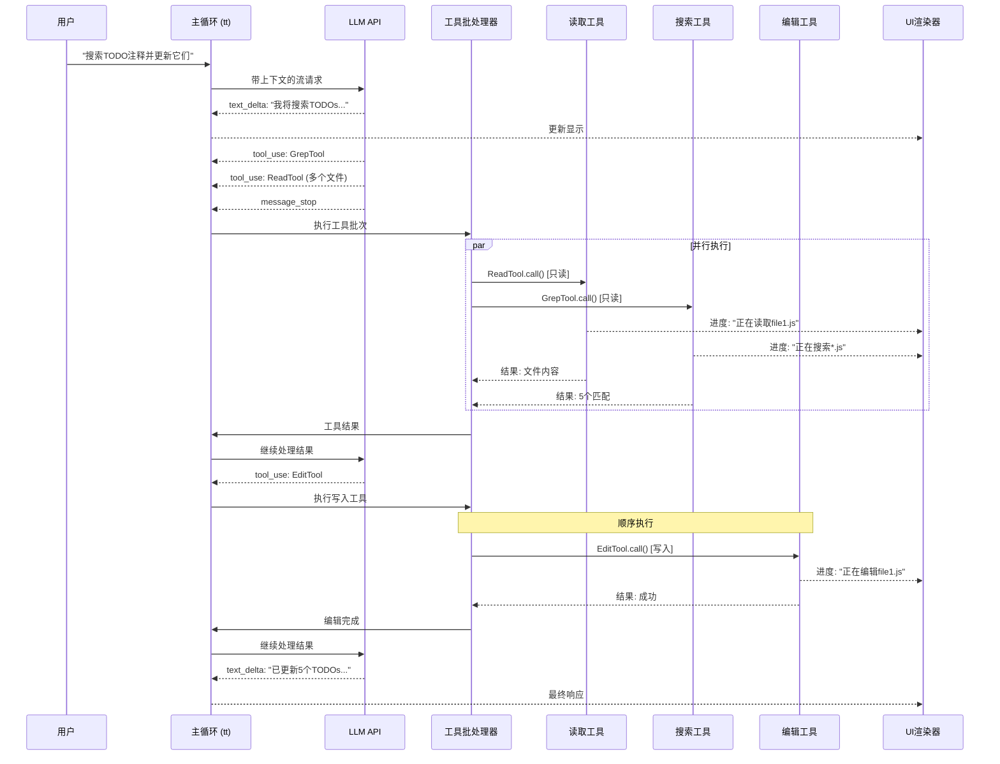
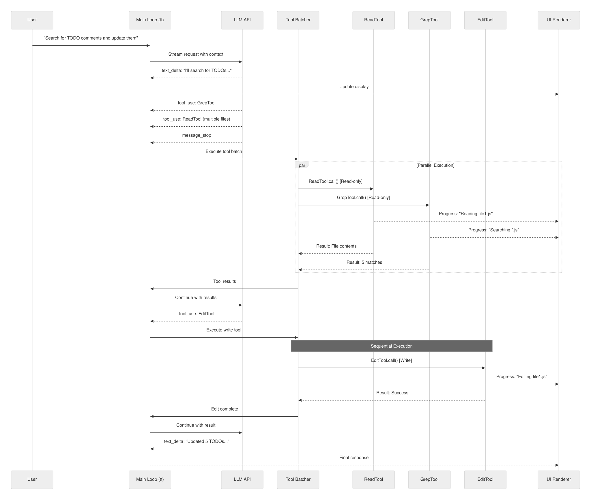
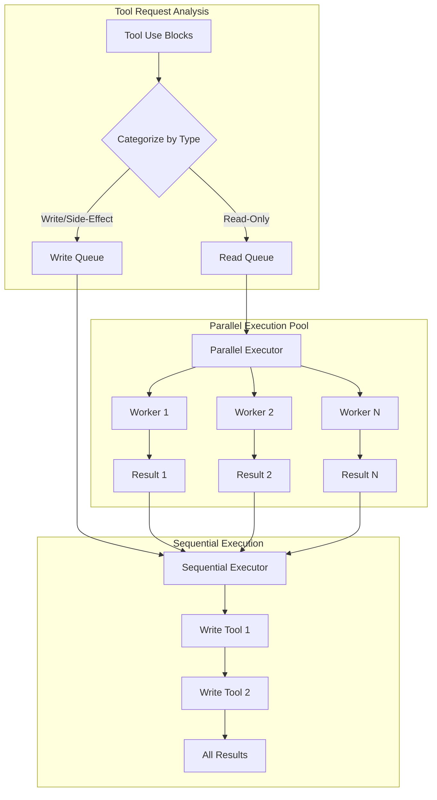
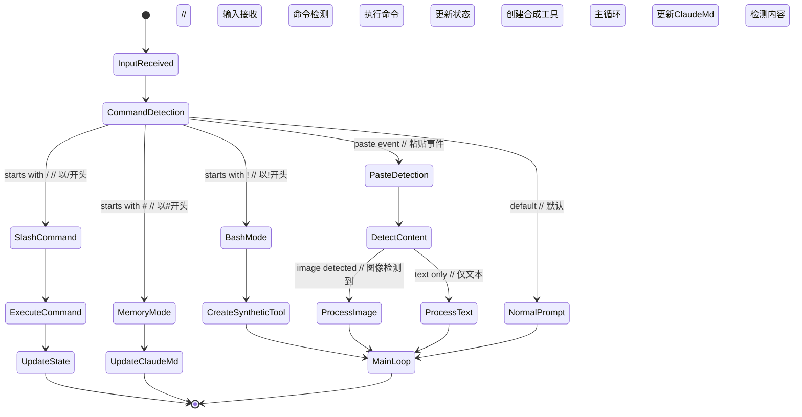
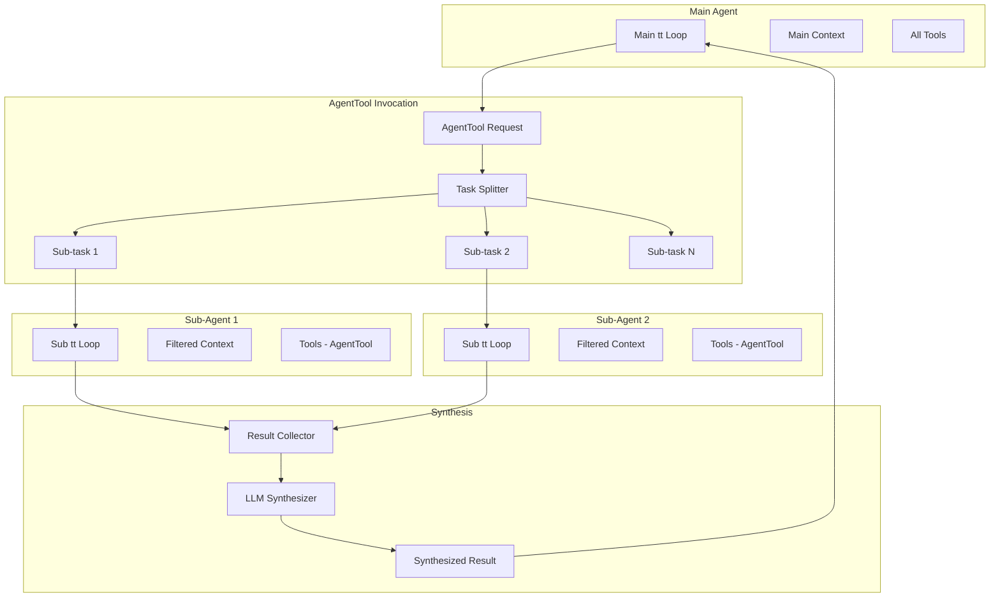

[参考链接](https://southbridge-research.notion.site/Control-Flow-The-Orchestration-Engine-2055fec70db181d0b215e1b8584d03fa)
# Control Flow & The Orchestration Engine
# 控制流与编排引擎




## The Main Conversation Loop: A Streaming State Machine
## 主对话循环：流式状态机

The heart of Claude Code is the `tt` async generator function—a sophisticated state machine that orchestrates the entire conversation flow. Let's examine its actual structure:
Claude Code的核心是`tt`异步生成器函数——这是一个精密的状态机，负责编排整个对话流程。让我们来检视它的实际结构：

```tsx
// Reconstructed main loop signature with timing annotations
// 带时间注释重构的主循环签名
async function* tt(
  currentMessages: CliMessage[],         // Full history - Memory: O(conversation_length) // 完整历史 - 内存：O(对话长度)
  baseSystemPromptString: string,        // Static prompt - ~2KB // 静态提示 - ~2KB
  currentGitContext: GitContext,         // Git state - ~1-5KB typically // Git状态 - 通常~1-5KB
  currentClaudeMdContents: ClaudeMdContent[], // Project context - ~5-50KB // 项目上下文 - ~5-50KB
  permissionGranterFn: PermissionGranter, // Permission callback // 权限回调
  toolUseContext: ToolUseContext,         // Shared context - ~10KB // 共享上下文 - ~10KB
  activeStreamingToolUse?: ToolUseBlock,  // Resume state // 恢复状态
  loopState: {
    turnId: string,        // UUID for this turn // 本轮对话的UUID
    turnCounter: number,   // Recursion depth // 递归深度
    compacted?: boolean,   // Was history compressed? // 历史是否已压缩？
    isResuming?: boolean   // Resuming from save? // 是否从保存点恢复？
  }
): AsyncGenerator<CliMessage, void, void> {
  // ┌─ PHASE 1: Context Preparation [~50-200ms] // 阶段1：上下文准备 [~50-200ms]
  // ├─ PHASE 2: Auto-compaction Check [~0-3000ms if triggered] // 阶段2：自动压缩检查 [触发时~0-3000ms]
  // ├─ PHASE 3: System Prompt Assembly [~10-50ms] // 阶段3：系统提示组装 [~10-50ms]
  // ├─ PHASE 4: LLM Stream Processing [~2000-10000ms] // 阶段4：LLM流处理 [~2000-10000ms]
  // ├─ PHASE 5: Tool Execution [~100-30000ms per tool] // 阶段5：工具执行 [每个工具~100-30000ms]
  // └─ PHASE 6: Recursion or Completion [~0ms] // 阶段6：递归或完成 [~0ms]
}

```

### Phase 1: Context Window Management
### 阶段1：上下文窗口管理

The first critical decision in the control flow is whether the conversation needs compaction:
控制流中的第一个关键决策是判断对话是否需要压缩：

```tsx
// Auto-compaction logic (inferred implementation)
// 自动压缩逻辑（推断实现）
class ContextCompactionController {
  private static readonly COMPACTION_THRESHOLDS = {
    tokenCount: 100_000,      // Aggressive token limit // 激进的token限制
    messageCount: 200,        // Message count fallback // 消息数量后备限制
    costThreshold: 5.00       // Cost-based trigger // 基于成本的触发器
  };

  static async shouldCompact(
    messages: CliMessage[],
    model: string
  ): Promise<boolean> {
    // Fast path: check message count first
    // 快速路径：先检查消息数量
    if (messages.length < 50) return false;

    // Expensive path: count tokens
    // 昂贵路径：计算tokens
    const tokenCount = await this.estimateTokens(messages, model);

    return tokenCount > this.COMPACTION_THRESHOLDS.tokenCount ||
           messages.length > this.COMPACTION_THRESHOLDS.messageCount;
  }

  static async compact(
    messages: CliMessage[],
    context: ToolUseContext
  ): Promise<CompactionResult> {
    // Phase 1: Identify messages to preserve
    // 阶段1：识别要保留的消息
    const preserve = this.identifyPreservedMessages(messages);

    // Phase 2: Generate summary via LLM
    // 阶段2：通过LLM生成摘要
    const summary = await this.generateSummary(
      messages.filter(m => !preserve.has(m.uuid)),
      context
    );

    // Phase 3: Reconstruct message history
    // 阶段3：重构消息历史
    return {
      messages: [
        this.createSummaryMessage(summary),
        ...messages.filter(m => preserve.has(m.uuid))
      ],
      tokensaved: this.calculateSavings(messages, summary)
    };
  }
}

```

**Performance Characteristics**:
**性能特性**：

- Token counting: O(n) where n is total message content length // Token计算：O(n)，其中n是消息内容总长度
- Summary generation: One additional LLM call (~2-3s) // 摘要生成：一次额外的LLM调用（~2-3秒）
- Memory impact: Temporarily doubles message storage during compaction // 内存影响：压缩期间临时 doubling 消息存储

### Phase 2: Dynamic System Prompt Assembly
### 阶段2：动态系统提示组装

The system prompt assembly reveals a sophisticated caching and composition strategy:
系统提示组装展现了一个精密的缓存和组合策略：

```tsx
// System prompt composition pipeline
// 系统提示组合管道
class SystemPromptAssembler {
  private static cache = new Map<string, {
    content: string,
    hash: string,
    expiry: number
  }>();

  static async assemble(
    basePrompt: string,
    claudeMd: ClaudeMdContent[],
    gitContext: GitContext,
    tools: ToolDefinition[],
    model: string
  ): Promise<string | ContentBlock[]> {
    // Parallel fetch of dynamic components
    // 并行获取动态组件
    const [
      claudeMdSection,
      gitSection,
      directorySection,
      toolSection
    ] = await Promise.all([
      this.formatClaudeMd(claudeMd),
      this.formatGitContext(gitContext),
      this.getDirectoryStructure(),
      this.formatToolDefinitions(tools)
    ]);

    // Model-specific adaptations
    // 模型特定适配
    const modelSection = this.getModelAdaptations(model);

    // Compose with smart truncation
    // 智能截断组合
    return this.compose({
      base: basePrompt,           // Priority 1 // 优先级1
      model: modelSection,        // Priority 2 // 优先级2
      claudeMd: claudeMdSection,  // Priority 3 // 优先级3
      git: gitSection,           // Priority 4 // 优先级4
      directory: directorySection, // Priority 5 // 优先级5
      tools: toolSection         // Priority 6 // 优先级6
    });
  }

  private static getModelAdaptations(model: string): string {
    // Model-specific prompt engineering
    // 模型特定的提示工程
    const adaptations = {
      'claude-3-opus': {
        style: 'detailed',
        instructions: 'Think step by step. Show your reasoning.',
        tokenBudget: 0.3  // 30% of context for reasoning // 30%上下文用于推理
      },
      'claude-3-sonnet': {
        style: 'balanced',
        instructions: 'Be concise but thorough.',
        tokenBudget: 0.2
      },
      'claude-3-haiku': {
        style: 'brief',
        instructions: 'Get to the point quickly.',
        tokenBudget: 0.1
      }
    };

    const config = adaptations[model] || adaptations['claude-3-sonnet'];
    return this.formatModelInstructions(config);
  }
}

```

### Phase 3: The Streaming State Machine
### 阶段3：流状态机

The LLM streaming phase implements a complex event-driven state machine:
LLM流阶段实现了一个复杂的事件驱动状态机：

```tsx
// Stream event processing state machine
// 流事件处理状态机
class StreamEventProcessor {
  private state: {
    phase: 'idle' | 'message_start' | 'content' | 'tool_input' | 'complete';
    currentMessage: Partial<CliMessage>;
    contentBlocks: ContentBlock[];
    activeToolInput?: {
      toolId: string;
      buffer: string;
      parser: StreamingToolInputParser;
    };
    metrics: {
      firstTokenLatency?: number;
      tokensPerSecond: number[];
    };
  };

  async *processStream(
    stream: AsyncIterable<StreamEvent>
  ): AsyncGenerator<UIEvent | CliMessage> {
    for await (const event of stream) {
      switch (event.type) {
        case 'message_start':
          this.state.phase = 'message_start';
          this.state.metrics.firstTokenLatency = Date.now() - startTime;
          yield { type: 'ui_state', data: { status: 'assistant_responding' } };
          break;

        case 'content_block_start':
          yield* this.handleContentBlockStart(event);
          break;

        case 'content_block_delta':
          yield* this.handleContentBlockDelta(event);
          break;

        case 'content_block_stop':
          yield* this.handleContentBlockStop(event);
          break;

        case 'message_stop':
          yield* this.finalizeMessage(event);
          break;

        case 'error':
          yield* this.handleError(event);
          break;
      }
    }
  }

  private async *handleContentBlockDelta(
    event: ContentBlockDeltaEvent
  ): AsyncGenerator<UIEvent> {
    const block = this.state.contentBlocks[event.index];

    switch (event.delta.type) {
      case 'text_delta':
        // Direct UI update for text
        // 文本的直接UI更新
        block.text += event.delta.text;
        yield {
          type: 'ui_text_delta',
          data: {
            text: event.delta.text,
            blockIndex: event.index
          }
        };
        break;

      case 'input_json_delta':
        // Accumulate JSON for tool input
        // 累积工具输入的JSON
        if (this.state.activeToolInput) {
          this.state.activeToolInput.buffer += event.delta.partial_json;

          // Try parsing at strategic points
          // 在策略点尝试解析
          if (event.delta.partial_json.includes('}') ||
              event.delta.partial_json.includes(']')) {
            const result = this.state.activeToolInput.parser.addChunk(
              event.delta.partial_json
            );

            if (result.complete) {
              block.input = result.value;
              yield {
                type: 'ui_tool_preview',
                data: {
                  toolId: this.state.activeToolInput.toolId,
                  input: result.value
                }
              };
            }
          }
        }
        break;
    }
  }
}

```

### Phase 4: The Tool Execution Pipeline
### 阶段4：工具执行管道

The tool execution system implements a sophisticated parallel/sequential execution strategy:
工具执行系统实现了一个精密的并行/顺序执行策略：



```tsx
// The parallel execution orchestrator
// 并行执行编排器
class ToolExecutionOrchestrator {
  private static readonly CONCURRENCY_LIMIT = 10;

  static async *executeToolBatch(
    toolUses: ToolUseBlock[],
    context: ToolUseContext,
    permissionFn: PermissionGranter
  ): AsyncGenerator<CliMessage> {
    // Phase 1: Categorize tools
    // 阶段1：分类工具
    const { readOnly, writeTools } = this.categorizeTools(toolUses);

    // Phase 2: Execute read-only tools in parallel
    // 阶段2：并行执行只读工具
    if (readOnly.length > 0) {
      yield* this.executeParallel(readOnly, context, permissionFn);
    }

    // Phase 3: Execute write tools sequentially
    // 阶段3：顺序执行写入工具
    for (const tool of writeTools) {
      yield* this.executeSequential(tool, context, permissionFn);
    }
  }

  private static async *executeParallel(
    tools: ToolUseBlock[],
    context: ToolUseContext,
    permissionFn: PermissionGranter
  ): AsyncGenerator<CliMessage> {
    const executions = tools.map(tool =>
      this.createToolExecution(tool, context, permissionFn)
    );

    // Custom parallel map with backpressure
    // 自定义带回压的并行映射
    yield* parallelMap(executions, this.CONCURRENCY_LIMIT);
  }
}

// The parallelMap implementation
// parallelMap实现
async function* parallelMap<T>(
  generators: AsyncGenerator<T>[],
  concurrency: number
): AsyncGenerator<T> {
  const executing = new Set<Promise<IteratorResult<T>>>();
  const pending = [...generators];

  // Fill initial slots
  // 填充初始槽位
  while (executing.size < concurrency && pending.length > 0) {
    const gen = pending.shift()!;
    executing.add(gen.next());
  }

  while (executing.size > 0) {
    // Race for next completion
    // 竞争下一次完成
    const result = await Promise.race(executing);
    executing.delete(result as any);

    if (!result.done) {
      // Yield the value
      // 产出值
      yield result.value;

      // Continue this generator
      // 继续这个生成器
      const nextPromise = result.generator.next();
      executing.add(nextPromise);
    }

    // Fill empty slot if available
    // 如果有空槽位就填充
    if (executing.size < concurrency && pending.length > 0) {
      const gen = pending.shift()!;
      executing.add(gen.next());
    }
  }
}

```

**Execution Timing Analysis**:
**执行时间分析**：

| Tool Type | Concurrency | Typical Latency | Bottleneck |
| --- | --- | --- | --- |
| ReadTool | Parallel (10) | 10-50ms | Disk I/O |
| GrepTool | Parallel (10) | 100-500ms | CPU regex |
| WebFetchTool | Parallel (3) | 500-3000ms | Network |
| EditTool | Sequential | 20-100ms | Validation |
| BashTool | Sequential | 50-10000ms | Process exec |
| AgentTool | Parallel (5) | 2000-20000ms | Sub-LLM calls |
| 工具类型 | 并发度 | 典型延迟 | 瓶颈 |
| --- | --- | --- | --- |
| 读取工具 | 并行 (10) | 10-50毫秒 | 磁盘I/O |
| 搜索工具 | 并行 (10) | 100-500毫秒 | CPU正则表达式 |
| 网络获取工具 | 并行 (3) | 500-3000毫秒 | 网络 |
| 编辑工具 | 顺序 | 20-100毫秒 | 验证 |
| Bash工具 | 顺序 | 50-10000毫秒 | 进程执行 |
| 代理工具 | 并行 (5) | 2000-20000毫秒 | 子LLM调用 |

### Phase 5: Permission Control Flow
### 阶段5：权限控制流

The permission system implements a multi-level decision tree:
权限系统实现了一个多层决策树：

```tsx
// Permission decision flow
// 权限决策流
class PermissionController {
  static async checkPermission(
    tool: ToolDefinition,
    input: any,
    context: ToolPermissionContext
  ): Promise<PermissionDecision> {
    // Level 1: Check explicit deny rules (highest priority)
    // 层级1：检查明确拒绝规则（最高优先级）
    const denyRule = this.findMatchingRule(
      tool,
      input,
      context.alwaysDenyRules
    );
    if (denyRule) {
      return { behavior: 'deny', reason: denyRule };
    }

    // Level 2: Check mode overrides
    // 层级2：检查模式覆盖
    if (context.mode === 'bypassPermissions') {
      return { behavior: 'allow', reason: 'bypass_mode' };
    }

    if (context.mode === 'acceptEdits' &&
        this.isEditTool(tool) &&
        this.isPathSafe(input.path)) {
      return { behavior: 'allow', reason: 'accept_edits_mode' };
    }

    // Level 3: Check explicit allow rules
    // 层级3：检查明确允许规则
    const allowRule = this.findMatchingRule(
      tool,
      input,
      context.alwaysAllowRules
    );
    if (allowRule) {
      return { behavior: 'allow', reason: allowRule };
    }

    // Level 4: Interactive prompt
    // 层级4：交互式提示
    return {
      behavior: 'ask',
      suggestions: this.generateRuleSuggestions(tool, input)
    };
  }

  private static findMatchingRule(
    tool: ToolDefinition,
    input: any,
    rules: Record<PermissionRuleScope, string[]>
  ): string | null {
    // Priority order: cliArg > localSettings > projectSettings > ...
    // 优先级顺序：cliArg > localSettings > projectSettings > ...
    const scopes: PermissionRuleScope[] = [
      'cliArg', 'localSettings', 'projectSettings',
      'policySettings', 'userSettings'
    ];

    for (const scope of scopes) {
      const scopeRules = rules[scope] || [];
      for (const rule of scopeRules) {
        if (this.matchesRule(tool, input, rule)) {
          return `${scope}:${rule}`;
        }
      }
    }

    return null;
  }
}

```

### Phase 6: Recursive Turn Management
### 阶段6：递归轮次管理

The control flow implements tail recursion for multi-turn interactions:
控制流为多轮交互实现了尾递归：

```tsx
// Recursion control and state management
// 递归控制和状态管理
class TurnController {
  static async *manageTurn(
    messages: CliMessage[],
    toolResults: CliMessage[],
    context: FullContext,
    loopState: LoopState
  ): AsyncGenerator<CliMessage> {
    // Check recursion depth
    // 检查递归深度
    if (loopState.turnCounter >= 10) {
      yield this.createSystemMessage(
        "Maximum conversation depth reached. Please start a new query."
      );
      return;
    }

    // Prepare next turn state
    // 准备下一轮状态
    const nextState = {
      ...loopState,
      turnCounter: loopState.turnCounter + 1,
      compacted: false  // Reset compaction flag // 重置压缩标志
    };

    // Merge messages for next turn
    // 合并下一轮的消息
    const nextMessages = [
      ...messages,
      ...toolResults.sort(this.sortByToolRequestOrder)
    ];

    // Tail recursion
    // 尾递归
    yield* tt(
      nextMessages,
      context.basePrompt,
      context.gitContext,
      context.claudeMd,
      context.permissionFn,
      context.toolContext,
      undefined,  // No active streaming tool // 没有活跃的流工具
      nextState
    );
  }
}

```

## Advanced Control Flow Patterns
## 高级控制流模式

### 1. Input Router State Machine
### 1. 输入路由状态机

The input processing implements a sophisticated routing system:
输入处理实现了一个精密的路由系统：



```tsx
// Input router implementation
// 输入路由实现
class InputRouter {
  static async routeInput(
    input: string,
    context: AppContext
  ): Promise<RouterAction> {
    // Command detection with priority
    // 带优先级的命令检测
    const matchers: [RegExp, InputHandler][] = [
      [/^\\/(\\w+)(.*)/, this.handleSlashCommand],
      [/^!(.+)/, this.handleBashMode],
      [/^#(.+)/, this.handleMemoryMode],
      [/^```[\\s\\S]+```$/, this.handleCodeBlock],
    ];

    for (const [pattern, handler] of matchers) {
      const match = input.match(pattern);
      if (match) {
        return handler(match, context);
      }
    }

    // Default: normal prompt
    // 默认：正常提示
    return {
      type: 'prompt',
      message: this.createUserMessage(input)
    };
  }

  private static handleBashMode(
    match: RegExpMatchArray,
    context: AppContext
  ): RouterAction {
    const command = match[1];

    // Create synthetic assistant message with tool use
    // 创建带工具使用的合成助手消息
    const syntheticMessages = [
      {
        type: 'user',
        message: {
          role: 'user',
          content: `Run this command: ${command}`
        }
      },
      {
        type: 'assistant',
        message: {
          role: 'assistant',
          content: [
            {
              type: 'text',
              text: 'I\\'ll run that command for you.'
            },
            {
              type: 'tool_use',
              id: `bash_${Date.now()}`,
              name: 'BashTool',
              input: { command, sandbox: false }
            }
          ]
        }
      }
    ];

    return {
      type: 'synthetic_conversation',
      messages: syntheticMessages
    };
  }
}

```

### 2. Stream Backpressure Management
### 2. 流背压管理

The streaming system implements sophisticated backpressure handling:
流系统实现了精密的背压处理：

```tsx
// Backpressure control for streaming
// 流的背压控制
class StreamBackpressureController {
  private buffer: Array<StreamEvent> = [];
  private pressure = {
    current: 0,
    threshold: 1000,  // Max buffered events // 最大缓冲事件数
    paused: false
  };

  async *controlledStream(
    source: AsyncIterable<StreamEvent>
  ): AsyncGenerator<StreamEvent> {
    const iterator = source[Symbol.asyncIterator]();

    while (true) {
      // Check pressure
      // 检查压力
      if (this.pressure.current > this.pressure.threshold) {
        this.pressure.paused = true;
        await this.waitForDrain();
      }

      const { done, value } = await iterator.next();
      if (done) break;

      // Buffer management
      // 缓冲区管理
      if (this.shouldBuffer(value)) {
        this.buffer.push(value);
        this.pressure.current++;
      } else {
        // Yield immediately for high-priority events
        // 高优先级事件立即产出
        yield value;
      }

      // Drain buffer periodically
      // 定期排空缓冲区
      if (this.buffer.length > 0 && !this.pressure.paused) {
        yield* this.drainBuffer();
      }
    }

    // Final drain
    // 最终排空
    yield* this.drainBuffer();
  }

  private shouldBuffer(event: StreamEvent): boolean {
    // Don't buffer tool results or errors
    // 不缓冲工具结果或错误
    return event.type === 'content_block_delta' &&
           event.delta.type === 'text_delta';
  }
}

```

### 3. AgentTool Hierarchical Control Flow
### 3. AgentTool层次控制流

The AgentTool implements a fascinating parent-child control structure:
AgentTool实现了一个引人入胜的父子控制结构：



```tsx
// AgentTool hierarchical execution
// AgentTool层次执行
class AgentToolExecutor {
  static async *execute(
    input: AgentToolInput,
    context: ToolUseContext,
    parentMessage: CliMessage
  ): AsyncGenerator<ToolProgress | ToolResult> {
    // Phase 1: Task analysis
    // 阶段1：任务分析
    const subtasks = this.analyzeTask(input.prompt);

    // Phase 2: Spawn sub-agents
    // 阶段2：生成子代理
    const subAgentPromises = subtasks.map(async (task, index) => {
      // Create isolated context
      // 创建隔离上下文
      const subContext = {
        ...context,
        tools: context.tools.filter(t => t.name !== 'AgentTool'),
        abortController: this.createLinkedAbort(context.abortController),
        options: {
          ...context.options,
          maxThinkingTokens: this.calculateTokenBudget(input.prompt)
        }
      };

      // Run sub-agent
      // 运行子代理
      return this.runSubAgent(task, subContext, index);
    });

    // Phase 3: Parallel execution with progress
    // 阶段3：带进度的并行执行
    const results: SubAgentResult[] = [];
    for await (const update of this.trackProgress(subAgentPromises)) {
      if (update.type === 'progress') {
        yield {
          type: 'progress',
          toolUseID: parentMessage.id,
          data: update
        };
      } else {
        results.push(update.result);
      }
    }

    // Phase 4: Synthesis
    // 阶段4：合成
    const synthesized = await this.synthesizeResults(results, input);

    yield {
      type: 'result',
      data: synthesized
    };
  }

  private static async synthesizeResults(
    results: SubAgentResult[],
    input: AgentToolInput
  ): Promise<string> {
    if (results.length === 1) {
      return results[0].content;
    }

    // Multi-result synthesis via LLM
    // 通过LLM进行多结果合成
    const synthesisPrompt = `
      Synthesize these ${results.length} findings into a cohesive response:
      将这${results.length}个发现合成为一个连贯的响应：
      ${results.map((r, i) => `Finding ${i+1}:\\n${r.content}`).join('\\n\\n')}

      Original task: ${input.prompt}
      原始任务：${input.prompt}
    `;

    const synthesizer = new SubAgentExecutor({
      prompt: synthesisPrompt,
      model: input.model || 'claude-3-haiku',  // Fast model for synthesis // 用于合成的快速模型
      isSynthesis: true
    });

    return synthesizer.run();
  }
}

```

### 4. Error Recovery Control Flow
### 4. 错误恢复控制流

The system implements sophisticated error recovery strategies:
系统实现了精密的错误恢复策略：

```tsx
// Error recovery state machine
// 错误恢复状态机
class ErrorRecoveryController {
  private static recoveryStrategies = {
    'rate_limit': this.handleRateLimit,
    'context_overflow': this.handleContextOverflow,
    'tool_error': this.handleToolError,
    'network_error': this.handleNetworkError,
    'permission_denied': this.handlePermissionDenied
  };

  static async *handleError(
    error: any,
    context: ErrorContext
  ): AsyncGenerator<CliMessage> {
    const errorType = this.classifyError(error);
    const strategy = this.recoveryStrategies[errorType];

    if (strategy) {
      yield* strategy(error, context);
    } else {
      // Generic error handling
      // 通用错误处理
      yield this.createErrorMessage(error);
    }
  }

  private static async *handleContextOverflow(
    error: ContextOverflowError,
    context: ErrorContext
  ): AsyncGenerator<CliMessage> {
    // Strategy 1: Try reducing max_tokens
    // 策略1：尝试减少max_tokens
    if (error.details.requested_tokens > 4096) {
      yield this.createSystemMessage("Reducing response size...");

      const retry = await this.retryWithReducedTokens(
        context.request,
        Math.floor(error.details.requested_tokens * 0.7)
      );

      if (retry.success) {
        yield* retry.response;
        return;
      }
    }

    // Strategy 2: Force compaction
    // 策略2：强制压缩
    yield this.createSystemMessage("Compacting conversation history...");
    const compacted = await this.forceCompaction(context.messages);

    // Retry with compacted history
    // 用压缩历史重试
    yield* this.retryWithMessages(compacted, context);
  }

  private static async *handleRateLimit(
    error: RateLimitError,
    context: ErrorContext
  ): AsyncGenerator<CliMessage> {
    // Multi-provider fallback
    // 多提供商后备
    const providers = ['anthropic', 'bedrock', 'vertex'];
    const current = context.provider;
    const alternatives = providers.filter(p => p !== current);

    for (const provider of alternatives) {
      yield this.createSystemMessage(
        `Rate limited on ${current}, trying ${provider}...`
      );

      try {
        const result = await this.retryWithProvider(
          context.request,
          provider
        );
        yield* result;
        return;
      } catch (e) {
        continue;
      }
    }

    // All providers exhausted
    // 所有提供商都已耗尽
    yield this.createErrorMessage(
      "All providers are rate limited. Please try again later."
    );
  }
}

```

## Performance Profiling Points
## 性能分析点

The control flow includes strategic profiling points:
控制流包含策略性的性能分析点：

```tsx
// Performance measurement integration
// 性能测量集成
class PerformanceProfiler {
  private static spans = new Map<string, PerformanceSpan>();

  static instrument<T extends AsyncGenerator>(
    name: string,
    generator: T
  ): T {
    return (async function* () {
      const span = tracer.startSpan(name);
      const start = performance.now();

      try {
        let itemCount = 0;
        for await (const item of generator) {
          itemCount++;

          // Measure inter-yield time
          // 测量产出间时间
          if (itemCount > 1) {
            span.addEvent('yield', {
              'yield.latency': performance.now() - lastYield
            });
          }

          yield item;
          lastYield = performance.now();
        }

        span.setAttributes({
          'generator.yield_count': itemCount,
          'generator.total_time': performance.now() - start
        });
      } finally {
        span.end();
      }
    })() as T;
  }
}

```


# 文件总结

## 概述
本文档深入分析了Claude Code的控制流与编排引擎，揭示了其高性能响应背后的复杂状态机和并行处理机制。通过反编译和逆向工程分析，文档详细展示了Claude Code如何通过精密的控制流程来管理复杂的对话交互、工具执行和错误恢复。

## 核心架构特点

### 1. 主对话循环：流式状态机
- **tt异步生成器**：整个系统的核心，管理完整的对话流程
- **六阶段处理流程**：
  1. 上下文准备 [~50-200ms]
  2. 自动压缩检查 [触发时~0-3000ms]
  3. 系统提示组装 [~10-50ms]
  4. LLM流处理 [~2000-10000ms]
  5. 工具执行 [每个工具~100-30000ms]
  6. 递归或完成 [~0ms]

### 2. 上下文窗口管理
- **智能压缩策略**：
  - Token计数：O(n)复杂度，激进限制100,000 tokens
  - 消息数量后备：200条消息限制
  - 成本触发器：$5.00成本阈值
- **压缩流程**：
  - 识别保留消息（最近、重要、系统消息）
  - 通过LLM生成摘要
  - 重构消息历史

### 3. 动态系统提示组装
- **组件化策略**：基础提示 + 模型适配 + CLAUDE.md + Git上下文 + 目录结构 + 工具定义
- **模型特定优化**：
  - Opus：详细风格，30%上下文用于推理
  - Sonnet：平衡风格，20%上下文用于推理
  - Haiku：简洁风格，10%上下文用于推理
- **并行获取**：所有动态组件并行获取，智能截断组合

### 4. 流状态机
- **事件驱动架构**：message_start → content_block_start → content_block_delta → content_block_stop → message_stop
- **实时UI更新**：文本增量直接更新UI，工具输入累积后解析
- **智能JSON解析**：在策略点（}或]）尝试解析，避免频繁解析失败

## 工具执行管道

### 并行/顺序执行策略
- **分类执行**：
  - 只读工具（ReadTool、GrepTool、WebFetchTool）：并行执行，限制10个并发
  - 写入工具（EditTool、BashTool）：顺序执行，避免冲突
- **性能优化**：
  - 自定义parallelMap实现，支持背压控制
  - 竞争机制确保高效完成检测
  - 动态槽位填充，最大化并发利用率

### 执行时间分析
| 工具类型 | 并发度 | 典型延迟 | 瓶颈 |
|---|---|---|---|
| 读取工具 | 并行 (10) | 10-50毫秒 | 磁盘I/O |
| 搜索工具 | 并行 (10) | 100-500毫秒 | CPU正则表达式 |
| 网络获取工具 | 并行 (3) | 500-3000毫秒 | 网络 |
| 编辑工具 | 顺序 | 20-100毫秒 | 验证 |
| Bash工具 | 顺序 | 50-10000毫秒 | 进程执行 |
| 代理工具 | 并行 (5) | 2000-20000毫秒 | 子LLM调用 |

## 权限控制系统

### 多层决策树
1. **层级1**：明确拒绝规则（最高优先级）
2. **层级2**：模式覆盖检查（绕过权限、接受编辑模式）
3. **层级3**：明确允许规则
4. **层级4**：交互式提示
- **规则优先级**：CLI参数 > 本地设置 > 项目设置 > 策略设置 > 用户设置

### 递归轮次管理
- **深度限制**：最大10轮递归，防止无限循环
- **状态传递**：轮次ID、计数器、压缩标志、恢复状态
- **尾递归优化**：高效的递归调用实现

## 高级控制流模式

### 1. 输入路由状态机
- **智能识别**：
  - `/` → 斜杠命令
  - `!` → Bash模式（合成工具使用）
  - `#` → 内存模式（更新CLAUDE.md）
  - 粘贴事件 → 内容类型检测
- **合成对话**：Bash模式创建用户消息和助手工具使用的合成对话

### 2. 流背压管理
- **缓冲控制**：最大1000个缓冲事件
- **压力检测**：动态暂停和恢复机制
- **优先级处理**：工具结果和错误立即处理，文本增量可缓冲
- **定期排空**：非暂停状态下定期清空缓冲区

### 3. AgentTool层次控制流
- **父子架构**：
  - 主代理 → 任务分割 → 子代理并行执行 → 结果收集 → LLM合成 → 返回主代理
- **隔离上下文**：子代理拥有过滤的工具集和独立的abort控制器
- **多结果合成**：通过LLM将多个子任务结果合成为连贯响应

### 4. 错误恢复控制流
- **分类恢复策略**：
  - 速率限制：多提供商后备
  - 上下文溢出：减少tokens或强制压缩
  - 工具错误：重试或降级
  - 网络错误：重试机制
  - 权限拒绝：用户提示
- **多提供商后备**：Anthropic → Bedrock → Vertex的故障转移

## 性能分析与优化

### 性能分析点
- **生成器仪表化**：测量产出间延迟、总执行时间、产出计数
- **OpenTelemetry集成**：跨服务的性能追踪
- **关键指标**：
  - 首个token延迟
  - 每秒token数
  - 工具执行时间
  - 内存使用情况

### 时间优化策略
- **并行处理**：尽可能并行执行只读操作
- **智能缓存**：系统提示组件缓存
- **延迟加载**：按需加载重量级依赖
- **背压控制**：防止内存溢出的流控制

## 技术创新点

### 架构创新
1. **流式状态机**：复杂的事件驱动对话管理
2. **分层权限系统**：灵活的多层安全控制
3. **工具编排引擎**：智能的并行/顺序执行策略
4. **层次代理系统**：父子代理的任务分解和合成

### 性能创新
1. **智能压缩**：基于多个维度的上下文压缩策略
2. **背压管理**：防止系统过载的流控制机制
3. **并发优化**：工具执行的最大化并行化
4. **缓存策略**：多层次的智能缓存机制

### 工程实践
1. **错误恢复**：全面的错误分类和恢复策略
2. **性能监控**：深度的性能分析和追踪
3. **状态管理**：复杂的递归状态传递
4. **模块化设计**：高度解耦的组件架构

## 结论

Claude Code的控制流与编排引擎体现了现代异步编程和分布式系统的最佳实践。其核心价值在于：

- **高性能**：多层次的并行处理和智能优化
- **可靠性**：全面的错误恢复和故障转移机制
- **可扩展性**：模块化的工具系统和代理架构
- **用户体验**：实时的进度反馈和流畅的交互

这种复杂的编排设计为AI助手应用提供了优秀的架构模板，特别是在需要处理复杂工作流程和实时交互的场景中。文档的深入分析为理解现代AI系统的控制流设计提供了宝贵的技术参考，展现了如何在大规模异步环境中保持系统的响应性和稳定性。

整个架构的成功关键在于平衡了复杂性（功能完整性）与性能（响应速度），通过精密的状态机和编排策略，实现了既强大又高效的AI助手体验。
