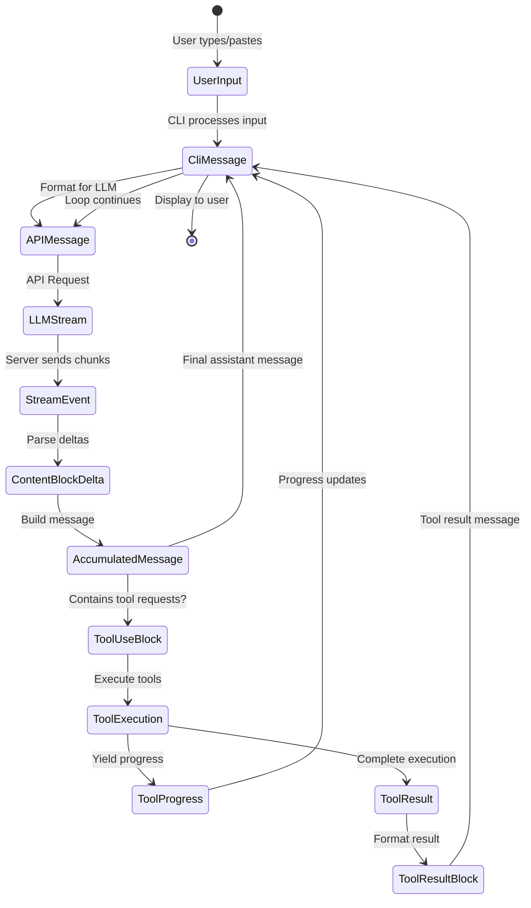
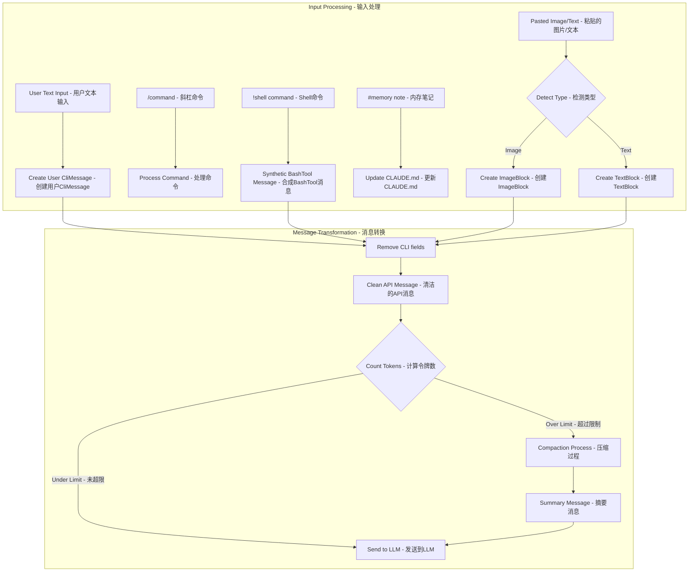

[参考链接](https://southbridge-research.notion.site/Data-Structures-The-Information-Architecture-2055fec70db1814ba2a7c5fa2879ac21)
# Data Structures & The Information Architecture
# 数据结构与信息架构



## The Streaming State Machine: How Messages Transform
## 流式状态机：消息如何转换

The most fascinating aspect of Claude Code's data architecture is how it manages the transformation of data through multiple representations while maintaining streaming performance. Let's start with the core innovation:
Claude Code数据架构最引人入胜的方面是它如何在保持流式性能的同时管理数据通过多种表示形式的转换。让我们从核心创新开始：

```tsx
// The dual-representation message system (inferred from analysis)
// 双表示消息系统（从分析推断）
interface MessageTransformPipeline {
  // Stage 1: CLI Internal Representation
  // 阶段1：CLI内部表示
  cliMessage: {
    type: "user" | "assistant" | "attachment" | "progress"
    uuid: string  // CLI-specific tracking CLI特定跟踪
    timestamp: string
    message?: APICompatibleMessage  // Only for user/assistant 仅用于用户/助手
    attachment?: AttachmentContent   // Only for attachment 仅用于附件
    progress?: ProgressUpdate        // Only for progress 仅用于进度
  }

  // Stage 2: API Wire Format
  // 阶段2：API线路格式
  apiMessage: {
    role: "user" | "assistant"
    content: string | ContentBlock[]
    // No CLI-specific fields
    // 无CLI特定字段
  }

  // Stage 3: Streaming Accumulator
  // 阶段3：流累加器
  streamAccumulator: {
    partial: Partial<APIMessage>
    deltas: ContentBlockDelta[]
    buffers: Map<string, string>  // tool_use_id → accumulating JSON tool_use_id → 累积JSON
  }
}

```

**Why This Matters**: This three-stage representation allows Claude Code to maintain UI responsiveness while handling complex streaming protocols. The CLI can update progress indicators using `CliMessage` metadata while the actual LLM communication uses a clean `APIMessage` format.
**为何重要**：这种三阶段表示允许Claude Code在处理复杂流式协议的同时保持UI响应性。CLI可以使用`CliMessage`元数据更新进度指示器，而实际的LLM通信使用干净的`APIMessage`格式。

## ContentBlock: The Polymorphic Building Block
## ContentBlock：多态构建块

Based on decompilation analysis, Claude Code implements a sophisticated type system for content:
基于反编译分析，Claude Code为内容实现了一个复杂的类型系统：

```tsx
// The ContentBlock discriminated union (reconstructed)
// ContentBlock判别联合体（重构）
type ContentBlock =
  | TextBlock
  | ImageBlock
  | ToolUseBlock
  | ToolResultBlock
  | ThinkingBlock
  | DocumentBlock      // Platform-specific - 平台特定
  | VideoBlock         // Platform-specific - 平台特定
  | GuardContentBlock  // Platform-specific - 平台特定
  | ReasoningBlock     // Platform-specific - 平台特定
  | CachePointBlock    // Platform-specific - 平台特定

// Performance annotations based on inferred usage
// 基于推断用法的性能注释
interface ContentBlockMetrics {
  TextBlock: {
    memorySize: "O(text.length)",        // 内存大小
    parseTime: "O(1)",                   // 解析时间
    serializeTime: "O(n)",               // 序列化时间
    streamable: true                     // 可流式传输
  },
  ImageBlock: {
    memorySize: "O(1) + external",  // Reference to base64/S3 - 引用base64/S3
    parseTime: "O(1)",                   // 解析时间
    serializeTime: "O(size)" | "O(1) for S3",  // 序列化时间
    streamable: false                    // 不可流式传输
  },
  ToolUseBlock: {
    memorySize: "O(JSON.stringify(input).length)",  // 内存大小
    parseTime: "O(n) for JSON parse",      // JSON解析时间
    serializeTime: "O(n)",                // 序列化时间
    streamable: true                      // 可流式传输 - JSON可以流式传输
  }
}

```

### The Streaming JSON Challenge
### 流式JSON的挑战

One of Claude Code's most clever innovations is handling streaming JSON for tool inputs:
Claude Code最巧妙的创新之一是处理工具输入的流式JSON：

```tsx
// Inferred implementation of streaming JSON parser
// 流式JSON解析器的推断实现
class StreamingToolInputParser {
  private buffer: string = '';      // 缓冲区
  private depth: number = 0;        // JSON深度
  private inString: boolean = false; // 是否在字符串内
  private escape: boolean = false;   // 是否转义

  addChunk(chunk: string): ParseResult {
    this.buffer += chunk;

    // Track JSON structure depth - 跟踪JSON结构深度
    for (const char of chunk) {
      if (!this.inString) {
        if (char === '{' || char === '[') this.depth++;
        else if (char === '}' || char === ']') this.depth--;
      }

      // Track string boundaries - 跟踪字符串边界
      if (char === '"' && !this.escape) {
        this.inString = !this.inString;
      }
      this.escape = (char === '\\\\' && !this.escape);
    }

    // Attempt parse at depth 0 - 在深度0时尝试解析
    if (this.depth === 0 && this.buffer.length > 0) {
      try {
        return { complete: true, value: JSON.parse(this.buffer) };
      } catch (e) {
        // Try auto-closing unclosed strings - 尝试自动关闭未闭合的字符串
        if (this.inString) {
          try {
            return {
              complete: true,
              value: JSON.parse(this.buffer + '"'),
              repaired: true    // 已修复
            };
          } catch {}
        }
        return { complete: false, error: e };
      }
    }

    return { complete: false };
  }
}

```

This parser can handle incremental JSON chunks from the LLM, attempting to parse as soon as the structure appears complete.
此解析器可以处理来自LLM的增量JSON块，在结构看起来完整时立即尝试解析。

## Message Lifecycle: From User Input to LLM and Back
## 消息生命周期：从用户输入到LLM再返回



### The CliMessage Structure: More Than Meets the Eye
### CliMessage结构：不仅仅是表面所见

The `CliMessage` type serves as the central nervous system of the application:
`CliMessage`类型作为应用程序的中枢神经系统：

```tsx
interface CliMessage {
  type: "user" | "assistant" | "attachment" | "progress"  // 消息类型
  uuid: string                                           // 唯一标识符
  timestamp: string                                      // 时间戳

  // For user/assistant messages only - 仅用于用户/助手消息
  message?: {
    role: "user" | "assistant"                           // 角色
    id?: string                    // LLM-provided ID - LLM提供的ID
    model?: string                 // Which model responded - 响应的模型
    stop_reason?: StopReason       // Why generation stopped - 生成停止原因
    stop_sequence?: string         // Specific stop sequence hit - 命中的特定停止序列
    usage?: TokenUsage             // Detailed token counts - 详细令牌计数
    content: string | ContentBlock[]                     // 内容
  }

  // CLI-specific metadata - CLI特定元数据
  costUSD?: number               // Calculated cost - 计算成本
  durationMs?: number            // API call duration - API调用持续时间
  requestId?: string             // For debugging - 用于调试
  isApiErrorMessage?: boolean    // Error display flag - 错误显示标志
  isMeta?: boolean              // System-generated message - 系统生成消息

  // Type-specific fields - 类型特定字段
  attachment?: AttachmentContent                         // 附件内容
  progress?: {
    toolUseID: string                                    // 工具使用ID
    parentToolUseID?: string   // For AgentTool sub-tools - 用于AgentTool子工具
    data: any                  // Tool-specific progress - 工具特定进度
  }
}

// Performance characteristics - 性能特征
interface CliMessagePerformance {
  creation: "O(1)",                                     // 创建时间
  serialization: "O(content size)",                      // 序列化时间
  memoryRetention: "Weak references for large content",  // 大内容使用弱引用
  garbageCollection: "Eligible when removed from history array"  // 从历史数组移除时可回收
}

```

### Mutation Points and State Transitions
### 变异点和状态转换

Claude Code carefully controls where data structures can be modified:
Claude Code仔细控制数据结构可以被修改的位置：

```tsx
// Inferred mutation control patterns - 推断的变异控制模式
class MessageMutationControl {
  // Mutation Point 1: Stream accumulation - 变异点1：流累积
  static accumulateStreamDelta(
    message: Partial<CliMessage>,
    delta: ContentBlockDelta
  ): void {
    if (delta.type === 'text_delta') {
      const lastBlock = message.content[message.content.length - 1];
      if (lastBlock.type === 'text') {
        lastBlock.text += delta.text;  // MUTATION - 变异
      }
    }
  }

  // Mutation Point 2: Tool result injection - 变异点2：工具结果注入
  static injectToolResult(
    history: CliMessage[],
    toolResult: ToolResultBlock
  ): void {
    const newMessage: CliMessage = {
      type: 'user',
      isMeta: true,  // System-generated - 系统生成
      message: {
        role: 'user',
        content: [toolResult]
      },
      // ... other fields - 其他字段
    };
    history.push(newMessage);  // MUTATION - 变异
  }

  // Mutation Point 3: Cost calculation - 变异点3：成本计算
  static updateCostMetadata(
    message: CliMessage,
    usage: TokenUsage
  ): void {
    message.costUSD = calculateCost(usage, message.model);  // MUTATION - 变异
    message.durationMs = Date.now() - parseISO(message.timestamp);  // MUTATION - 变异
  }
}

```

## The System Prompt: Dynamic Context Assembly
## 系统提示：动态上下文组装

Perhaps the most complex data structure is the dynamically assembled system prompt:
也许最复杂的数据结构是动态组装的系统提示：

```tsx
// System prompt assembly pipeline (reconstructed) - 系统提示组装管道（重构）
interface SystemPromptPipeline {
  sources: {
    baseInstructions: string        // Static base - 静态基础
    claudeMdContent: ClaudeMdLayer[] // Hierarchical - 层次结构
    gitContext: GitContextData       // Real-time - 实时
    directoryStructure: TreeData     // Cached/fresh - 缓存/新鲜
    toolDefinitions: ToolSpec[]      // Available tools - 可用工具
    modelAdaptations: ModelSpecificPrompt // Per-model - 每个模型
  }

  assembly: {
    order: ['base', 'model', 'claude.md', 'git', 'files', 'tools'],  // 组装顺序
    separators: Map<string, string>,  // Section delimiters - 部分分隔符
    sizeLimit: number,                // Token budget - 令牌预算
    prioritization: 'recency' | 'relevance'  // 优先级策略
  }
}

// The GitContext structure reveals real-time awareness - GitContext结构揭示实时感知
interface GitContextData {
  currentBranch: string                             // 当前分支
  status: {
    modified: string[]                              // 已修改文件
    untracked: string[]                             // 未跟踪文件
    staged: string[]                                // 已暂存文件
  }
  recentCommits: Array<{                            // 最近提交
    hash: string                                    // 哈希值
    message: string                                 // 提交消息
    author: string                                  // 作者
    timestamp: string                               // 时间戳
  }>
  uncommittedDiff?: string  // Expensive, conditional - 昂贵的，条件性的
}

```

### Memory Layout: [CLAUDE.md](http://claude.md/) Hierarchical Loading
### 内存布局：CLAUDE.md层次化加载

```
Project Root - 项目根目录
├── .claude/
│   ├── CLAUDE.md (Local - highest priority - 本地 - 最高优先级)
│   └── settings.json
├── ~/
│   └── .claude/
│       └── CLAUDE.md (User - second priority - 用户 - 第二优先级)
├── <project-root>/
│   └── .claude/
│       └── CLAUDE.md (Project - third priority - 项目 - 第三优先级)
└── /etc/claude-code/
    └── CLAUDE.md (Managed - lowest priority - 托管 - 最低优先级)

```

The loading mechanism implements an efficient merge strategy:
加载机制实现了高效的合并策略：

```tsx
// Inferred CLAUDE.md loading algorithm - 推断的CLAUDE.md加载算法
class ClaudeMdLoader {
  private cache = new Map<string, {content: string, mtime: number}>();

  async loadMerged(): Promise<string> {
    const layers = [
      '/etc/claude-code/CLAUDE.md',      // Managed - 托管
      '~/.claude/CLAUDE.md',              // User - 用户
      '<project>/.claude/CLAUDE.md',      // Project - 项目
      '.claude/CLAUDE.md'                 // Local - 本地
    ];

    const contents = await Promise.all(
      layers.map(path => this.loadWithCache(path))
    );

    // Merge with override semantics - 使用覆盖语义合并
    return this.mergeWithOverrides(contents);
  }

  private mergeWithOverrides(contents: string[]): string {
    // Later layers override earlier ones - 后面的层覆盖前面的层
    // @override directive for explicit overrides - @override指令用于显式覆盖
    // @append directive for additions - @append指令用于添加
    // Default: concatenate with separators - 默认：使用分隔符连接
  }
}

```

## Tool-Related Data Structures
## 工具相关数据结构

### ToolDefinition: The Complete Tool Interface
### ToolDefinition：完整的工具接口

```tsx
interface ToolDefinition {
  // Identity - 身份标识
  name: string                               // 工具名称
  description: string                        // 工具描述
  prompt?: string  // Additional LLM instructions - 额外的LLM指令

  // Schema (dual representation) - 模式（双重表示）
  inputSchema: ZodSchema          // Runtime validation - 运行时验证
  inputJSONSchema?: JSONSchema    // LLM communication - LLM通信

  // Execution - 执行
  call: AsyncGenerator<ToolProgress | ToolResult, void, void>  // 异步生成器

  // Permissions - 权限
  checkPermissions?: (
    input: any,
    context: ToolUseContext,
    permContext: ToolPermissionContext
  ) => Promise<PermissionDecision>  // 权限决策

  // Output formatting - 输出格式化
  mapToolResultToToolResultBlockParam: (
    result: any,
    toolUseId: string
  ) => ContentBlock | ContentBlock[]  // 内容块或块数组

  // Metadata - 元数据
  isReadOnly: boolean                         // 是否只读
  isMcp?: boolean                            // 是否MCP
  isEnabled?: (config: any) => boolean       // 启用函数
  getPath?: (input: any) => string | undefined  // 路径获取函数

  // UI - 用户界面
  renderToolUseMessage?: (input: any) => ReactElement  // 渲染函数
}

// Memory characteristics of tool definitions - 工具定义的内存特征
interface ToolDefinitionMemory {
  staticSize: "~2KB per tool",                    // 静态大小
  zodSchema: "Lazy compilation, cached",          // 延迟编译，缓存
  jsonSchema: "Generated once, memoized",         // 生成一次，记忆化
  closures: "Retains context references"          // 保留上下文引用
}

```

### The Execution Context: Everything a Tool Needs
### 执行上下文：工具所需的一切

```tsx
interface ToolUseContext {
  // Cancellation - 取消机制
  abortController: AbortController                // 中止控制器

  // File state tracking - 文件状态跟踪
  readFileState: Map<string, {                   // 读取文件状态
    content: string                              // 内容
    timestamp: number  // mtime - 修改时间
  }>

  // Permission resolution - 权限解析
  getToolPermissionContext: () => ToolPermissionContext  // 获取工具权限上下文

  // Options bag - 选项包
  options: {
    tools: ToolDefinition[]                      // 工具定义列表
    mainLoopModel: string                        // 主循环模型
    debug?: boolean                              // 调试模式
    verbose?: boolean                            // 详细模式
    isNonInteractiveSession?: boolean            // 非交互式会话
    maxThinkingTokens?: number                   // 最大思考令牌数
  }

  // MCP connections - MCP连接
  mcpClients?: McpClient[]                       // MCP客户端数组
}

// The permission context reveals a sophisticated security model - 权限上下文揭示了复杂的安全模型
interface ToolPermissionContext {
  mode: "default" | "acceptEdits" | "bypassPermissions"  // 模式

  additionalWorkingDirectories: Set<string>              // 额外工作目录

  // Hierarchical rule system - 层次化规则系统
  alwaysAllowRules: Record<PermissionRuleScope, string[]> // 始终允许规则
  alwaysDenyRules: Record<PermissionRuleScope, string[]> // 始终拒绝规则
}

type PermissionRuleScope =
  | "cliArg"         // Highest priority - 最高优先级
  | "localSettings"  // 本地设置
  | "projectSettings" // 项目设置
  | "policySettings" // 策略设置
  | "userSettings"   // Lowest priority - 最低优先级

```

## MCP Protocol Structures
## MCP协议结构

The Multi-Cloud/Process protocol reveals a sophisticated RPC system:
多云/进程协议揭示了一个复杂的RPC系统：

```tsx
// JSON-RPC 2.0 with extensions - 带扩展的JSON-RPC 2.0
interface McpMessage {
  jsonrpc: "2.0"                               // 版本
  id?: string | number  // Optional for notifications - 通知的可选ID
}

interface McpRequest extends McpMessage {
  method: string                               // 方法名
  params?: unknown                             // 参数
}

interface McpResponse extends McpMessage {
  id: string | number  // Required for responses - 响应必需的ID
  result?: unknown                             // 结果
  error?: {                                    // 错误
    code: number                               // 错误代码
    message: string                            // 错误消息
    data?: unknown                             // 错误数据
  }
}

// Capability negotiation structure - 能力协商结构
interface McpCapabilities {
  experimental?: Record<string, any>           // 实验性功能

  // Feature flags - 功能标志
  roots?: boolean      // Workspace roots - 工作区根目录
  sampling?: boolean   // LLM sampling delegation - LLM采样委托
  prompts?: boolean    // Dynamic prompts - 动态提示
  resources?: boolean  // Resource serving - 资源服务
  tools?: boolean      // Tool exposure - 工具暴露
  logging?: boolean    // Log forwarding - 日志转发
}

// The tool specification sent by MCP servers - MCP服务器发送的工具规范
interface McpToolSpec {
  name: string                                 // 工具名称
  description?: string                         // 工具描述
  inputSchema: JSONSchema  // Always JSON Schema - 始终是JSON模式

  // MCP-specific metadata - MCP特定元数据
  isReadOnly?: boolean                         // 是否只读
  requiresConfirmation?: boolean               // 是否需要确认
  timeout?: number                             // 超时时间
  maxRetries?: number                          // 最大重试次数
}

```

### MCP State Machine
### MCP状态机

```mermaid
stateDiagram-v2
    [*] --> Disconnected - 断开连接
    Disconnected --> Connecting: connect() - 连接
    Connecting --> Initializing: transport ready - 传输就绪
    Initializing --> Ready: capabilities exchanged - 能力交换完成

    Ready --> Ready: request/response - 请求/响应
    Ready --> Ready: notification - 通知

    Ready --> Closing: close() - 关闭
    Connecting --> Failed: error - 错误
    Initializing --> Failed: negotiation failed - 协商失败

    Closing --> Disconnected: closed - 已关闭
    Failed --> Disconnected: reset - 重置

```

## Session State: The Global Memory
## 会话状态：全局内存

```tsx
interface SessionState {
  // Identity - 身份
  sessionId: string  // UUID v4 - 会话ID
  originalCwd: string                          // 原始工作目录
  cwd: string  // Can change via bash cd - 当前工作目录（可通过bash cd改变）

  // Cost tracking (mutable accumulator) - 成本跟踪（可变累加器）
  totalCostUSD: number                         // 总成本（美元）
  totalAPIDuration: number                     // API总持续时间
  modelTokens: Record<string, {                // 模型令牌记录
    inputTokens: number                        // 输入令牌数
    outputTokens: number                       // 输出令牌数
    cacheReadInputTokens: number               // 缓存读取输入令牌数
    cacheCreationInputTokens: number           // 缓存创建输入令牌数
  }>

  // Model selection - 模型选择
  mainLoopModelOverride?: string               // 主循环模型覆盖
  initialMainLoopModel?: string                // 初始主循环模型

  // Activity metrics - 活动指标
  sessionCounter: number                       // 会话计数器
  locCounter: number      // Lines of code - 代码行数
  prCounter: number       // Pull requests - 拉取请求数
  commitCounter: number   // Git commits - Git提交数

  // State flags - 状态标志
  lastInteractionTime: number                  // 最后交互时间
  hasUnknownModelCost: boolean                 // 是否有未知模型成本
  maxRateLimitFallbackActive: boolean          // 最大速率限制回退是否激活

  // Available models - 可用模型
  modelStrings: string[]                       // 模型字符串数组
}

// Session state access pattern (inferred) - 会话状态访问模式（推断）
class SessionManager {
  private static state: SessionState;  // Singleton - 单例

  static update<K extends keyof SessionState>(
    key: K,
    value: SessionState[K]
  ): void {
    this.state[key] = value;
    this.persistToDisk();  // Async, non-blocking - 异步，非阻塞
  }

  static increment(metric: keyof SessionState): void {
    if (typeof this.state[metric] === 'number') {
      this.state[metric]++;
    }
  }
}

```

## Bidirectional Streaming Implementation
## 双向流实现

The platform-level streaming reveals a sophisticated protocol:
平台级别的流处理揭示了一个复杂的协议：

```tsx
// Bidirectional streaming payload structures - 双向流载荷结构
interface BidirectionalStreamingProtocol {
  // Client → Server - 客户端到服务器
  clientPayload: {
    bytes: string  // Base64 encoded - Base64编码
    encoding: 'base64'                        // 编码方式

    // Decoded content types - 解码的内容类型
    contentTypes:
      | ContinuedUserInput                    // 持续用户输入
      | ToolResultBlock                       // 工具结果块
      | ConversationTurnInput                 // 对话回合输入
  }

  // Server → Client - 服务器到客户端
  serverPayload: {
    bytes: string  // Base64 encoded - Base64编码
    encoding: 'base64'                        // 编码方式

    // Decoded event types - 解码的事件类型
    eventTypes:
      | ContentBlockDeltaEvent                // 内容块增量事件
      | ToolUseRequestEvent                   // 工具使用请求事件
      | ErrorEvent                            // 错误事件
      | MetadataEvent                         // 元数据事件
  }
}

// The streaming state machine for bidirectional flows - 双向流的流状态机
class BidirectionalStreamManager {
  private encoder = new TextEncoder();        // 文本编码器
  private decoder = new TextDecoder();        // 文本解码器
  private buffer = new Uint8Array(65536);  // 64KB buffer - 64KB缓冲区

  async *processStream(stream: ReadableStream) {
    const reader = stream.getReader();        // 流读取器
    let partial = '';                         // 部分数据

    while (true) {
      const { done, value } = await reader.read();
      if (done) break;

      // Decode and split by newlines (SSE format) - 解码并按换行符分割（SSE格式）
      partial += this.decoder.decode(value, { stream: true });
      const lines = partial.split('\\n');
      partial = lines.pop() || '';

      for (const line of lines) {
        if (line.startsWith('data: ')) {
          const payload = JSON.parse(line.slice(6));
          yield this.decodePayload(payload);
        }
      }
    }
  }

  private decodePayload(payload: any) {
    const bytes = Buffer.from(payload.bytes, 'base64');
    // Further decode based on protocol buffers or JSON - 基于协议缓冲区或JSON进一步解码
    return JSON.parse(bytes.toString());
  }
}

```

## Performance Optimizations in Data Structures
## 数据结构中的性能优化

### 1. **String Interning for Common Values**
### 1. **常用值的字符串驻留**

```tsx
// Inferred string interning pattern - 推断的字符串驻留模式
class StringIntern {
  private static pool = new Map<string, string>();  // 字符串池

  static intern(str: string): string {
    if (!this.pool.has(str)) {
      this.pool.set(str, str);
    }
    return this.pool.get(str)!;
  }
}

// Usage in message processing - 在消息处理中的使用
message.type = StringIntern.intern(rawType);  // 'user', 'assistant' etc - 用户、助手等
message.stop_reason = StringIntern.intern(reason);  // 'end_turn', 'tool_use' etc - 结束回合、工具使用等

```

### 2. **Lazy Content Block Parsing**
### 2. **延迟内容块解析**

```tsx
// Content blocks may use lazy parsing for performance - 内容块可以使用延迟解析来提高性能
class LazyContentBlock {
  private _raw: string;                          // 原始数据
  private _parsed?: any;                         // 解析后的数据

  constructor(raw: string) {
    this._raw = raw;
  }

  get content() {
    if (!this._parsed) {
      this._parsed = this.parse(this._raw);
    }
    return this._parsed;
  }

  private parse(raw: string): any {
    // Expensive parsing only when accessed - 只在访问时进行昂贵的解析
    return JSON.parse(raw);
  }
}
```

### 3. **ReadFileState Weak References**
### 3. **ReadFileState弱引用**
```tsx
// File cache with automatic memory management - 带自动内存管理的文件缓存
class ReadFileState {
  private cache = new Map<string, WeakRef<FileContent>>();  // 文件内容缓存
  private registry = new FinalizationRegistry((path: string) => {  // 终结注册表
    this.cache.delete(path);  // 删除缓存条目
  });

  set(path: string, content: FileContent) {    // 设置文件内容
    const ref = new WeakRef(content);          // 创建弱引用
    this.cache.set(path, ref);                 // 添加到缓存
    this.registry.register(content, path);     // 注册到终结注册表
  }

  get(path: string): FileContent | undefined {  // 获取文件内容
    const ref = this.cache.get(path);           // 获取弱引用
    if (ref) {
      const content = ref.deref();              // 解引用
      if (!content) {                           // 如果内容已被垃圾回收
        this.cache.delete(path);                // 从缓存中删除
      }
      return content;
    }
  }
}
```

# 文件总结

## 概述
本文档深入分析了Claude Code的数据结构与消息架构，揭示了其高性能流式处理背后的技术实现。通过反编译和逆向工程分析，文档详细展示了Claude Code如何通过精心设计的数据结构来处理复杂的多层消息转换和流式协议。

## 核心架构特点

### 1. 流式状态机架构
- **三阶段表示系统**：
  - CLI内部表示（CliMessage）：包含UI元数据和跟踪信息
  - API线路格式（APIMessage）：与LLM通信的简洁格式
  - 流累加器（StreamAccumulator）：处理增量数据的缓冲机制
- **优势**：保持UI响应性同时处理复杂流式协议

### 2. 多态内容块系统
- **ContentBlock联合类型**：支持文本、图像、工具调用、结果等多种内容类型
- **性能优化**：不同内容块具有不同的内存特征和序列化特性
- **流式支持**：文本和工具块支持流式传输，图像块通过引用优化

### 3. 流式JSON解析器
- **智能解析**：支持增量JSON块的解析，可自动修复未闭合字符串
- **深度跟踪**：通过JSON结构深度判断完整性
- **字符串边界检测**：精确跟踪字符串状态和转义字符

## 消息生命周期管理

### 输入处理管道
- **多样化输入源**：用户文本、斜杠命令、Shell命令、内存笔记、粘贴内容
- **智能类型检测**：自动识别输入内容类型并转换为相应格式
- **消息转换**：去除CLI特定字段，生成纯净的API消息

### 令牌管理策略
- **动态压缩**：超过令牌限制时自动压缩历史消息
- **成本控制**：实时计算API调用成本和持续时间
- **性能指标**：详细的令牌使用统计和分析

## CliMessage：中枢神经系统

### 结构设计
- **类型安全**：支持用户、助手、附件、进度四种消息类型
- **元数据丰富**：包含成本、持续时间、请求ID等调试信息
- **性能优化**：大内容使用弱引用，从历史数组移除时可垃圾回收

### 变异控制机制
- **三个变异点**：
  1. 流累积：增量构建文本内容
  2. 工具结果注入：添加系统生成的工具结果消息
  3. 成本计算：动态更新成本和时间元数据

## 系统提示动态组装

### 多源数据集成
- **基础指令**：静态的系统级指令
- **CLAUDE.md层次**：支持本地、用户、项目、托管四个优先级
- **实时上下文**：Git状态、目录结构、可用工具
- **模型适配**：针对不同模型的特定提示

### Git上下文实时感知
- **分支信息**：当前分支状态和文件修改情况
- **提交历史**：最近的提交记录和作者信息
- **差异分析**：条件性的未提交差异计算

### CLAUDE.md层次化加载
- **四级优先级**：本地 > 用户 > 项目 > 托管
- **高效合并**：覆盖语义、显式覆盖、添加指令
- **缓存机制**：文件修改时间检查和内容缓存

## 工具系统架构

### ToolDefinition完整接口
- **双重模式**：运行时Zod验证 + LLM通信JSON模式
- **异步执行**：支持进度更新的生成器模式
- **权限系统**：分层权限检查和决策机制
- **输出格式化**：工具结果到内容块的转换

### 执行上下文
- **取消机制**：AbortController支持
- **文件状态跟踪**：读取文件的缓存和修改时间管理
- **权限解析**：多层次的权限规则系统
- **选项配置**：调试、详细模式、非交互会话等

### 权限安全模型
- **五级规则范围**：CLI参数 > 本地设置 > 项目设置 > 策略设置 > 用户设置
- **模式控制**：默认、接受编辑、绕过权限三种模式
- **工作目录管理**：额外的授权工作目录集合

## MCP协议实现

### JSON-RPC 2.0扩展
- **消息结构**：统一的请求、响应、通知格式
- **能力协商**：工作区根目录、LLM采样、动态提示等功能
- **工具规范**：MCP特定的元数据和安全配置

### 状态机管理
- **连接生命周期**：断开 → 连接 → 初始化 → 就绪 → 关闭
- **错误处理**：连接失败、协商失败的恢复机制
- **双向通信**：支持请求/响应和通知模式

## 会话状态管理

### 全局内存结构
- **身份跟踪**：会话ID、工作目录状态
- **成本统计**：USD成本、API持续时间、模型令牌详细统计
- **活动指标**：会话、代码行、拉取请求、提交计数器
- **状态标志**：最后交互时间、未知成本、速率限制状态

### 单例访问模式
- **线程安全**：静态单例状态管理
- **持久化**：异步非阻塞的磁盘持久化
- **增量更新**：支持单个字段的更新和计数器递增

## 双向流协议

### 载荷结构设计
- **客户端到服务器**：持续用户输入、工具结果、对话回合
- **服务器到客户端**：内容增量、工具请求、错误、元数据事件
- **编码优化**：Base64编码的紧凑载荷格式

### 流处理机制
- **SSE格式**：服务器发送事件的标准化处理
- **缓冲管理**：64KB缓冲区和增量解码
- **协议解析**：多层数据解码和JSON提取

## 性能优化策略

### 1. 字符串驻留
- **内存优化**：常用字符串的池化管理
- **减少重复**：消息类型、停止原因等重复值的复用
- **快速比较**：驻留字符串的指针比较

### 2. 延迟解析
- **按需计算**：内容块仅在访问时解析
- **成本分摊**：昂贵的JSON解析操作延迟到必要时
- **内存效率**：原始字符串和解析结果的智能管理

### 3. 弱引用缓存
- **自动内存管理**：文件内容的弱引用缓存
- **垃圾回收友好**：FinalizationRegistry自动清理
- **内存安全**：防止内存泄漏和悬挂引用

## 技术创新点

### 架构创新
1. **三层消息表示**：UI、API、流的清晰分离
2. **多态内容系统**：统一接口处理多种内容类型
3. **动态系统提示**：实时上下文的高效组装
4. **双向流协议**：客户端和服务器的平等通信

### 性能创新
1. **智能JSON解析**：增量解析和自动修复
2. **分层权限系统**：灵活的安全控制机制
3. **内存优化策略**：驻留、延迟、弱引用的组合使用
4. **缓存管理**：多级缓存和自动失效机制

### 工程实践
1. **类型安全**：TypeScript接口的全面应用
2. **错误处理**：优雅的降级和恢复机制
3. **可观测性**：丰富的元数据和调试信息
4. **扩展性**：MCP协议和工具系统的模块化设计

## 结论

Claude Code的数据结构与消息架构体现了现代软件工程的最佳实践，通过精心设计的数据结构实现了高性能的流式处理。其架构的核心价值在于：

- **性能卓越**：多层次的优化确保了快速的响应时间
- **架构清晰**：清晰的职责分离和模块化设计
- **扩展性强**：灵活的工具系统和MCP协议支持
- **用户友好**：丰富的进度反馈和错误处理

这种架构设计为处理复杂的AI交互场景提供了优秀的解决方案，特别是在需要实时响应和大量数据处理的场景中表现出色。文档的分析为理解现代AI应用的数据架构设计提供了宝贵的参考价值。
