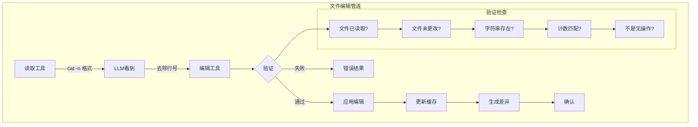

[参考链接](https://southbridge-research.notion.site/File-Editing-AI-Assisted-Code-Modification-2055fec70db18100803ff7287c24c6cc)
# File Editing: AI-Assisted Code Modification
# 文件编辑：AI辅助的代码修改



## 文件编辑管道架构

Claude Code中的文件编辑不仅仅是更改文本——它是一个精心编排的管道，旨在处理AI辅助代码修改的复杂性：

```tsx
class FileEditingPipeline {
  // 四阶段编辑循环
  static async executeEdit(
    tool: EditTool,
    input: EditInput,
    context: ToolContext
  ): Promise<EditResult> {
    // 阶段1：验证
    const validation = await this.validateEdit(input, context);
    if (!validation.valid) {
      return { success: false, error: validation.error };
    }

    // 阶段2：准备
    const prepared = await this.prepareEdit(input, validation.fileState);

    // 阶段3：应用
    const result = await this.applyEdit(prepared);

    // 阶段4：验证
    const verified = await this.verifyEdit(result, input);

    return verified;
  }

  // 状态跟踪系统
  private static fileStates = new Map<string, FileState>();

  interface FileState {
    content: string;
    hash: string;
    mtime: number;
    encoding: BufferEncoding;
    lineEndings: '\\n' | '\\r\\n' | '\\r';
    isBinary: boolean;
    size: number;
  }
}

```

**为什么使用多个工具而不是一个通用编辑器？**

| 工具 | 目的 | 保证 | 失败模式 |
| --- | --- | --- | --- |
| `EditTool` | 单个字符串替换 | 精确匹配计数 | 如果出现次数≠预期则失败 |
| `MultiEditTool` | 顺序编辑 | 原子批处理 | 如果任何编辑无效则失败 |
| `WriteTool` | 完整替换 | 完全覆盖 | 如果未先读取则失败 |
| `NotebookEditTool` | 单元格操作 | 结构保留 | 如果单元格缺失则失败 |

每个工具都提供特定的保证，这是通用编辑器在保持LLM友好性的同时无法维持的。

## 行号问题：一个看似复杂的挑战

文件编辑中最关键的挑战是行号前缀问题：

```tsx
// LLM从ReadTool看到的内容：
const readOutput = `
1	function hello() {
2	  console.log('Hello, world!');
3	}
`;

// LLM可能错误尝试编辑的内容：
const wrongOldString = "2	  console.log('Hello, world!');";  // 错误 - 包含行号

// 它应该使用的内容：
const correctOldString = "  console.log('Hello, world!');";  // 正确 - 无行号

```

行号去除逻辑：

```tsx
class LineNumberHandler {
  // LLM收到关于此问题的广泛指令
  static readonly LINE_NUMBER_PATTERN = /^\\d+\\t/;

  static stripLineNumbers(content: string): string {
    return content
      .split('\\n')
      .map(line => line.replace(this.LINE_NUMBER_PATTERN, ''))
      .join('\\n');
  }

  // 但真正的挑战是确保LLM做到这一点
  static validateOldString(
    oldString: string,
    fileContent: string
  ): ValidationResult {
    // 检查1：oldString是否包含行号前缀？
    if (this.LINE_NUMBER_PATTERN.test(oldString)) {
      return {
        valid: false,
        error: 'old_string似乎包含行号前缀。' +
               '请移除开头的数字和制表符。',
        suggestion: oldString.replace(this.LINE_NUMBER_PATTERN, '')
      };
    }

    // 检查2：字符串是否存在于文件中？
    const occurrences = this.countOccurrences(fileContent, oldString);
    if (occurrences === 0) {
      // 尝试检测是否是行号问题
      const possibleLineNumber = oldString.match(/^(\\d+)\\t/);
      if (possibleLineNumber) {
        const lineNum = parseInt(possibleLineNumber[1]);
        const actualLine = this.getLine(fileContent, lineNum);
        return {
          valid: false,
          error: `未找到字符串。您是否包含了行号${lineNum}？`,
          suggestion: actualLine
        };
      }
    }

    return { valid: true, occurrences };
  }
}

```

## EditTool：字符串替换的手术级精度

EditTool实现零歧义的精确字符串匹配：

```tsx
class EditToolImplementation {
  static async executeEdit(
    input: EditInput,
    context: ToolContext
  ): Promise<EditResult> {
    const { file_path, old_string, new_string, expected_replacements = 1 } = input;

    // 步骤1：检索缓存文件状态
    const cachedFile = context.readFileState.get(file_path);
    if (!cachedFile) {
      throw new Error(
        '文件必须在编辑前使用ReadFileTool读取。' +
        '这确保您拥有当前文件内容。'
      );
    }

    // 步骤2：验证文件未被外部更改
    const currentStats = await fs.stat(file_path);
    if (currentStats.mtimeMs !== cachedFile.timestamp) {
      throw new Error(
        '文件自上次读取以来已被外部修改。' +
        '请再次读取文件以查看当前内容。'
      );
    }

    // 步骤3：验证编辑
    const validation = this.validateEdit(
      old_string,
      new_string,
      cachedFile.content,
      expected_replacements
    );

    if (!validation.valid) {
      throw new Error(validation.error);
    }

    // 步骤4：应用替换
    const newContent = this.performReplacement(
      cachedFile.content,
      old_string,
      new_string,
      expected_replacements
    );

    // 步骤5：生成差异用于验证
    const diff = this.generateDiff(
      cachedFile.content,
      newContent,
      file_path
    );

    // 步骤6：以相同编码/行结尾写入
    await this.writeFilePreservingFormat(
      file_path,
      newContent,
      cachedFile
    );

    // 步骤7：更新缓存
    context.readFileState.set(file_path, {
      content: newContent,
      timestamp: Date.now()
    });

    // 步骤8：生成上下文片段
    const snippet = this.generateContextSnippet(
      newContent,
      new_string,
      5 // 上下文行数
    );

    return {
      success: true,
      diff,
      snippet,
      replacements: expected_replacements
    };
  }

  private static validateEdit(
    oldString: string,
    newString: string,
    fileContent: string,
    expectedReplacements: number
  ): EditValidation {
    // 无操作检查
    if (oldString === newString) {
      return {
        valid: false,
        error: 'old_string和new_string相同。不会进行任何更改。'
      };
    }

    // 空old_string特殊情况（插入）
    if (oldString === '') {
      return {
        valid: false,
        error: '不允许空的old_string。对于新文件请使用WriteTool。'
      };
    }

    // 使用精确字符串匹配计算出现次数
    const occurrences = this.countExactOccurrences(fileContent, oldString);

    if (occurrences === 0) {
      return {
        valid: false,
        error: '在文件中未找到old_string。确保包括空白字符在内的精确匹配。',
        suggestion: this.findSimilarStrings(fileContent, oldString)
      };
    }

    if (occurrences !== expectedReplacements) {
      return {
        valid: false,
        error: `期望${expectedReplacements}次替换但找到${occurrences}次出现。` +
               `将expected_replacements设置为${occurrences}或优化old_string。`
      };
    }

    return { valid: true };
  }

  private static countExactOccurrences(
    content: string,
    searchString: string
  ): number {
    // 转义特殊正则表达式字符以进行精确匹配
    const escaped = searchString.replace(/[.*+?^${}()|[\\]\\\\]/g, '\\\\$&');
    const regex = new RegExp(escaped, 'g');
    return (content.match(regex) || []).length;
  }

  private static performReplacement(
    content: string,
    oldString: string,
    newString: string,
    limit: number
  ): string {
    // 特殊替换模式的字符转义
    const escapeReplacement = (str: string) => {
      return str
        .replace(/\\$/g, '$$$$')  // $ -> $$
        .replace(/\\n/g, '\\n')    // 保留换行符
        .replace(/\\r/g, '\\r');   // 保留回车符
    };

    const escapedNew = escapeReplacement(newString);

    let result = content;
    let count = 0;
    let lastIndex = 0;

    // 手动替换以尊重限制
    while (count < limit) {
      const index = result.indexOf(oldString, lastIndex);
      if (index === -1) break;

      result = result.slice(0, index) +
               newString +  // 使用原始字符串，而非转义字符串
               result.slice(index + oldString.length);

      lastIndex = index + newString.length;
      count++;
    }

    return result;
  }

  private static generateDiff(
    oldContent: string,
    newContent: string,
    filePath: string
  ): string {
    // 使用统一差异格式
    const diff = createUnifiedDiff(
      filePath,
      filePath,
      oldContent,
      newContent,
      '编辑前',
      '编辑后',
      { context: 3 }
    );

    return diff;
  }
}

```

**为什么`expected_replacements`很重要**：

```tsx
// 场景：多次出现
const fileContent = `
function processUser(user) {
  console.log(user);
  return user;
}
`;

// 不使用expected_replacements：
edit({
  old_string: "user",
  new_string: "userData"
});
// 结果：所有出现都被替换（包括函数参数！）

// 使用expected_replacements：
edit({
  old_string: "user",
  new_string: "userData",
  expected_replacements: 2  // 仅使用处，不包括参数
});
// 结果：失败 - 强制使用更具体的old_string

```

## MultiEditTool：原子顺序操作

MultiEditTool解决了多个相关编辑的复杂问题：

```tsx
class MultiEditToolImplementation {
  static async executeMultiEdit(
    input: MultiEditInput,
    context: ToolContext
  ): Promise<MultiEditResult> {
    const { file_path, edits } = input;

    // 加载文件一次
    const cachedFile = context.readFileState.get(file_path);
    if (!cachedFile) {
      throw new Error('文件必须在编辑前读取');
    }

    // 在应用任何编辑之前验证所有编辑
    const validationResult = this.validateAllEdits(
      edits,
      cachedFile.content
    );

    if (!validationResult.valid) {
      throw new Error(validationResult.error);
    }

    // 顺序应用编辑到工作副本
    let workingContent = cachedFile.content;
    const appliedEdits: AppliedEdit[] = [];

    for (let i = 0; i < edits.length; i++) {
      const edit = edits[i];

      try {
        // 根据当前工作内容验证此编辑
        const validation = this.validateSingleEdit(
          edit,
          workingContent,
          i
        );

        if (!validation.valid) {
          throw new Error(
            `编辑${i + 1}失败：${validation.error}`
          );
        }

        // 应用编辑
        const beforeEdit = workingContent;
        workingContent = this.applyEdit(
          workingContent,
          edit
        );

        appliedEdits.push({
          index: i,
          edit,
          diff: this.generateEditDiff(beforeEdit, workingContent),
          summary: this.summarizeEdit(edit)
        });

      } catch (error) {
        // 原子失败 - 不写入任何更改
        throw new Error(
          `MultiEdit在编辑${i + 1}/${edits.length}处中止：${error.message}`
        );
      }
    }

    // 所有编辑已验证并应用 - 一次性写入
    await this.writeFilePreservingFormat(
      file_path,
      workingContent,
      cachedFile
    );

    // 更新缓存
    context.readFileState.set(file_path, {
      content: workingContent,
      timestamp: Date.now()
    });

    return {
      success: true,
      editsApplied: appliedEdits,
      totalDiff: this.generateDiff(
        cachedFile.content,
        workingContent,
        file_path
      )
    };
  }

  private static validateAllEdits(
    edits: Edit[],
    originalContent: string
  ): ValidationResult {
    // 检查空编辑数组
    if (edits.length === 0) {
      return {
        valid: false,
        error: '未提供编辑'
      };
    }

    // 检测潜在冲突
    const conflicts = this.detectEditConflicts(edits, originalContent);
    if (conflicts.length > 0) {
      return {
        valid: false,
        error: '检测到编辑冲突：\\n' +
               conflicts.map(c => c.description).join('\\n')
      };
    }

    // 模拟所有编辑以确保它们有效
    let simulatedContent = originalContent;
    for (let i = 0; i < edits.length; i++) {
      const edit = edits[i];
      const occurrences = this.countOccurrences(
        simulatedContent,
        edit.old_string
      );

      if (occurrences === 0) {
        return {
          valid: false,
          error: `编辑${i + 1}：未找到old_string。` +
                 `之前的编辑可能已删除它。`
        };
      }

      if (occurrences !== (edit.expected_replacements || 1)) {
        return {
          valid: false,
          error: `编辑${i + 1}：期望${edit.expected_replacements || 1}次` +
                 `替换但找到${occurrences}次`
        };
      }

      // 应用到模拟
      simulatedContent = this.applyEdit(simulatedContent, edit);
    }

    return { valid: true };
  }

  private static detectEditConflicts(
    edits: Edit[],
    content: string
  ): EditConflict[] {
    const conflicts: EditConflict[] = [];

    for (let i = 0; i < edits.length - 1; i++) {
      for (let j = i + 1; j < edits.length; j++) {
        const edit1 = edits[i];
        const edit2 = edits[j];

        // 冲突类型1：后面的编辑修改前面编辑的结果
        if (edit2.old_string.includes(edit1.new_string)) {
          conflicts.push({
            type: 'dependency',
            edits: [i, j],
            description: `编辑${j + 1}依赖于编辑${i + 1}的结果`
          });
        }

        // 冲突类型2：重叠替换
        if (this.editsOverlap(edit1, edit2, content)) {
          conflicts.push({
            type: 'overlap',
            edits: [i, j],
            description: `编辑${i + 1}和${j + 1}影响重叠文本`
          });
        }

        // 冲突类型3：相同目标，不同替换
        if (edit1.old_string === edit2.old_string &&
            edit1.new_string !== edit2.new_string) {
          conflicts.push({
            type: 'contradiction',
            edits: [i, j],
            description: `编辑${i + 1}和${j + 1}以不同方式替换相同文本`
          });
        }
      }
    }

    return conflicts;
  }

  private static editsOverlap(
    edit1: Edit,
    edit2: Edit,
    content: string
  ): boolean {
    // 查找所有出现的位置
    const positions1 = this.findAllPositions(content, edit1.old_string);
    const positions2 = this.findAllPositions(content, edit2.old_string);

    // 检查是否有任何位置重叠
    for (const pos1 of positions1) {
      const end1 = pos1 + edit1.old_string.length;

      for (const pos2 of positions2) {
        const end2 = pos2 + edit2.old_string.length;

        // 检查重叠
        if (pos1 < end2 && pos2 < end1) {
          return true;
        }
      }
    }

    return false;
  }
}

```

**冲突检测的实际应用**：

```tsx
// 示例：依赖编辑
const edits = [
  {
    old_string: "console.log",
    new_string: "logger.info"
  },
  {
    old_string: "logger.info('test')",  // 依赖第一个编辑！
    new_string: "logger.debug('test')"
  }
];
// 结果：检测到冲突 - 编辑2依赖于编辑1

// 示例：安全的顺序编辑
const safeEdits = [
  {
    old_string: "var x",
    new_string: "let x"
  },
  {
    old_string: "var y",
    new_string: "let y"
  }
];
// 结果：无冲突 - 独立更改

```

## WriteTool：完整文件操作

WriteTool处理完整的文件创建或替换：

```tsx
class WriteToolImplementation {
  static async executeWrite(
    input: WriteInput,
    context: ToolContext
  ): Promise<WriteResult> {
    const { file_path, content } = input;

    // 检查文件是否存在
    const exists = await fs.access(file_path).then(() => true).catch(() => false);

    if (exists) {
      // 现有文件 - 必须已被读取
      const cachedFile = context.readFileState.get(file_path);
      if (!cachedFile) {
        throw new Error(
          '现有文件必须在覆盖前使用ReadFileTool读取。' +
          '这可以防止意外数据丢失。'
        );
      }

      // 验证未被外部修改
      const stats = await fs.stat(file_path);
      if (stats.mtimeMs !== cachedFile.timestamp) {
        throw new Error(
          '文件已被外部修改。' +
          '在覆盖前再次读取文件以查看当前内容。'
        );
      }
    }

    // 文档文件限制
    if (this.isDocumentationFile(file_path) && !context.explicitlyAllowed) {
      throw new Error(
        '创建文档文件（*.md, README）需要明确的用户请求。' +
        '除非特别要求文档，否则专注于代码实现。'
      );
    }

    // 准备写入操作
    const writeData = await this.prepareWriteData(
      content,
      exists ? context.readFileState.get(file_path) : null
    );

    // 确保目录存在
    const dir = path.dirname(file_path);
    await fs.mkdir(dir, { recursive: true });

    // 写入文件
    await fs.writeFile(file_path, writeData.content, {
      encoding: writeData.encoding,
      mode: writeData.mode
    });

    // 更新缓存
    context.readFileState.set(file_path, {
      content: content,
      timestamp: Date.now()
    });

    // 生成结果
    if (exists) {
      const snippet = this.generateContextSnippet(content, null, 10);
      return {
        success: true,
        action: 'updated',
        snippet
      };
    } else {
      return {
        success: true,
        action: 'created',
        path: file_path
      };
    }
  }

  private static async prepareWriteData(
    content: string,
    existingFile: FileState | null
  ): Promise<WriteData> {
    // 检测或保留行结尾
    let lineEnding = '\\n'; // 默认为LF

    if (existingFile) {
      // 保留现有行结尾
      lineEnding = existingFile.lineEndings;
    } else if (process.platform === 'win32') {
      // Windows上新文件默认为CRLF
      lineEnding = '\\r\\n';
    }

    // 规范化然后应用正确的行结尾
    const normalizedContent = content.replace(/\\r\\n|\\r|\\n/g, '\\n');
    const finalContent = normalizedContent.replace(/\\n/g, lineEnding);

    // 检测编码（简化 - 实际实现更复杂）
    const encoding = existingFile?.encoding || 'utf8';

    // 更新时保留文件模式
    const mode = existingFile ?
      (await fs.stat(existingFile.path)).mode :
      0o644;

    return {
      content: finalContent,
      encoding,
      mode
    };
  }
}

```

## 验证层：深度防御

每个编辑操作都经过多层验证：

```tsx
class FileValidationPipeline {
  static async validateFileOperation(
    operation: FileOperation,
    context: ToolContext
  ): Promise<ValidationResult> {
    // 层1：路径验证
    const pathValidation = await this.validatePath(operation.path, context);
    if (!pathValidation.valid) return pathValidation;

    // 层2：权限检查
    const permissionCheck = await this.checkPermissions(operation, context);
    if (!permissionCheck.valid) return permissionCheck;

    // 层3：文件状态验证
    const stateValidation = await this.validateFileState(operation, context);
    if (!stateValidation.valid) return stateValidation;

    // 层4：内容验证
    const contentValidation = await this.validateContent(operation);
    if (!contentValidation.valid) return contentValidation;

    // 层5：安全检查
    const safetyCheck = await this.performSafetyChecks(operation, context);
    if (!safetyCheck.valid) return safetyCheck;

    return { valid: true };
  }

  private static async validatePath(
    filePath: string,
    context: ToolContext
  ): Promise<ValidationResult> {
    // 绝对路径要求
    if (!path.isAbsolute(filePath)) {
      return {
        valid: false,
        error: '文件路径必须是绝对路径',
        suggestion: path.resolve(filePath)
      };
    }

    // 路径遍历防护
    const resolved = path.resolve(filePath);
    const normalized = path.normalize(filePath);

    if (resolved !== normalized) {
      return {
        valid: false,
        error: '路径包含可疑的遍历模式'
      };
    }

    // 边界检查
    const projectRoot = context.projectRoot;
    const allowed = [
      projectRoot,
      ...context.additionalWorkingDirectories
    ];

    const isAllowed = allowed.some(dir =>
      resolved.startsWith(path.resolve(dir))
    );

    if (!isAllowed) {
      return {
        valid: false,
        error: '路径在允许的目录之外',
        allowedDirs: allowed
      };
    }

    // 特殊文件防护
    const forbidden = [
      /\\.git\\//,
      /node_modules\\//,
      /\\.env$/,
      /\\.ssh\\//,
      /\\.gnupg\\//
    ];

    if (forbidden.some(pattern => pattern.test(resolved))) {
      return {
        valid: false,
        error: '不允许对敏感文件进行操作'
      };
    }

    return { valid: true };
  }

  private static async validateFileState(
    operation: FileOperation,
    context: ToolContext
  ): Promise<ValidationResult> {
    if (operation.type === 'create') {
      // 检查文件是否已存在
      const exists = await fs.access(operation.path)
        .then(() => true)
        .catch(() => false);

      if (exists && !operation.overwrite) {
        return {
          valid: false,
          error: '文件已存在。使用WriteTool并在之前读取以覆盖。'
        };
      }
    }

    if (operation.type === 'edit' || operation.type === 'overwrite') {
      const cached = context.readFileState.get(operation.path);

      if (!cached) {
        return {
          valid: false,
          error: '文件必须在编辑前读取'
        };
      }

      // 陈旧性检查
      try {
        const stats = await fs.stat(operation.path);
        if (stats.mtimeMs !== cached.timestamp) {
          const timeDiff = stats.mtimeMs - cached.timestamp;
          return {
            valid: false,
            error: '文件已被外部修改',
            details: {
              cachedTime: new Date(cached.timestamp),
              currentTime: new Date(stats.mtimeMs),
              difference: `${Math.abs(timeDiff)}ms`
            }
          };
        }
      } catch (error) {
        return {
          valid: false,
          error: '文件不再存在或无法访问'
        };
      }
    }

    return { valid: true };
  }
}

```

## 差异生成和反馈：闭环处理

每个编辑都为LLM生成丰富的反馈：

```tsx
class DiffGenerator {
  static generateEditFeedback(
    operation: EditOperation,
    result: EditResult
  ): EditFeedback {
    const feedback: EditFeedback = {
      summary: this.generateSummary(operation, result),
      diff: this.generateDiff(operation, result),
      snippet: this.generateContextSnippet(operation, result),
      statistics: this.generateStatistics(operation, result)
    };

    return feedback;
  }

  private static generateDiff(
    operation: EditOperation,
    result: EditResult
  ): string {
    const { oldContent, newContent, filePath } = result;

    // 根据更改大小使用不同的差异策略
    const changeRatio = this.calculateChangeRatio(oldContent, newContent);

    if (changeRatio < 0.1) {
      // 小更改 - 使用统一差异
      return this.generateUnifiedDiff(
        oldContent,
        newContent,
        filePath,
        { context: 5 }
      );
    } else if (changeRatio < 0.5) {
      // 中等更改 - 使用单词差异
      return this.generateWordDiff(
        oldContent,
        newContent,
        filePath
      );
    } else {
      // 大更改 - 使用摘要差异
      return this.generateSummaryDiff(
        oldContent,
        newContent,
        filePath
      );
    }
  }

  private static generateContextSnippet(
    operation: EditOperation,
    result: EditResult
  ): string {
    const { newContent, changedRanges } = result;
    const lines = newContent.split('\\n');
    const snippets: string[] = [];

    for (const range of changedRanges) {
      const start = Math.max(0, range.start - 5);
      const end = Math.min(lines.length, range.end + 5);

      const snippet = lines
        .slice(start, end)
        .map((line, idx) => {
          const lineNum = start + idx + 1;
          const isChanged = lineNum >= range.start && lineNum <= range.end;
          const prefix = isChanged ? '>' : ' ';
          return `${prefix} ${lineNum}\\t${line}`;
        })
        .join('\\n');

      snippets.push(snippet);
    }

    // 限制总片段大小
    const combined = snippets.join('\\n...\\n');
    if (combined.length > 1000) {
      return combined.substring(0, 1000) + '\\n... (截断)';
    }

    return combined;
  }

  private static generateUnifiedDiff(
    oldContent: string,
    newContent: string,
    filePath: string,
    options: DiffOptions
  ): string {
    const oldLines = oldContent.split('\\n');
    const newLines = newContent.split('\\n');

    // 使用Myers差异算法
    const diff = new MyersDiff(oldLines, newLines);
    const hunks = diff.getHunks(options.context);

    // 格式化为统一差异
    const header = [
      `--- ${filePath}\\t(编辑前)`,
      `+++ ${filePath}\\t(编辑后)`,
      ''
    ].join('\\n');

    const formattedHunks = hunks.map(hunk => {
      const range = `@@ -${hunk.oldStart},${hunk.oldLength} ` +
                    `+${hunk.newStart},${hunk.newLength} @@`;

      const lines = hunk.lines.map(line => {
        switch (line.type) {
          case 'unchanged': return ` ${line.content}`;
          case 'deleted': return `-${line.content}`;
          case 'added': return `+${line.content}`;
        }
      });

      return [range, ...lines].join('\\n');
    }).join('\\n');

    return header + formattedHunks;
  }
}

```

## 特殊情况和边缘条件

文件编辑必须处理许多边缘情况：

```tsx
class EdgeCaseHandlers {
  // 空文件处理
  static handleEmptyFile(
    operation: EditOperation,
    content: string
  ): HandlerResult {
    if (content.trim() === '') {
      if (operation.type === 'edit') {
        return {
          error: '无法编辑空文件。使用WriteTool添加内容。'
        };
      }

      // ReadTool的特殊反馈
      return {
        warning: '<system-reminder>警告：文件存在但内容为空。</system-reminder>'
      };
    }

    return { ok: true };
  }

  // 二进制文件检测
  static async detectBinaryFile(
    filePath: string,
    content: Buffer
  ): Promise<boolean> {
    // 检查空字节（二进制文件中常见）
    for (let i = 0; i < Math.min(content.length, 8192); i++) {
      if (content[i] === 0) {
        return true;
      }
    }

    // 检查文件扩展名
    const binaryExtensions = [
      '.jpg', '.png', '.gif', '.pdf', '.zip',
      '.exe', '.dll', '.so', '.dylib'
    ];

    const ext = path.extname(filePath).toLowerCase();
    if (binaryExtensions.includes(ext)) {
      return true;
    }

    // 使用文件魔数
    const magicNumbers = {
      'png': [0x89, 0x50, 0x4E, 0x47],
      'jpg': [0xFF, 0xD8, 0xFF],
      'pdf': [0x25, 0x50, 0x44, 0x46],
      'zip': [0x50, 0x4B, 0x03, 0x04]
    };

    for (const [type, magic] of Object.entries(magicNumbers)) {
      if (this.bufferStartsWith(content, magic)) {
        return true;
      }
    }

    return false;
  }

  // 符号链接处理
  static async handleSymlink(
    filePath: string,
    operation: FileOperation
  ): Promise<SymlinkResult> {
    try {
      const stats = await fs.lstat(filePath);

      if (!stats.isSymbolicLink()) {
        return { isSymlink: false };
      }

      const target = await fs.readlink(filePath);
      const resolvedTarget = path.resolve(path.dirname(filePath), target);

      // 检查目标是否存在
      const targetExists = await fs.access(resolvedTarget)
        .then(() => true)
        .catch(() => false);

      if (!targetExists && operation.type === 'read') {
        return {
          isSymlink: true,
          error: `损坏的符号链接：指向不存在的${target}`
        };
      }

      // 对于编辑操作，提供选择
      if (operation.type === 'edit') {
        return {
          isSymlink: true,
          warning: `这是指向${target}的符号链接。编辑将修改目标文件。`,
          target: resolvedTarget
        };
      }

      return {
        isSymlink: true,
        target: resolvedTarget
      };
    } catch (error) {
      return { isSymlink: false };
    }
  }

  // 编码检测和处理
  static async detectEncoding(
    filePath: string,
    buffer: Buffer
  ): Promise<EncodingInfo> {
    // 检查BOM
    if (buffer[0] === 0xEF && buffer[1] === 0xBB && buffer[2] === 0xBF) {
      return { encoding: 'utf8', hasBOM: true };
    }

    if (buffer[0] === 0xFF && buffer[1] === 0xFE) {
      return { encoding: 'utf16le', hasBOM: true };
    }

    if (buffer[0] === 0xFE && buffer[1] === 0xFF) {
      return { encoding: 'utf16be', hasBOM: true };
    }

    // 尝试UTF-8
    try {
      const decoded = buffer.toString('utf8');
      // 检查替换字符
      if (!decoded.includes('\\ufffd')) {
        return { encoding: 'utf8', hasBOM: false };
      }
    } catch {}

    // 回退启发式
    const nullBytes = buffer.filter(b => b === 0).length;
    const highBytes = buffer.filter(b => b > 127).length;

    if (nullBytes > buffer.length * 0.1) {
      return { encoding: 'binary', hasBOM: false };
    }

    if (highBytes < buffer.length * 0.1) {
      return { encoding: 'ascii', hasBOM: false };
    }

    // 默认为utf8并附带警告
    return {
      encoding: 'utf8',
      hasBOM: false,
      warning: '编码不确定，假设为UTF-8'
    };
  }
}

```

## 性能优化

大规模文件编辑需要仔细优化：

```tsx
class FileEditingPerformance {
  // 大文件的缓存策略
  private static chunkCache = new Map<string, ChunkedFile>();

  static async readLargeFile(
    filePath: string,
    options: ReadOptions
  ): Promise<FileContent> {
    const stats = await fs.stat(filePath);

    // 对超过10MB的文件使用流式处理
    if (stats.size > 10 * 1024 * 1024) {
      return this.streamRead(filePath, options);
    }

    // 对1-10MB的文件使用分块缓存
    if (stats.size > 1024 * 1024) {
      return this.chunkedRead(filePath, options);
    }

    // 小文件直接读取
    return this.directRead(filePath, options);
  }

  private static async chunkedRead(
    filePath: string,
    options: ReadOptions
  ): Promise<FileContent> {
    const cached = this.chunkCache.get(filePath);

    if (cached && cached.mtime === (await fs.stat(filePath)).mtimeMs) {
      // 使用缓存块
      return this.assembleFromChunks(cached, options);
    }

    // 分块读取
    const chunkSize = 256 * 1024; // 256KB块
    const chunks: Buffer[] = [];
    const stream = createReadStream(filePath, {
      highWaterMark: chunkSize
    });

    for await (const chunk of stream) {
      chunks.push(chunk);
    }

    // 缓存以备将来使用
    this.chunkCache.set(filePath, {
      chunks,
      mtime: (await fs.stat(filePath)).mtimeMs,
      encoding: 'utf8'
    });

    return this.assembleFromChunks({ chunks }, options);
  }

  // 批量编辑准备
  static prepareBatchEdits(
    edits: Edit[],
    content: string
  ): PreparedBatch {
    // 预计算所有位置
    const positions = new Map<string, number[]>();

    for (const edit of edits) {
      if (!positions.has(edit.old_string)) {
        positions.set(
          edit.old_string,
          this.findAllPositions(content, edit.old_string)
        );
      }
    }

    // 按位置排序编辑（逆序以安全应用）
    const sortedEdits = edits
      .map(edit => ({
        edit,
        position: positions.get(edit.old_string)![0]
      }))
      .sort((a, b) => b.position - a.position);

    return {
      edits: sortedEdits,
      positions,
      canApplyInReverse: true
    };
  }

  // 内存高效差异生成
  static *generateStreamingDiff(
    oldContent: string,
    newContent: string
  ): Generator<DiffChunk> {
    const oldLines = oldContent.split('\\n');
    const newLines = newContent.split('\\n');

    // 对大文件使用滑动窗口
    const windowSize = 1000;
    let oldIndex = 0;
    let newIndex = 0;

    while (oldIndex < oldLines.length || newIndex < newLines.length) {
      const oldWindow = oldLines.slice(oldIndex, oldIndex + windowSize);
      const newWindow = newLines.slice(newIndex, newIndex + windowSize);

      const diff = this.computeWindowDiff(
        oldWindow,
        newWindow,
        oldIndex,
        newIndex
      );

      yield diff;

      oldIndex += diff.oldConsumed;
      newIndex += diff.newConsumed;
    }
  }
}

```

**性能特征**：

| 文件大小 | 操作 | 方法 | 时间 | 内存 |
| --- | --- | --- | --- | --- |
| <100KB | 读取 | 直接 | <5ms | O(n) |
| 100KB-1MB | 读取 | 直接 | 5-20ms | O(n) |
| 1-10MB | 读取 | 分块 | 20-100ms | O(chunk) |
| >10MB | 读取 | 流式 | 100ms+ | O(1) |
| 任何 | 编辑（单个） | 内存中 | <10ms | O(n) |
| 任何 | 编辑（多个） | 顺序 | <50ms | O(n) |
| 任何 | 写入 | 直接 | <20ms | O(n) |

## 常见失败模式和恢复

理解常见失败有助于构建健壮的编辑：
```tsx
class FailureRecovery {
  // 外部修改冲突
  static async handleExternalModification(
    filePath: string,
    cachedState: FileState,
    operation: EditOperation
  ): Promise<RecoveryStrategy> {
    const currentContent = await fs.readFile(filePath, 'utf8');
    const currentStats = await fs.stat(filePath);

    // 尝试三向合并
    const mergeResult = await this.attemptThreeWayMerge(
      cachedState.content,    // 基础
      operation.newContent,   // 我们的
      currentContent         // 他们的
    );

    if (mergeResult.success && !mergeResult.conflicts) {
      return {
        strategy: 'auto_merge',
        content: mergeResult.merged,
        warning: '文件已被外部修改。更改已合并。'
      };
    }

    // 生成冲突标记
    if (mergeResult.conflicts) {
      return {
        strategy: 'conflict_markers',
        content: mergeResult.conflictMarked,
        error: '检测到合并冲突。需要手动解决。',
        conflicts: mergeResult.conflicts
      };
    }

    // 回退：显示差异并询问
    return {
      strategy: 'user_decision',
      error: '文件被外部修改',
      options: [
        '覆盖外部更改',
        '中止编辑',
        '再次读取文件'
      ],
      diff: this.generateDiff(cachedState.content, currentContent)
    };
  }

  // 编码问题
  static async handleEncodingError(
    filePath: string,
    error: Error,
    content: string
  ): Promise<RecoveryStrategy> {
    // 尝试不同编码
    const encodings = ['utf8', 'latin1', 'utf16le'];

    for (const encoding of encodings) {
      try {
        const buffer = Buffer.from(content, encoding as any);
        await fs.writeFile(filePath + '.test', buffer);
        await fs.unlink(filePath + '.test');

        return {
          strategy: 'alternate_encoding',
          encoding,
          warning: `使用${encoding}编码而不是UTF-8`
        };
      } catch {}
    }

    // 二进制回退
    return {
      strategy: 'binary_write',
      warning: '视为二进制文件',
      content: Buffer.from(content, 'binary')
    };
  }

  // 磁盘空间问题
  static async handleDiskSpaceError(
    filePath: string,
    requiredBytes: number
  ): Promise<RecoveryStrategy> {
    const diskInfo = await this.getDiskInfo(path.dirname(filePath));

    if (diskInfo.available < requiredBytes) {
      // 计算可以释放什么
      const suggestions = await this.analyzeDiskUsage(path.dirname(filePath));

      return {
        strategy: 'free_space',
        error: `磁盘空间不足。需要${this.formatBytes(requiredBytes)}，` +
               `有${this.formatBytes(diskInfo.available)}`,
        suggestions: suggestions.map(s => ({
          path: s.path,
          size: this.formatBytes(s.size),
          type: s.type
        }))
      };
    }

    // 可能是配额问题
    return {
      strategy: 'quota_check',
      error: '尽管有可用空间但写入失败。检查磁盘配额。',
      command: `quota -v ${process.env.USER}`
    };
  }

  // 部分写入恢复
  static async recoverPartialWrite(
    filePath: string,
    expectedSize: number
  ): Promise<RecoveryResult> {
    try {
      const stats = await fs.stat(filePath);

      if (stats.size === 0) {
        // 完全失败 - 检查备份
        const backupPath = filePath + '.backup';
        if (await fs.access(backupPath).then(() => true).catch(() => false)) {
          await fs.rename(backupPath, filePath);
          return {
            recovered: true,
            method: 'backup_restore'
          };
        }
      }

      if (stats.size < expectedSize) {
        // 部分写入 - 检查临时文件
        const tempPath = filePath + '.tmp';
        if (await fs.access(tempPath).then(() => true).catch(() => false)) {
          const tempStats = await fs.stat(tempPath);
          if (tempStats.size === expectedSize) {
            await fs.rename(tempPath, filePath);
            return {
              recovered: true,
              method: 'temp_file_restore'
            };
          }
        }
      }

      return {
        recovered: false,
        partialSize: stats.size,
        expectedSize
      };
    } catch (error) {
      return {
        recovered: false,
        error: error.message
      };
    }
  }
}

```


# 文件总结

## 概述
本文档深入分析了Claude Code的文件编辑架构，揭示了AI辅助代码修改背后的精密设计。通过反编译和逆向工程分析，文档详细展示了Claude Code如何通过多层验证、智能冲突检测和原子操作来确保文件编辑的安全性和可靠性。

## 核心架构特点

### 1. 四阶段编辑管道
- **阶段1：验证** - 路径、权限、文件状态检查
- **阶段2：准备** - 编辑前预处理和状态获取
- **阶段3：应用** - 执行实际的文件修改
- **阶段4：验证** - 编辑后的验证和反馈生成
- **优势**：确保每个编辑操作都经过严格的检查和验证流程

### 2. 行号问题的解决方案
- **挑战识别**：LLM容易在old_string中包含行号前缀
- **检测机制**：正则表达式匹配`/^\d+\t/`模式
- **智能建议**：自动去除行号并提供修正建议
- **预防策略**：通过广泛指令和示例引导正确使用

### 3. EditTool：手术级精度编辑
- **精确匹配**：基于字符串出现次数的严格验证
- **外部修改检测**：通过文件修改时间戳防止并发冲突
- **替换限制**：expected_replacements参数防止意外替换
- **格式保持**：保留原始文件的编码和行结尾格式

### 4. MultiEditTool：原子批量操作
- **冲突检测**：
  - 依赖关系检测（后续编辑修改前面编辑的结果）
  - 重叠检测（编辑影响相同文本区域）
  - 矛盾检测（相同目标的不同替换）
- **原子性保证**：要么全部成功，要么全部失败
- **顺序验证**：逐步验证每个编辑在当前状态下的有效性

### 5. WriteTool：完整文件操作
- **安全机制**：
  - 现有文件必须先读取才能覆盖
  - 外部修改时间戳验证
  - 文档文件创建限制
- **格式保持**：智能检测和保留原始文件的编码、行结尾、权限
- **目录创建**：自动创建不存在的目录结构

## 深度防御验证体系

### 五层验证架构
1. **路径验证**：
   - 绝对路径要求
   - 路径遍历攻击防护
   - 边界检查（项目根目录限制）
   - 敏感文件保护（.git、.ssh等）

2. **权限检查**：
   - 多层权限规则评估
   - 用户交互式确认
   - 操作类型权限映射

3. **文件状态验证**：
   - 缓存状态一致性检查
   - 外部修改检测
   - 文件存在性验证

4. **内容验证**：
   - 编辑内容合理性检查
   - 无操作检测
   - 特殊字符处理

5. **安全检查**：
   - 恶意代码检测
   - 危险操作识别
   - 系统安全边界检查

## 差异生成和反馈系统

### 智能差异策略
- **小更改（<10%）**：统一差异格式，5行上下文
- **中等更改（10-50%）**：单词级差异
- **大更改（>50%）**：摘要差异格式
- **上下文片段**：围绕更改区域的5行上下文，最大1000字符

### 反馈机制
- **实时差异显示**：Myers算法的高效实现
- **上下文高亮**：更改行的特殊标记
- **统计信息**：替换次数、更改大小等

## 边缘情况处理

### 特殊文件类型
1. **空文件**：
   - 编辑操作被拒绝，建议使用WriteTool
   - ReadTool返回特殊系统提醒

2. **二进制文件**：
   - 空字节检测（前8KB）
   - 文件扩展名检查
   - 文件魔数验证（PNG、JPG、PDF等）

3. **符号链接**：
   - 目标存在性验证
   - 损坏链接检测
   - 编辑操作的明确警告

4. **编码检测**：
   - BOM检测（UTF-8、UTF-16）
   - 编码回退策略（UTF-8 → Latin1 → UTF-16）
   - 编码不确定的警告机制

## 性能优化策略

### 大文件处理
- **文件大小分级**：
  - <100KB：直接读取（<5ms）
  - 100KB-1MB：直接读取（5-20ms）
  - 1-10MB：分块缓存（20-100ms）
  - >10MB：流式处理（100ms+）

### 缓存机制
- **分块缓存**：256KB块大小，基于修改时间的失效
- **文件状态缓存**：WeakRef + FinalizationRegistry自动清理
- **预计算优化**：批量编辑的位置预计算

### 内存管理
- **流式差异生成**：滑动窗口算法，1000行窗口
- **块大小优化**：64KB读写块，块间垃圾回收
- **O(1)内存复杂度**：大文件的恒定内存占用

## 故障恢复机制

### 外部修改冲突
- **三向合并**：基础版本、我们的更改、他们的更改
- **冲突标记**：标准Git冲突格式
- **用户决策**：覆盖、中止、重新读取选项

### 编码问题恢复
- **编码尝试序列**：UTF-8 → Latin1 → UTF-16LE
- **二进制回退**：作为二进制文件处理
- **测试写入**：验证编码可用性

### 磁盘空间问题
- **空间分析**：可用空间检查和使用分析
- **清理建议**：可删除文件的建议列表
- **配额检查**：磁盘配额问题的检测

### 部分写入恢复
- **备份恢复**：.backup文件的自动恢复
- **临时文件恢复**：.tmp文件的完整性检查
- **大小验证**：期望大小与实际大小的比较

## 技术创新点

### 架构创新
1. **原子操作保证**：MultiEditTool的全有或全无机制
2. **行号智能处理**：自动检测和修正LLM的常见错误
3. **五层验证体系**：深度防御的安全架构
4. **差异生成优化**：基于更改大小的自适应策略

### 性能创新
1. **分级文件处理**：根据文件大小的不同处理策略
2. **分块缓存机制**：大文件的高效缓存策略
3. **流式差异算法**：内存友好的大文件差异计算
4. **批量编辑优化**：位置预计算和逆序应用

### 安全创新
1. **时间戳验证**：防止外部修改冲突
2. **路径安全验证**：多层次的路径安全检查
3. **敏感文件保护**：系统关键文件的自动保护
4. **权限分层管理**：基于操作类型的权限控制

### 工程实践
1. **错误恢复机制**：全面的故障处理和恢复策略
2. **格式保持机制**：编码、行结尾、权限的智能保持
3. **反馈系统设计**：丰富的编辑反馈和差异显示
4. **边缘情况覆盖**：全面的特殊场景处理

## 结论

Claude Code的文件编辑架构体现了现代软件工程的最佳实践，通过精密的验证机制、智能的冲突检测和可靠的原子操作，实现了既安全又高效的AI辅助代码修改功能。其核心价值在于：

- **安全性**：多层验证确保文件操作的安全性
- **可靠性**：原子操作和冲突检测保证编辑的一致性
- **性能**：分级处理和缓存优化确保大文件的高效处理
- **用户友好**：智能的错误恢复和丰富的反馈机制

这种复杂的文件编辑架构为AI辅助编程提供了优秀的技术参考，特别是在需要处理复杂文件操作、保证数据完整性和提供优秀用户体验的场景中。文档的深入分析为理解现代AI系统的文件操作设计提供了宝贵的技术指导。
