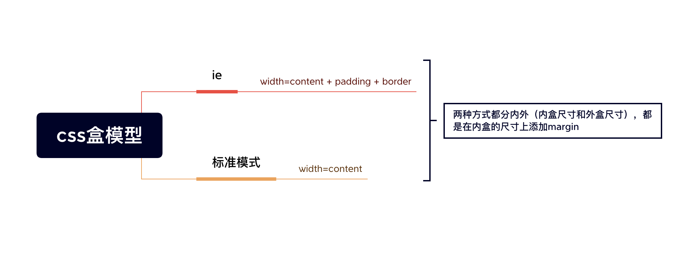
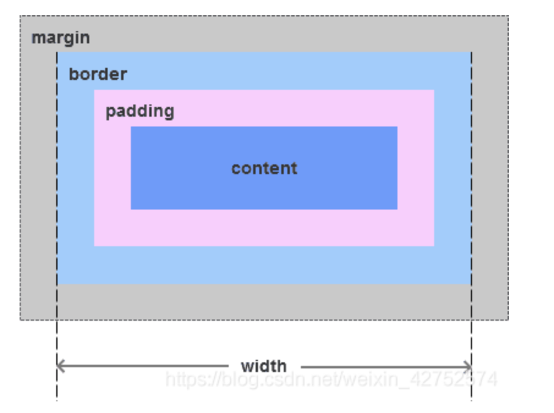
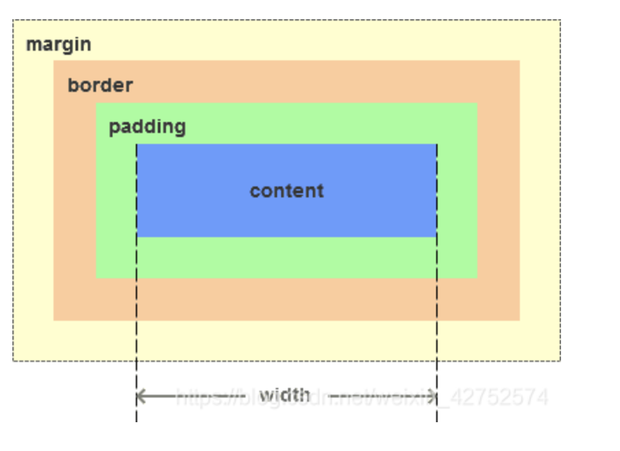

盒模型：盒模型又称框模型（Box Model）,包含了
> 元素内容（content）
> 内边距（padding）
> 边框（border）
> 外边距（margin）

### ie模式

IE模型元素宽度`width = content + padding + border`，高度计算相同。


### 标准模式（非ie模式）

标准模型元素宽度`width=content`，高度计算相同。
**`这也就说明在标准模式下设置了width，再设置border或者padding后，会导致宽度（高度）会变，导致页面布局错乱。`**


### js获取宽高

[getComputedStyle介绍](css盒模型/https://developer.mozilla.org/zh-CN/docs/Web/API/Window/getComputedStyle)

```javascript
window.getComputedStyle(dom).width / height
```

### 设置


### 延伸

### 1.BFC

`BFC(Block Formatting Context)：块级格式化上下文。`
> BFC决定了元素如何对其内容进行定位，以及与其他元素的关系和相互作用。
> 一个BFC环境中的元素不会影响到其他环境中的布局

#### 1.1 BFC的原理（渲染规则）

> BFC内的元素垂直方向的边距会发生重叠。属于不同BFC的元素外边距不会发生重叠
> BFC的区域不会与浮动元素的布局重叠。
> BFC元素是一个独立的容器，外面的元素不会影响里面的元素。里面的元素也不会影响外面的元素。
> 计算BFC高度的时候，浮动元素也会参与计算(清除浮动)

#### 1.2 如何创建BFC

> overflow不为visible;
> float的值不为none；
> position的值不为static或relative；
> display属性为inline-blocks、table、table-cell、table-caption、flex、inline-flex;

### 2.外边距重叠

`当两个垂直外边距相遇时，他们将形成一个外边距，合并后的外边距高度等于两个发生合并的外边距的高度中的较大者。`

*注意：只有普通文档流中块框的垂直外边距才会发生外边距合并，行内框、浮动框或绝对定位之间的外边距不会合并。*
