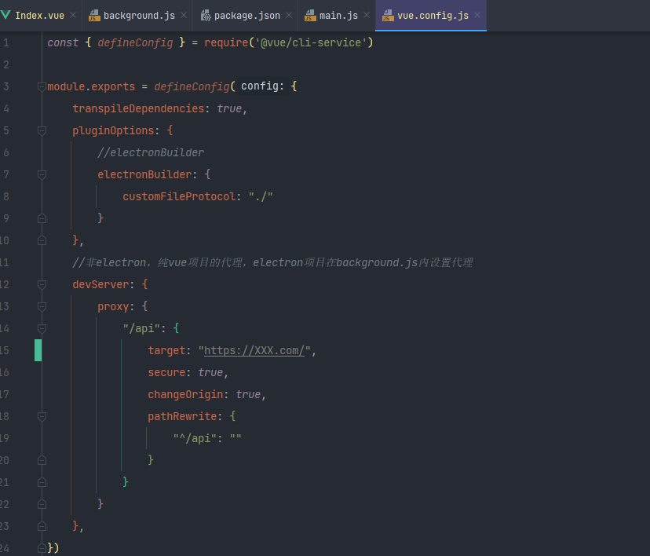

`electron + Vue 项目运行的时候，一切正常。使用 electronBuilder打包后，Vue的字体资源会加载错误，解决方法如下：`

```javascript
//vue.config.js
pluginOptions: {
        //electronBuilder
        electronBuilder: {
            customFileProtocol: "./"
        }
    },
```


