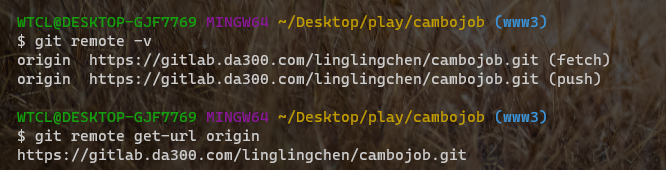
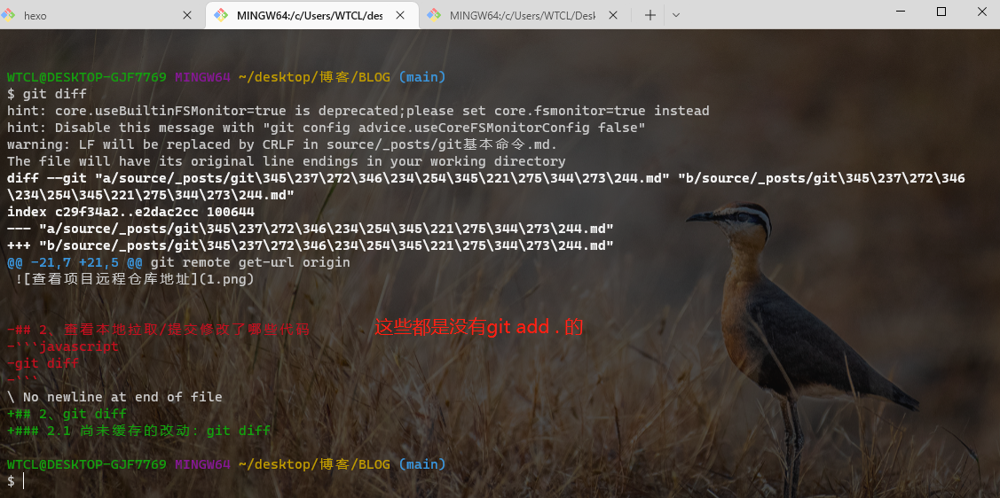
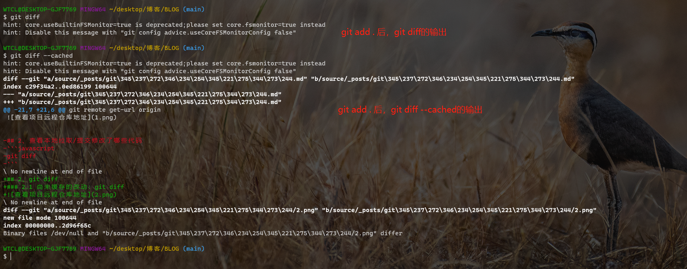

## 1、查看项目远程仓库地址

```javascript
// 第一种方式
git remote -v

// 第二种方式
git remote get-url origin

// 第三种方式
直接在该项目.git目录下config文件内查看
```



## 2、git diff

### 2.1 尚未缓存的改动：git diff



## 2.2 查看已缓存的改动： git diff --cached



## 2.3 显示暂存区和工作区的差异: git diff [file]

## 2.4 显示暂存区和上一次提交(commit)的差异: git diff --cached [file] 或者 git diff --staged [file]

## 2.5 显示两次提交之间的差异: git diff [first-branch]...[second-branch]
