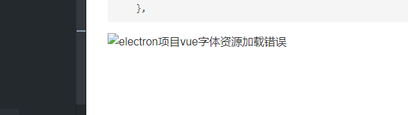

hexo内引入图片使用``的方式，但是在hexo里，会有一个与文档title同名的目录（如果title没改的话）,
在hexo里()内不用写目录，直接写图片名称+后缀即可。
以本文档为例，名为“hexo一次全局替换”，图片链接就可以写为``，在hexo的服务器与部署服务器
上就能展示，但是本地显示的是图二右边破损的图标


所以为兼容本地和服务器显示，应写为` a代表的就是同名文件夹`

**``但是由于该项目历史文档较多，所以写了一个node进行自动替换，代码如下``**

```javascript
const fs = require('fs');
const path = require('path');
const pathName = '_posts'

let arr = []
arr.map(item => {
  fs.readFile(`${pathName}/${item.name}`, {encoding: 'utf8'}, (err, data) => {
    if (err) {
      console.log('err');
    } else {
      let reg = /title.*/
      let title = reg.exec(data)
      if (title) {
        title = title[0].replace('title: ', '')
        let imgPath = data.replace(/]\((.*)\)/g, `]\(${title}/$1\)`)
        fs.writeFile(`${pathName}/${item.name}`, imgPath, (err1, data1) => {
          if (err1) {
            console.log('err1')
          } else {
            console.log(data1)
          }
        })
      } else {
        console.log('')
      }
    }
  })
})

```
