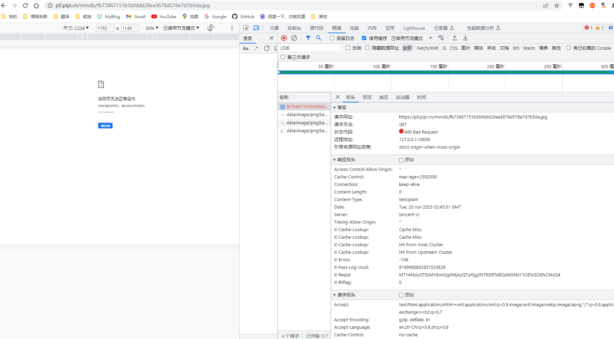
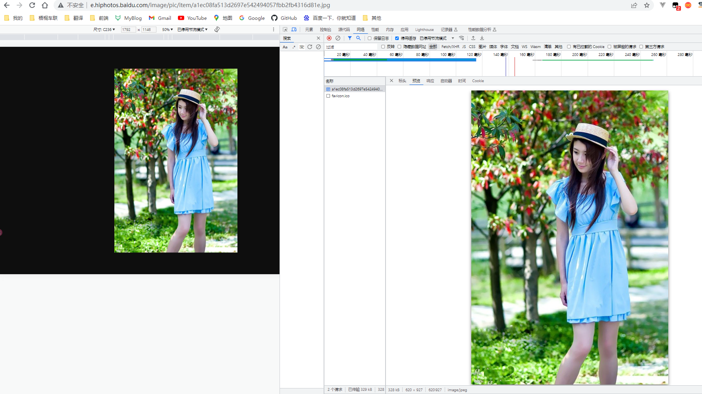
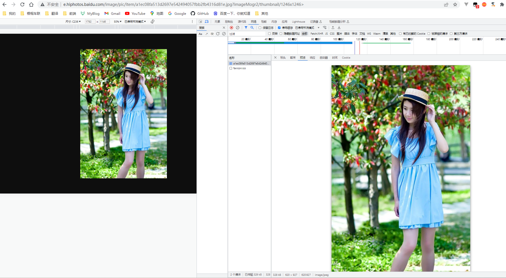

### 参考链接
[参考链接](http://78re52.com1.z0.glb.clouddn.com/docs/v6/api/reference/fop/image/imagemogr2.html)

`记录一次因为图片参数导致的图片不显示的问题`

事情是这样的，由于之前接触的都是oss，知道在图片后面拼接参数可以利用oss服务对图片进行处理（不拼接参数也可以访问），但是`https://p0.pipi.cn/mmdb/fb73867151b5bfddd28ea3678d576e7d7b5da.jpg?imageMogr2/thumbnail/1246x1246%3E`这个链接去掉`?`后面的参数，页面显示报错400

经过搜索后发现imagemogr2是一个图片处理程序，url中`imageMogr2/`
后面的参数可以去掉（理解为不对图片做任何处理），但是`imageMogr2/`不能去掉，如果去掉就会导致400报错。

``需要注意的是：如果原本的图片链接中没有imageMogr2/，那么这张图片就没有使用imageMogr2服务，手动拼接参数虽然不会报错，但是也不会进行图片处理，比如：http://e.hiphotos.baidu.com/image/pic/item/a1ec08fa513d2697e542494057fbb2fb4316d81e.jpg和http://e.hiphotos.baidu.com/image/pic/item/a1ec08fa513d2697e542494057fbb2fb4316d81e.jpg?imageMogr2/thumbnail/1246x1246%3E返回的图片是一样的``

