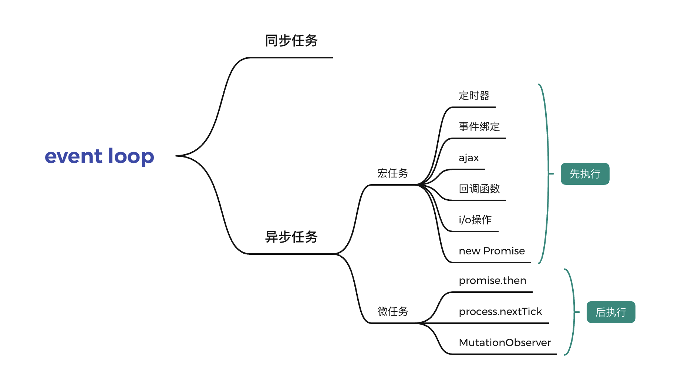

js 中的事件循环 event loop

`所谓单线程，是指在JS引擎中负责解释和执行JavaScript代码的线程只有一个。`

> 事件循环负责收集用事件（包括用户事件以及其他非用户事件等）、对任务进行排队以便在合适的时候执行回调。然后它执行所有处于等待中的 JavaScript 任务（宏任务），然后是微任务，然后在开始下一次循环之前执行一些必要的渲染和绘制操作。

### 1、同步任务

同步任务指的是，在主线程上排队执行的任务，只有前一个任务执行完毕，才能执行后一个任务；

### 2、异步任务

异步任务指的是，不进入主线程、而进入"任务队列"（task queue）的任务。`只有等主线程任务执行完毕，"任务队列"开始通知主线程，请求执行任务，该任务才会进入主线程执行。`

> 1）所有同步任务都在主线程上执行，形成一个执行栈（execution context stack）。
> （2）主线程之外，还存在一个"任务队列"（task queue）。只要异步任务有了运行结果，就在"任务队列"之中放置一个事件。
> （3）一旦"执行栈"中的所有同步任务执行完毕，系统就会读取"任务队列"，看看里面有哪些事件。那些对应的异步任务，于是结束等待状态，进入执行栈，开始执行。
> （4）主线程不断重复上面的第三步。

### 3、总结

`执行顺序为：同步优先，异步靠边，回调垫底。`

**javascript 是单线程。单线程就意味着，所有任务需要排队，前一个任务结束，才会执行后一个任务。如果前一个任务耗时很长，后一个任务就不得不一直等着。于是就有一个概念——任务队列。如果排队是因为计算量大，CPU 忙不过来，倒也算了，但是很多时候 CPU 是闲着的，因为 IO 设备（输入输出设备）很慢（比如 Ajax 操作从网络读取数据），不得不等着结果出来，再往下执行。于是 JavaScript 语言的设计者意识到，这时主线程完全可以不管 IO 设备，挂起处于等待中的任务，先运行排在后面的任务。等到 IO 设备返回了结果，再回过头，把挂起的任务继续执行下去。**

`同步可以保证顺序一致，但是容易导致阻塞；异步可以解决阻塞问题，但是会改变顺序性，根据不同的需要去写你的代码。`

Promise 是异步的，是指他的 then()和 catch()方法，Promise 本身还是同步的，所以这里先执行 a 变量内部的 Promise 同步代码。（同步优先）

注意 new Promise() 是同步方法，resolve 才是异步方法。

同步（Promise）>异步（微任务（process.nextTick ，Promises.then, Promise.catch ，resove,reject,MutationObserver)>宏任务（setTimeout，setInterval，setImmediate））
process.nextTick> Promises.then

> 宏任务是主流，当 js 开始被执行的时候，就是开启一个宏任务，在宏任务中执行一条一条的指令；
> 宏任务可以同时有多个，但会按顺序一个一个执行；
> 每一个宏任务，后面都可以跟一个微任务队列，如果微任务队列中有指令或方法，那么就会执行；如果没有，则开始执行下一个宏任务，直到所有的宏任务执行完为止，微任务相当于宏任务的小尾巴；
> 为什么有了宏任务，还会有微任务存在？因为宏任务太占用性能，当需要一些较早就准备好的方法，排在最后才执行的时候，又不想新增一个宏任务，那么就可以把这些方法，一个一个的放在微任务队列里面，在这个宏任务中的代码执行完后，就会执行微任务队列。
