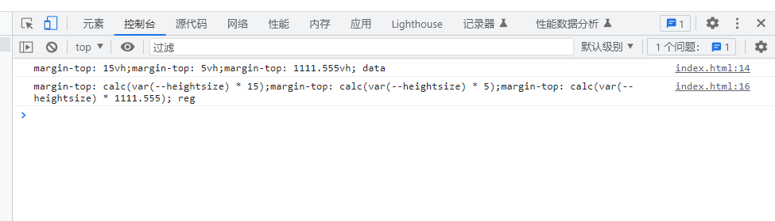

`正则内保存匹配的对象，进行替换，如：将15vh内的数字替换成calc(var(--heightsize) *数字，并把vh去掉`

`(\d+\.\d+|\d+)就是将匹配到的数字做暂存，在表达式内用$1进行引用`

```javascript
let data = "margin-top: 15vh;margin-top: 5vh;margin-top: 1111.555vh;";
console.log(data, "data");
let reg = data.replace(/(\d+\.\d+|\d+)vh/g, "calc(var(--heightsize) * $1)");
console.log(reg, "reg");
```


