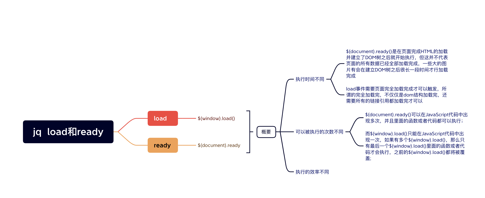

> 执行时间
> 编写个数不同
> 简化写法

### 执行时间
- window.onload ：必须等到页面内包括图片的所有元素加载完毕后才能执行。
- $(document).ready()：DOM 结构绘制完毕后就执行，不必等到加载完毕。

### 编写个数不同
- window.onload：不能同时编写多个，如果有多个 window.onload 方法，只会执行一个
- $(document).ready()：可以同时编写多个，并且都可以得到执行

### 简化写法
- window.onload：没有简化写法
- $(document).ready(function(){})：可以简写成 $(function(){});
