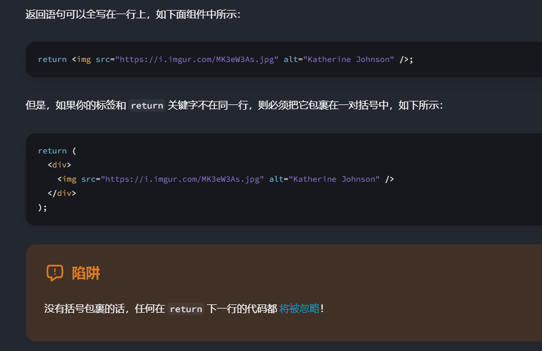

### 组件命名
``组件的名称必须以大写字母开头，否则它们将无法运行！``

### 组件return
如果你的标签和 return 关键字不在同一行，则必须把它包裹在一对括号中

### use client
[参考链接](https://react.dev/reference/react/use-client)

### 事件处理
[参考链接](https://zh-hans.react.dev/learn/responding-to-events)
