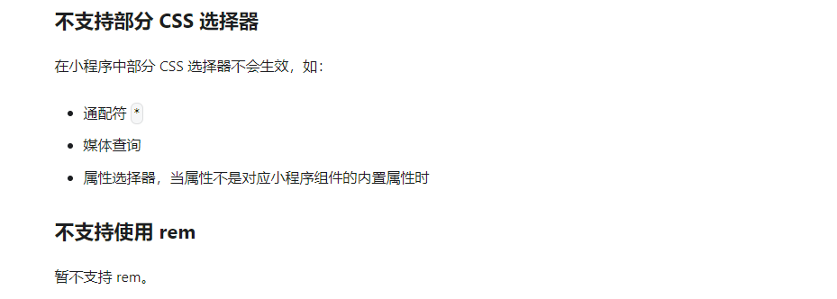

[taro 官网说明](taro小程序内使用rem/https://taro-docs.jd.com/docs/next/use-h5#%E4%B8%8D%E6%94%AF%E6%8C%81%E4%BD%BF%E7%94%A8-rem)
`taro官网明确表示暂时不支持rem`


由于项目内使用的 less，所以我们采用 less 变量声明的方式，曲线救国

```less
// base.less
//基准的font-size是根据项目确定的，如果是老项目，则需要根据老代码确定
// 由于之前采用的是vh，所以在这我们将1rem设置为1vh（屏幕高度1000）
@fontsize: 10px;
```

```less
// index.less
@import "/src/static/baseFontSize";

.startup {
  width: 100vw;
  height: 100vh;
  background-image: linear-gradient(180deg, #282c60 0%, #0e173e 66%);
  position: absolute;
  top: 0;
  left: 0;
  z-index: 800;
  font-family: PingFangSC-Semibold;
  //项目改造，之前写法是font-size:7.7vh  我们改造成rem的方式时，将1rem设置为了屏幕高度的1/100，所以7.7这个数值就不用变
  font-size: calc(@fontsize * 7.7);
  color: #ffffff;
  text-align: center;
}
```
