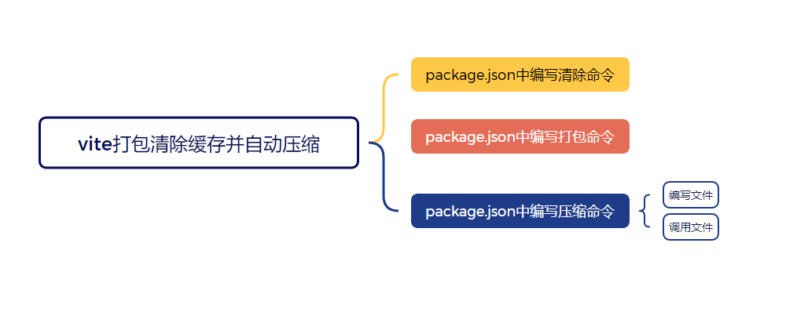

## 1. 清除命令
```json
"clean": "rm -rf dist/* || rimraf dist/* || echo 'No files to clean.'",
```
## 2. 压缩命令
```json
"zip": "node zip.js"
```
压缩文件zip.js
```javascript
// 引入所需模块
import fs from 'fs';
import archiver from 'archiver';
import { fileURLToPath } from 'url';
import { dirname } from 'path';

// 获取当前文件的目录
const __filename = fileURLToPath(import.meta.url);
const __dirname = dirname(__filename);

// 创建一个文件以写入压缩包内容
const output = fs.createWriteStream(`${__dirname}/dist.zip`);

// 创建archiver实例，并设置压缩格式和压缩级别
const archive = archiver('zip', {
  zlib: { level: 9 }
});

// 监听输出文件流的'close'事件，表示所有的数据已经被写入到文件中
output.on('close', function() {
  console.log(`打包完成，总大小：${archive.pointer()} bytes`);
});

// 监听archive的错误事件
archive.on('error', function(err) {
  throw err;
});

// 管道输出文件流到archive对象
archive.pipe(output);

// 指定需要压缩的目录，这里是dist目录
archive.directory('dist/', false);

// 完成文件添加并结束输出流
archive.finalize();

```

## 3. 打包命令
```javascript
//先清除缓存，再打包，最后压缩
// --mode development 是做了环境区分
"build:sit": "npm run clean && vite build --mode development && npm run zip",
```
