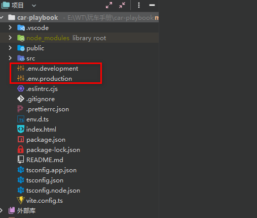
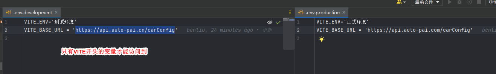
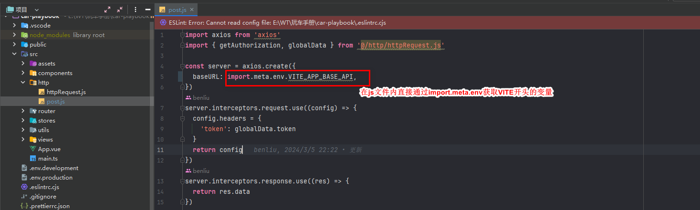

## vite环境配置



上面的是代码配置和运行效果，供我们打包发布
如果在运行或打包时需要看下配置的环境，则需要在vite.config.js中配置
```javascript
import { fileURLToPath, URL } from 'node:url'
import { defineConfig,loadEnv } from 'vite'
import vue from '@vitejs/plugin-vue'
import chalk from 'chalk';

export default defineConfig(({ command, mode }) => {
  //   需要加载loadEnv
  const env = loadEnv(mode, process.cwd(), '');
  console.log(`本次打包的环境是：${chalk.yellow(env.VITE_ENV)}`);//chalk是一个颜色插件
  console.log(`本次打包使用的baseURL是：${chalk.bold.yellow(env.VITE_BASE_URL)}`);

  return {
    base: './',
    plugins:
      [
        vue()
      ],
    css:
      {
        preprocessorOptions: {
          less: {
            // 引入全局 Less 文件
            additionalData: `@import "./src/assets/css/base.less";`
          }
        }
      }
    ,
    resolve: {
      alias: {
        '@':
          fileURLToPath(new URL('./src', import.meta.url))
      }
    }
    ,
    build: {
      rollupOptions: {
        output: {
          // 自定义入口文件名
          entryFileNames: `assets/[name]_${new Date().getTime()}.js`,
          // 自定义块文件名
          chunkFileNames:
            `assets/[name]-[hash]_${new Date().getTime()}.js`
          // 自定义资源文件名
          // assetFileNames: `assets/[name]-[hash].[ext]_${new Date().getTime()}`
        }
      }
    }
  }
})

```
