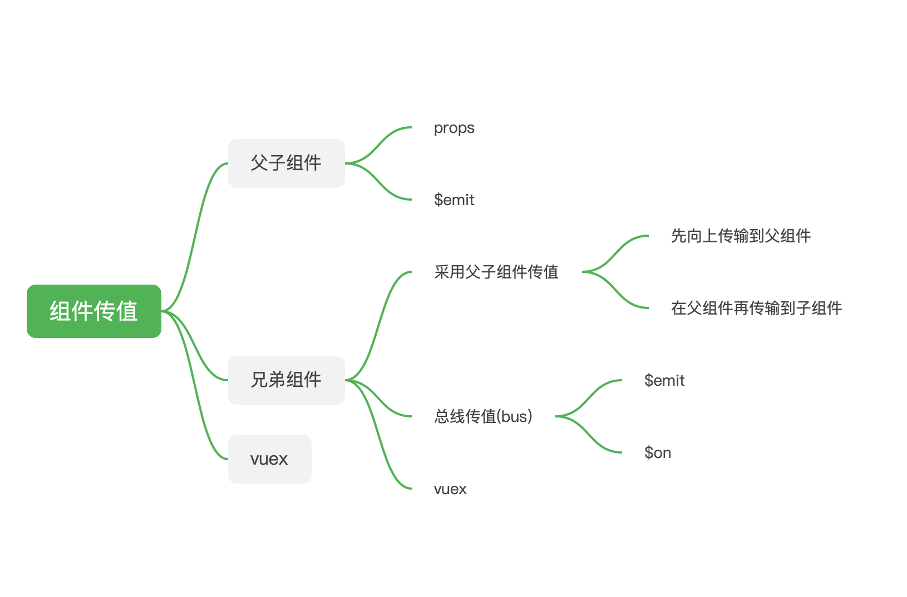

### 1、父子组件

> 父传子
> 子传父

#### 1.1 父传子

#### 1.2 子传父

### 2、兄弟组件

> 采用父子组件传值方式
> 总线传值（bus）
> vuex

#### 2.1 采用父子组件传值方式

#### 2.2 总线传值（bus）

```javascript
// 兄弟组件传值  main.js
const bus = new Vue();
Vue.prototype.$bus = bus;

// 需要发送数据的组件
if (res.data.data.presidePosition.member.userIcon.length > 1) {
  this.$bus.$emit("hudong", res.data.data.presidePosition.member.userIcon);//定义一个名称，并发送数据
  console.log(res.data.data.presidePosition.member.userIcon);
}

// 需要接收数据的组件
beforeMount() {//接收的时机自选，这里放在dom加载前
    this.$bus.$on('hudong', (url) => {//接收数据
      console.log(url, 'urlurlurlurlurlurlurlurlurlurlurlurlurlurl')
      this.avatar = url
    })
  }
```

#### 2.3vuex



### 3、vuex
