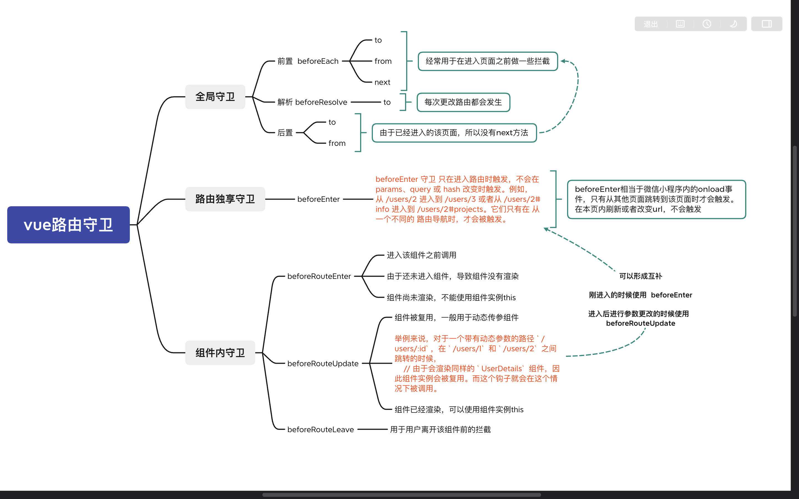
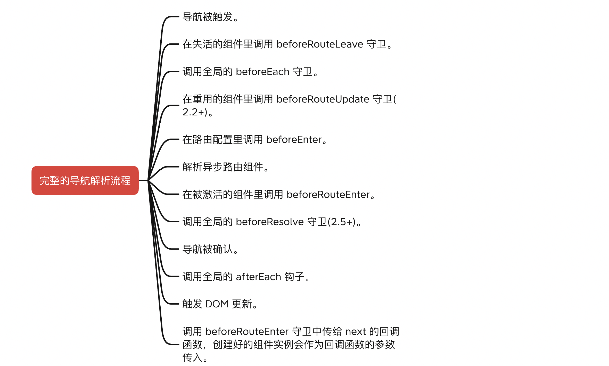

[vue 路由守卫](vue路由守卫/https://router.vuejs.org/zh/guide/advanced/navigation-guards.html)

### 1、vue 路由守卫

> 1 全局守卫
> 2 路由独享守卫
> 3 组件内守卫



### 2、完整的导航解析流程


### 3、路由守卫中next带参数和不带参数的区别
`假设参数是 '/login'`
在Vue.js, 路由守卫用于在路由切换前或切换后执行特定的逻辑。`next()` 和 `next('/login')` 是两种不同的方式来控制路由守卫的行为。

1. **next()**:
   当你在路由守卫中调用 `next()` 时，表示允许当前的路由切换继续进行。这通常用于在一个路由守卫中执行完必要的逻辑后，允许路由继续切换到下一个路由。例如，在一个验证用户登录状态的守卫中，如果用户已登录，你可以调用 `next()` 来允许切换到下一个路由。示例：

   ```javascript
   router.beforeEach((to, from, next) => {
     if (userIsLoggedIn) {
       // 用户已登录，允许继续路由切换
       next();
     } else {
       // 用户未登录，重定向到登录页面
       next('/login');
     }
   });
   ```

2. **next('/login')**:
   当你调用 `next('/login')` 时，表示你希望中断当前的路由切换，并强制跳转到指定的路由（在这个例子中是登录页面）。这通常用于在某些情况下，你希望用户在未满足特定条件时被强制重定向到特定的页面。示例：

   ```javascript
   router.beforeEach((to, from, next) => {
     if (userIsLoggedIn) {
       // 用户已登录，允许继续路由切换
       next();
     } else {
       // 用户未登录，强制跳转到登录页面
       next('/login');
     }
   });
   ```

总之，`next()` 允许路由继续切换，而 `next('/login')` 则中断当前切换并重定向到指定的路由。