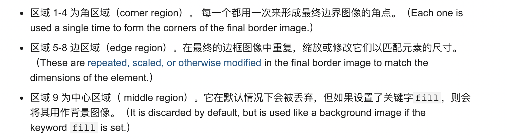
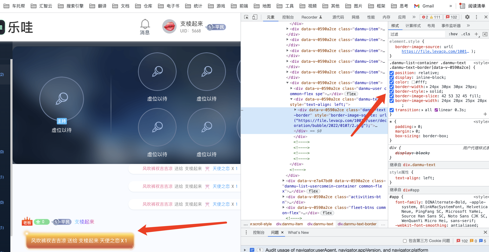

https://developer.mozilla.org/zh-CN/docs/Web/CSS/border-image-slice

> border-image-slice 指定图像的边界向内偏移
> 通过 border-image-source 引用边框图片后，border-image-slice 属性会将图片分割为 9 个区域：四个角，四个边（edges）以及中心区域。四条切片线，从它们各自的侧面设置给定距离，控制区域的大小。
> 

中间的区域将不会被边框使用，但当设置有 fill 关键词时将会被作为 background-image。这个关键词可以被设置在属性的任何一个位置(前面、后面或者两个值之间)

border-image-repeat, border-image-width, border-image-outset 属性则定义这些图片将如何使用。

