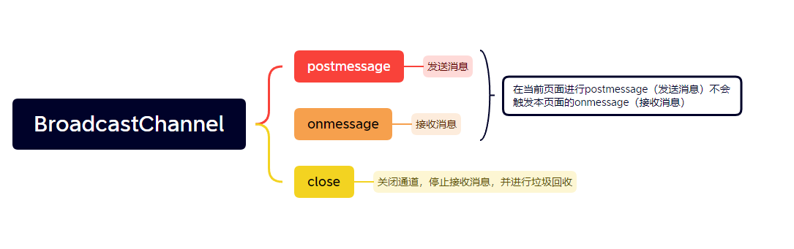
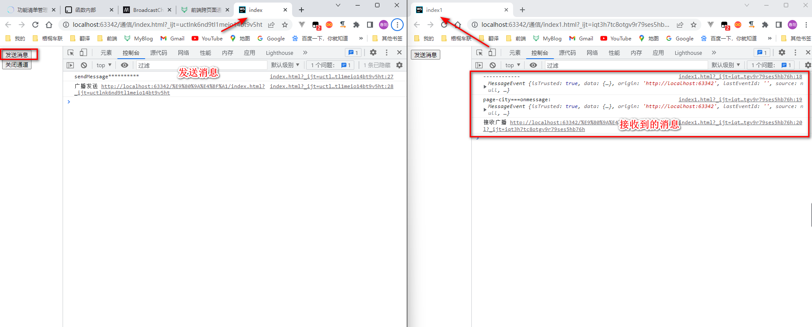
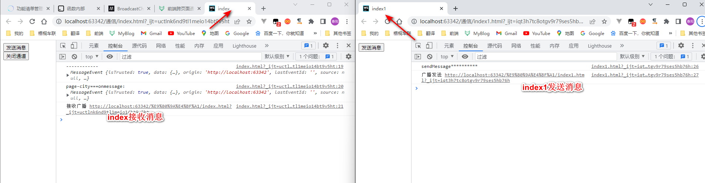
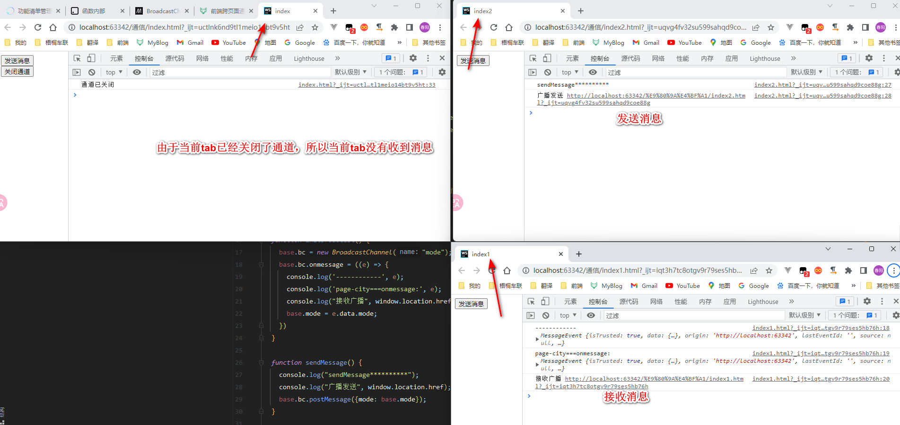
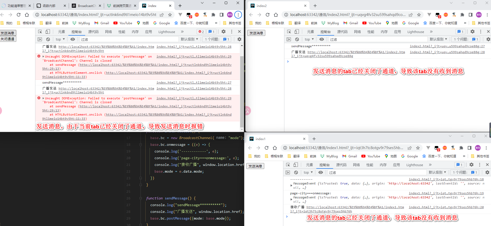

### 1、BroadcastChannel

BroadcastChannel 接口代理了一个命名频道，可以让指定 origin 下的任意 browsing context 来订阅它。它允许同源的不同浏览器窗口，Tab页，frame 或者 iframe 下的不同文档之间相互通信。通过触发一个 message 事件，消息可以广播到所有监听了该频道的BroadcastChannel 对象。
[参考链接](https://developer.mozilla.org/zh-CN/docs/Web/API/BroadcastChannel)



```html
<!doctype html>
<html lang="en">
<head>
  <meta charset="UTF-8">
  <meta name="viewport"
        content="width=device-width, user-scalable=no, initial-scale=1.0, maximum-scale=1.0, minimum-scale=1.0">
  <meta http-equiv="X-UA-Compatible" content="ie=edge">
  <title>index</title>
</head>
<body>
<button onclick="sendMessage()">发送消息</button>
<button onclick="closeBroadcastChannel()">关闭通道</button>
<script>
  let base = {bc: ''}

  function initBroadcast() {
    base.bc = new BroadcastChannel("mode");
    base.bc.onmessage = ((e) => {
      console.log('------------', e);
      console.log('page-city===onmessage:', e);
      console.log("接收广播", window.location.href);
      base.mode = e.data.mode;
    })
  }

  function sendMessage() {
    console.log("sendMessage**********");
    console.log("广播发送", window.location.href);
    base.bc.postMessage({mode: base.mode});
  }

  function closeBroadcastChannel() {
    console.log('通道已关闭')
    base.bc.close()
  }

  initBroadcast()
  sendMessage()
</script>
</body>
</html>
```





### 2、ServiceWorker
[参考链接](https://developer.mozilla.org/zh-CN/docs/Web/API/ServiceWorker)
