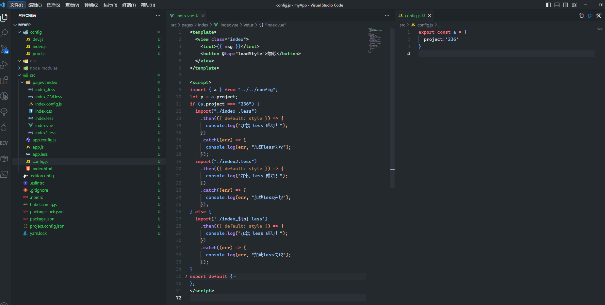

动态引入css（less/sass）文件，在保证功能不变的前提下，适配不同的UI。


代码结构如图所示，我们可以根据配置文件(config.js)内的变量值，动态添加不同文件名的css(less/sass)文件即可

```javascript
// 核心代码
import { a } from "../../config";
let p = a.project;
if (a.project === "236") {
  import("./index_.less")
    .then(({ default: style }) => {
      console.log("加载 less 成功！");
    })
    .catch((err) => {
      console.log(err, "加载less失败");
    });
  import("./index2.less")
    .then(({ default: style }) => {
      console.log("加载 less 成功！");
    })
    .catch((err) => {
      console.log(err, "加载less失败");
    });
} else {
  import(`./index_${p}.less`)
    .then(({ default: style }) => {
      console.log("加载 less 成功！");
    })
    .catch((err) => {
      console.log(err, "加载less失败");
    });
}
```
