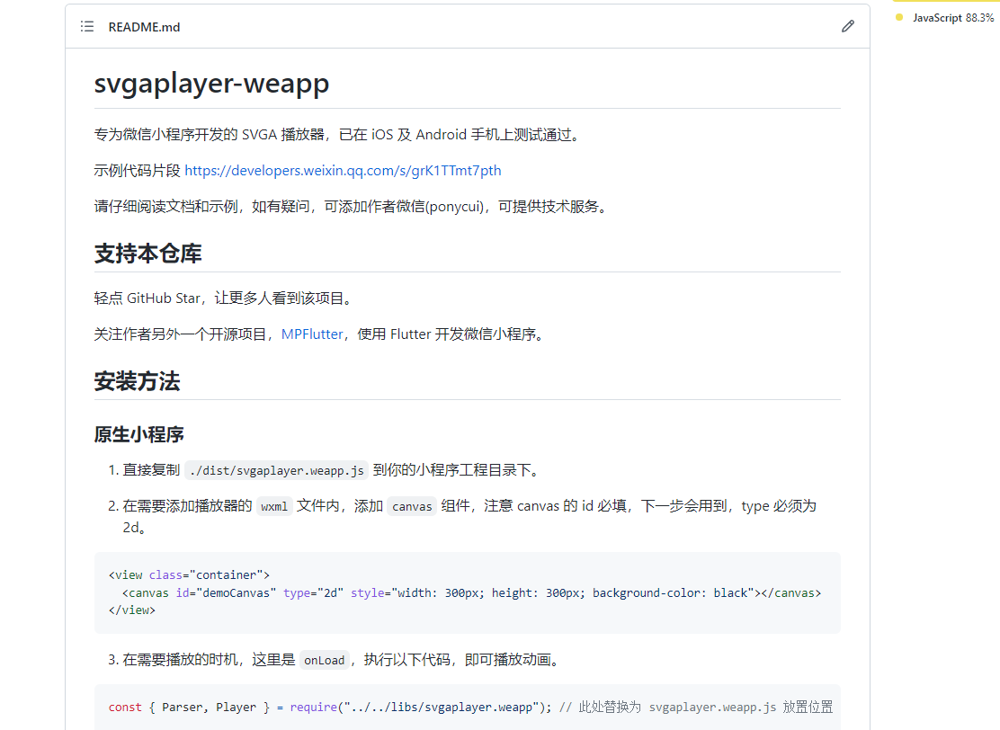

> 安装代码包
> 代码内引入使用
> 预备 canvas 画布
> 开始播放

### 1、安装代码包

[资源包](小程序使用svga/https://github.com/hanshuang-ai/svgaplayer-weapp)


### 2、代码内引入

```javascript
const { Parser, Player } = require("./js/svgaplayer.weapp.js");
```

### 3、预备 canvas 画布

```html
<!-- 礼物特效组件 -->
<canvas
  type="2d"
  wx:if="{{showGiftCanvas}}"
  wx:for="{{giftListCanvas}}"
  wx:for-item="item"
  wx:for-index="index"
  wx:key="item"
  id="{{item.id}}"
  class="giftCanvas"
></canvas>
```

### 4、加载资源开始使用

```javascript
//礼物弹幕
let that = this;
if (type == "sendgift") {
  textObj._type = type;
  textObj.timeID = `id${new Date().getTime()}`;
  arr.push(textObj);
  that.setData({
    messageChat: arr,
    toVview: textObj.timeID,
  });
  // 礼物特效
  let arr1 = that.data.giftListCanvas; //礼物特效数组
  if (t.ggif.indexOf("svga") > -1) {
    arr1.push({
      id: `id${new Date().getTime()}`,
      ggif: t.ggif,
    });
    that.setData({
      giftListCanvas: arr1,
    });
    /**
     * 画布容器
     * 礼物资源
     */
    let svgaPlay = async function (element, ggif) {
      that.setData({
        showGiftCanvas: true, //是否显示礼物动画画布
      });
      let parser = new Parser();
      let player = new Player();
      player.loops = 1; //循环1次
      player.fillMode = "Forward"; //播放结束后保留最后一帧
      player.clearsAfterStop = true; //播放结束后清空画布
      await player.setCanvas(`#${element}`);
      let videoItem = await parser.load(`${ggif}`);
      await player.setVideoItem(videoItem);
      player.startAnimation();
      // 礼物播放完的监听
      player.onFinished(() => {
        arr1.shift(); //数组内移除第一项，继续播放
        that.setData({
          showGiftCanvas: false,
          giftListCanvas: arr1,
        });
        if (arr1.length > 0) {
          svgaPlay(arr1[0].id, arr1[0].ggif);
        }
      });
    };
    if (arr1.length == 1) {
      svgaPlay(arr1[0].id, arr1[0].ggif);
    }
  } else {
    wx.showToast({
      title: "暂不支持",
      icon: "none",
    });
  }
}
```
