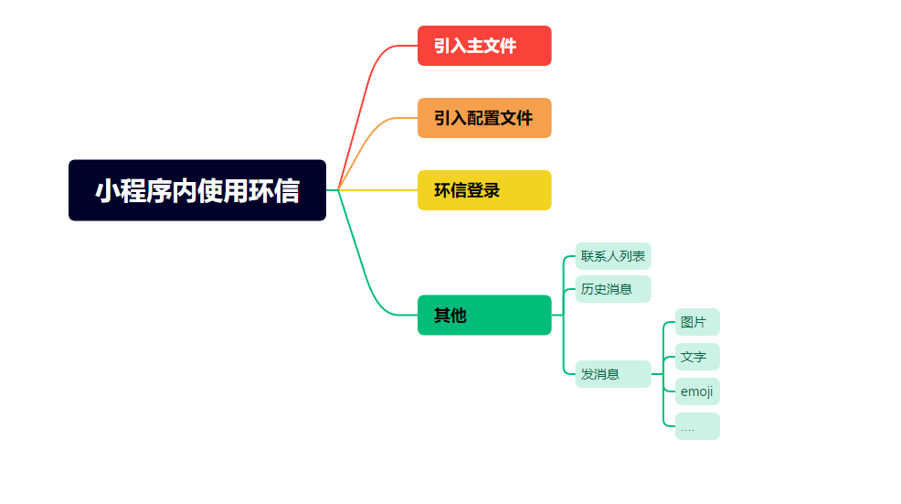
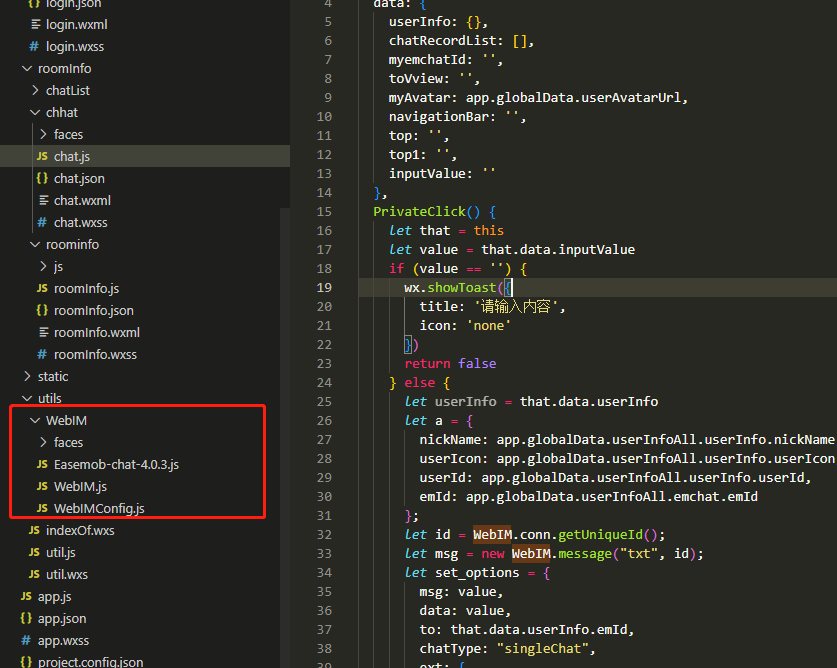
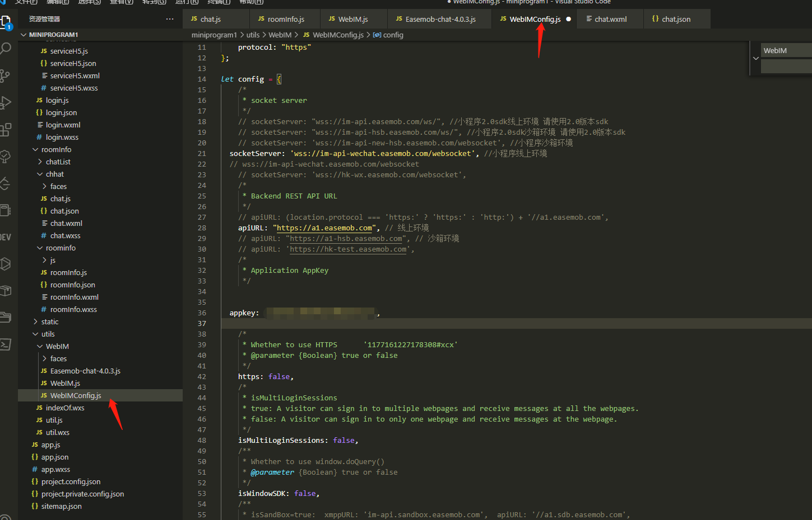
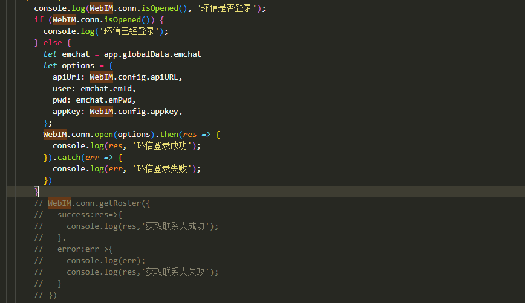
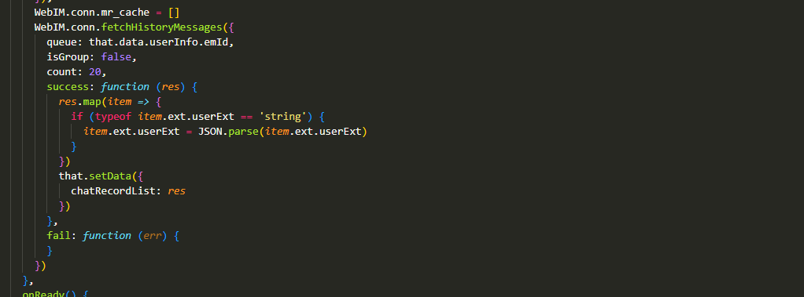
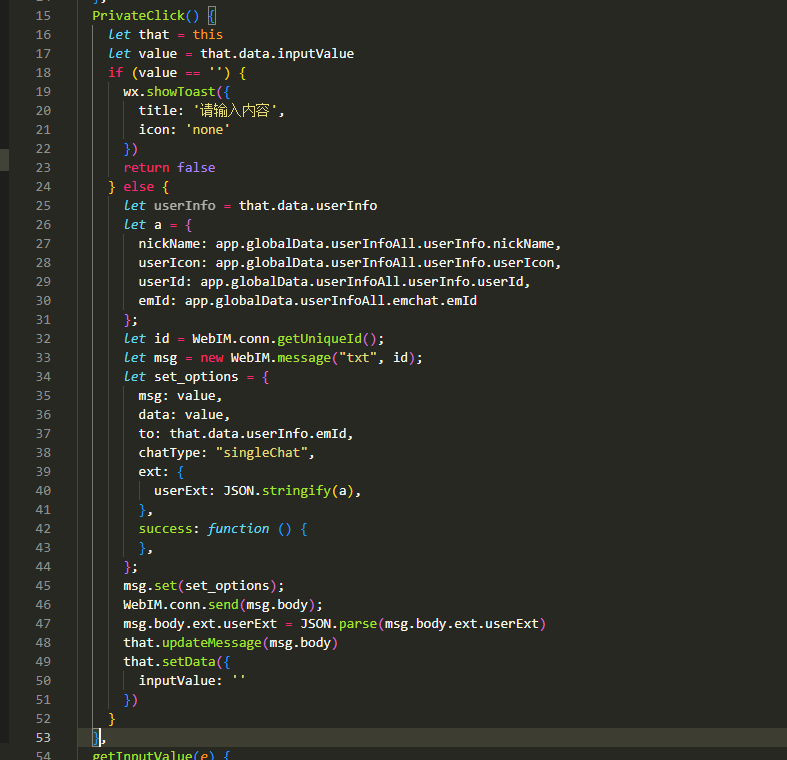
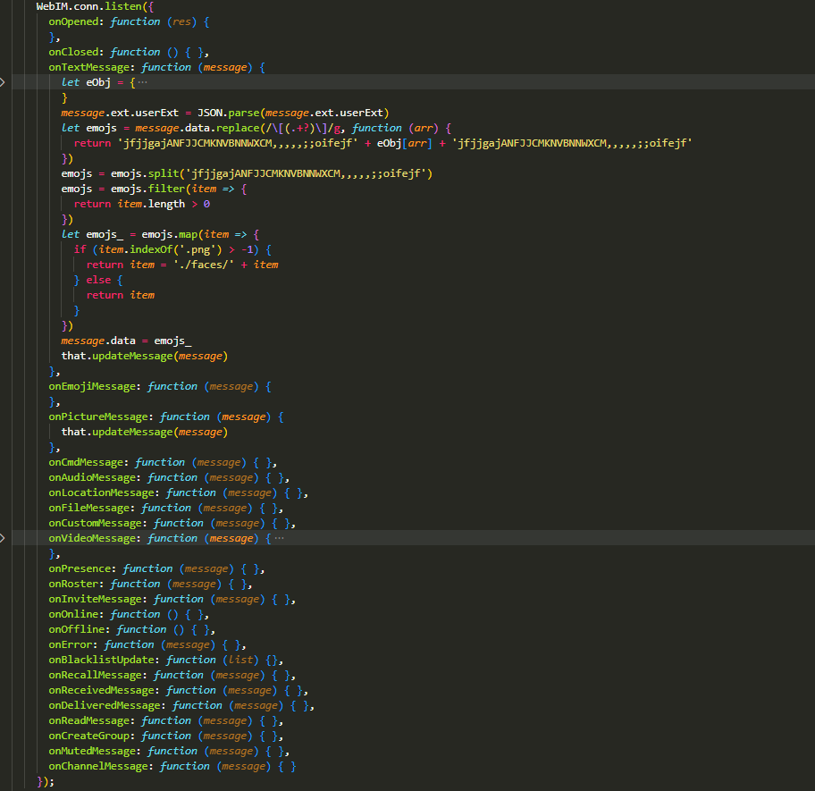

### 1、小程序内引入环信文件



### 2、完善环信配置



### 3、环信登录



### 4、加载历史消息



### 5、发送消息



### 6、接收消息



`需要注意的是：发送消息的时候，需要在本地的消息列表内手动添加信息`

```javascript
// 添加消息到消息列表，并自动滚动到该条消息
  updateMessage(obj) {
    let that = this
    let chatRecordList = that.data.chatRecordList
    chatRecordList.push(obj)
    chatRecordList[chatRecordList.length - 1].idd = 'id' + chatRecordList[chatRecordList.length - 1].id
    that.setData({
      chatRecordList: chatRecordList,
      toVview: 'id' + chatRecordList[chatRecordList.length - 1].id
    })
  }
```

<br>
<br>
<br>
<hr>

### 7、部分代码

```html
<wxs src="../../utils/indexOf.wxs" module="str" />
<view style="padding-top: {{top}}px;height: {{top}}px;background: #fff;">
  <view
    class="top"
    style="height: {{top1}}px;position: fixed;left: 0;width: 100vw;top: {{top}}px;z-index: 100;"
  >
    <view
      class="topImageContaienr"
      style="padding-left: 20rpx;box-sizing: border-box;height: 100%;position: relative;background: #fff;"
    >
      <view
        style="width: 60rpx;height: 60rpx;position: absolute;left: 0%;top: 50%;transform: translate(40rpx,-50%);text-align: center;line-height: 72rpx;"
      >
        <image
          src="/static/img/back2.png"
          bindtap="backToIndex"
          style="width: 20rpx;height: 28rpx;"
        ></image>
      </view>
      <!-- 由于该页使用了自定义导航，所以导航栏可以显示环信联系人昵称 -->
      <view
        style="position: absolute;left: 50%;top: 50%;transform: translate(-50%,-50%);"
        >{{userInfo.userInfo.nickName}}</view
      >
    </view>
  </view>
</view>
<view id="container">
  <view>
    <view>
      <view> </view>
    </view>
  </view>
  <scroll-view
    class="chatViewContainer"
    scroll-y="true"
    scroll-into-view="{{toVview}}"
  >
    <!-- 环信历史消息 -->
    <view
      wx:for="{{chatRecordList}}"
      wx:for-item="item"
      wx:for-index="index"
      wx:key="item"
      class="itemitemitem"
      id="{{item.idd}}"
    >
      <view wx:if="{{myemchatId==item.to}}" class="left">
        <view>
          <image
            src="{{userInfo.userInfo.userIcon}}"
            style="width: 80rpx;height: 80rpx;border-radius: 50%;"
          ></image>
          <view class="text" wx:if="{{item.data}}">
            <view
              wx:if="{{item.data}}"
              wx:for="{{item.data}}"
              wx:for-item="item_"
              wx:key="item_"
              wx:for-index="index_"
              class="cccc"
            >
              <text wx:if="{{str.indexOf11(item_,'./faces/ee_')?false:true}}"
                >{{item_}}</text
              >
              <image src="{{item_}}" wx:else class="emoemoemo"></image>
            </view>
          </view>
          <view class="imageEmchat" wx:if="{{item.url}}">
            <image
              src="{{item.url}}"
              style="width: 400rpx;height: 400rpx;"
            ></image>
          </view>
        </view>
      </view>
      <view wx:else class="right">
        <view>
          <image
            src="{{myAvatar}}"
            style="width: 80rpx;height: 80rpx;border-radius: 50%;"
          ></image>
          <view class="text">{{item.msg||item.data}}</view>
        </view>
      </view>
    </view>
  </scroll-view>
  <!-- 发送消息 -->
  <view class="inputContainer">
    <input
      type="text"
      placeholder="请输入聊天内容"
      bindconfirm="PrivateClick"
      value="{{inputValue}}"
      bindinput="getInputValue"
    />
    <view bindtap="PrivateClick" class="sendView">发送</view>
  </view>
</view>
```

```javascript
const app = getApp();
const WebIM = require("../../utils/WebIM/WebIM").WebIM;
Page({
  data: {
    userInfo: {},
    chatRecordList: [],
    myemchatId: "",
    toVview: "",
    myAvatar: app.globalData.userAvatarUrl,
    navigationBar: "",
    top: "",
    top1: "",
    inputValue: "",
  },
  //   发送消息，需要注意消息的组合格式
  PrivateClick() {
    let that = this;
    let value = that.data.inputValue;
    if (value == "") {
      wx.showToast({
        title: "请输入内容",
        icon: "none",
      });
      return false;
    } else {
      let userInfo = that.data.userInfo;
      let a = {
        nickName: app.globalData.userInfoAll.userInfo.nickName,
        userIcon: app.globalData.userInfoAll.userInfo.userIcon,
        userId: app.globalData.userInfoAll.userInfo.userId,
        emId: app.globalData.userInfoAll.emchat.emId,
      };
      let id = WebIM.conn.getUniqueId();
      let msg = new WebIM.message("txt", id);
      let set_options = {
        msg: value,
        data: value,
        to: that.data.userInfo.emId,
        chatType: "singleChat",
        ext: {
          userExt: JSON.stringify(a),
        },
        success: function () {},
      };
      msg.set(set_options);
      WebIM.conn.send(msg.body);
      msg.body.ext.userExt = JSON.parse(msg.body.ext.userExt);
      that.updateMessage(msg.body);
      that.setData({
        inputValue: "",
      });
    }
  },
  //   输入框输入的时候，将值赋给inputValue
  getInputValue(e) {
    let that = this;
    that.setData({
      inputValue: e.detail.value,
    });
  },
  //   更新消息，有最新消息时自动定位到最新消息
  updateMessage(obj) {
    let that = this;
    let chatRecordList = that.data.chatRecordList;
    chatRecordList.push(obj);
    chatRecordList[chatRecordList.length - 1].idd =
      "id" + chatRecordList[chatRecordList.length - 1].id;
    that.setData({
      chatRecordList: chatRecordList,
      toVview: "id" + chatRecordList[chatRecordList.length - 1].id,
    });
  },
  onLoad(options) {
    let that = this;
    that.setData({
      userInfo: JSON.parse(options.userInfo),
      myemchatId: app.globalData.emchat.emId,
    });
    wx.getSystemInfo({
      success: (res) => {
        that.system = res;
      },
    });
    that.menu = wx.getMenuButtonBoundingClientRect();
    that.systemBar = that.system.statusBarHeight;
    that.navigationBar =
      (that.menu.top - that.system.statusBarHeight) * 2 + that.menu.height;
    const top = that.systemBar;
    const top1 = that.navigationBar;
    that.setData({
      top: top,
      top1: top1,
    });
    // 获取环信历史消息，需要注意的是历史记录保存时间和数量是和环信套餐有关的
    WebIM.conn.mr_cache = [];
    WebIM.conn.fetchHistoryMessages({
      queue: that.data.userInfo.emId,
      isGroup: false,
      count: 20, //请求最近历史消息数
      success: function (res) {
        res.map((item) => {
          if (typeof item.ext.userExt == "string") {
            item.ext.userExt = JSON.parse(item.ext.userExt);
          }
        });
        that.setData({
          chatRecordList: res,
        });
      },
      fail: function (err) {},
    });
  },
  onReady() {},
  onShow() {
    let that = this;
    // 消息监听
    WebIM.conn.listen({
      onOpened: function (res) {},
      onClosed: function () {},
      onTextMessage: function (message) {
        let eObj = {
          "[):]": "ee_1.png",
          "[:D]": "ee_2.png",
          "[;)]": "ee_3.png",
          "[:-o]": "ee_4.png",
          "[:p]": "ee_5.png",
          "[(H)]": "ee_6.png",
          "[:@]": "ee_7.png",
          "[:s]": "ee_8.png",
          "[:$]": "ee_9.png",
          "[:(]": "ee_10.png",
          "[:'(]": "ee_11.png",
          "[<o)]": "ee_12.png",
          "[(a)]": "ee_13.png",
          "[8o|]": "ee_14.png",
          "[8-|]": "ee_15.png",
          "[+o(]": "ee_16.png",
          "[|-)]": "ee_17.png",
          "[:|]": "ee_18.png",
          "[*-)]": "ee_19.png",
          "[:-#]": "ee_20.png",
          "[^o)]": "ee_21.png",
          "[:-*]": "ee_22.png",
          "[8-)]": "ee_23.png",
          "[del]": "btn_del.png",
          "[(|)]": "ee_24.png",
          "[(u)]": "ee_25.png",
          "[(S)]": "ee_26.png",
          "[(*)]": "ee_27.png",
          "[(#)]": "ee_28.png",
          "[(R)]": "ee_29.png",
          "[({)]": "ee_30.png",
          "[(})]": "ee_31.png",
          "[(k)]": "ee_32.png",
          "[(F)]": "ee_33.png",
          "[(W)]": "ee_34.png",
          "[(D)]": "ee_35.png",
        };
        message.ext.userExt = JSON.parse(message.ext.userExt);
        let emojs = message.data.replace(/\[(.+?)\]/g, function (arr) {
          return (
            "jfjjgajANFJJCMKNVBNNWXCM,,,,,;;oifejf" +
            eObj[arr] +
            "jfjjgajANFJJCMKNVBNNWXCM,,,,,;;oifejf"
          );
        });
        emojs = emojs.split("jfjjgajANFJJCMKNVBNNWXCM,,,,,;;oifejf");
        emojs = emojs.filter((item) => {
          return item.length > 0;
        });
        let emojs_ = emojs.map((item) => {
          if (item.indexOf(".png") > -1) {
            return (item = "./faces/" + item);
          } else {
            return item;
          }
        });
        message.data = emojs_;
        that.updateMessage(message);
      },
      onEmojiMessage: function (message) {},
      onPictureMessage: function (message) {
        that.updateMessage(message);
      },
      onCmdMessage: function (message) {},
      onAudioMessage: function (message) {},
      onLocationMessage: function (message) {},
      onFileMessage: function (message) {},
      onCustomMessage: function (message) {},
      onVideoMessage: function (message) {
        var node = document.getElementById("privateVideo");
        var option = {
          url: message.url,
          headers: {
            Accept: "audio/mp4",
          },
          onFileDownloadComplete: function (response) {
            var objectURL = WebIM.utils.parseDownloadResponse.call(
              conn,
              response
            );
            node.src = objectURL;
          },
          onFileDownloadError: function () {},
        };
        WebIM.utils.download.call(conn, option);
      },
      onPresence: function (message) {},
      onRoster: function (message) {},
      onInviteMessage: function (message) {},
      onOnline: function () {},
      onOffline: function () {},
      onError: function (message) {},
      onBlacklistUpdate: function (list) {},
      onRecallMessage: function (message) {},
      onReceivedMessage: function (message) {},
      onDeliveredMessage: function (message) {},
      onReadMessage: function (message) {},
      onCreateGroup: function (message) {},
      onMutedMessage: function (message) {},
      onChannelMessage: function (message) {},
    });
  },
  onHide() {},
  onUnload() {
    let that = this;
    that.setData({
      chatRecordList: [],
    });
  },
  onPullDownRefresh() {},
  onReachBottom() {},
  onShareAppMessage() {},
});
```
