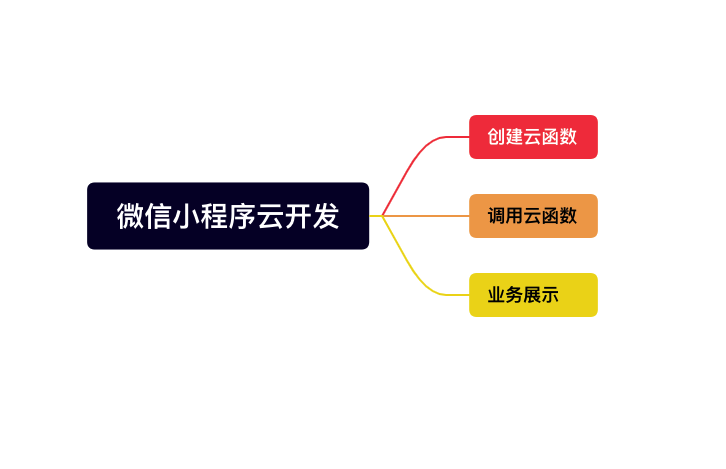
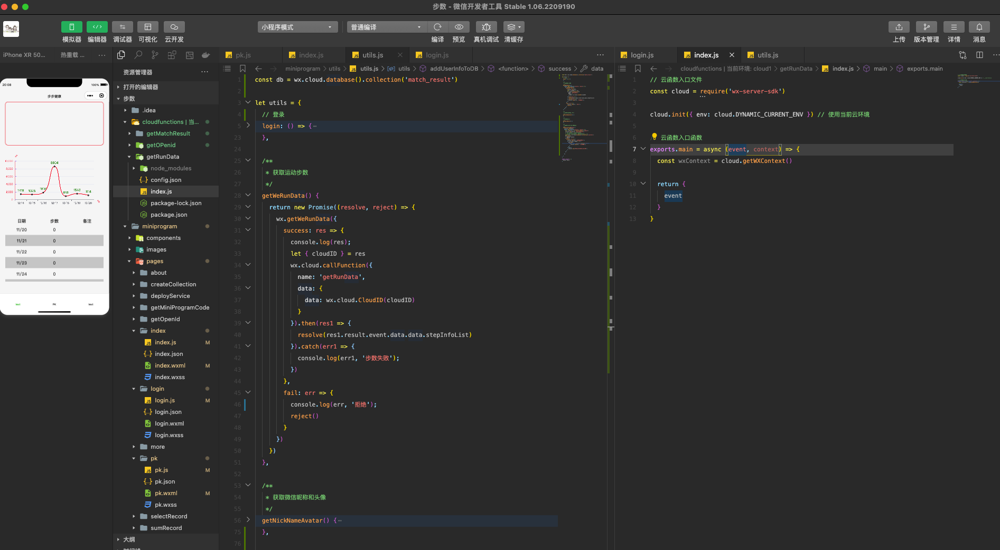

微信小程序开发最主要的就是编写云函数、使用微信提供的功能与数据库，在存储与鉴权方面存在一定便利。
`实现方式最主要云函数的编写与调用，wx.cloud.callFunction({})`

### 1、定义云函数

假如我们要在微信小程序内获取用户运动步数，首先要在 cloudfunctions 文件夹内定义函数

```javascript
// 云函数入口文件
const cloud = require("wx-server-sdk");

cloud.init({ env: cloud.DYNAMIC_CURRENT_ENV }); // 使用当前云环境

// 云函数入口函数
exports.main = async (event, context) => {
  const wxContext = cloud.getWXContext();

  return {
    event,
  };
};
```

### 2、调用云函数

封装调用

```javascript
getWeRunData() {
    return new Promise((resolve, reject) => {
        // 检测用户授权
      wx.getWeRunData({
        success: res => {
          console.log(res);
          let { cloudID } = res
        //云函数的调用
          wx.cloud.callFunction({
            name: 'getRunData',
            data: {
              data: wx.cloud.CloudID(cloudID)
            }
          }).then(res1 => {
            resolve(res1.result.event.data.data.stepInfoList)
          }).catch(err1 => {
            console.log(err1, '步数失败');
          })
        },
        fail: err => {
          console.log(err, '拒绝');
          reject()
        }
      })
    })
  }
```

### 3、业务内使用

我们的业务内需要页面展示的时候就调用一次接口，所以写在了 onshow 内

```javascript
async onShow() {
let list = await utils.utils.getWeRunData().then((r)=>{return r}).catch(rr=>{return rr})
}
```

### 4、代码示例



`其他函数同理，包含数据库函数，值得注意的是，数据库内保存的函数都会有一个唯一的_id，这个_id就是用户的openid`
