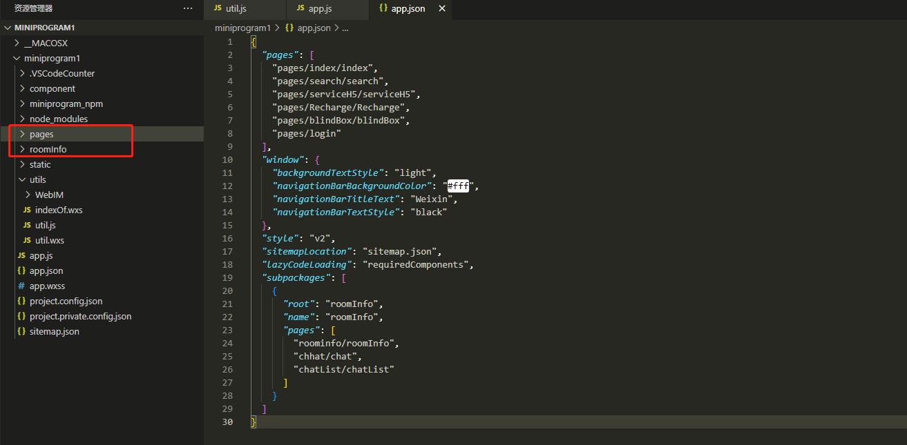

```json
{
  "pages": [
    "pages/index/index",
    "pages/search/search",
    "pages/serviceH5/serviceH5",
    "pages/Recharge/Recharge",
    "pages/blindBox/blindBox",
    "pages/login"
  ],
  "window": {
    "backgroundTextStyle": "light",
    "navigationBarBackgroundColor": "#fff",
    "navigationBarTitleText": "Weixin",
    "navigationBarTextStyle": "black"
  },
  "style": "v2",
  "sitemapLocation": "sitemap.json",
  "lazyCodeLoading": "requiredComponents",
  "subpackages": [
    {
      "root": "roomInfo",
      "name": "roomInfo",
      "pages": ["roominfo/roomInfo", "chhat/chat", "chatList/chatList"]
    }
  ]
}
```

`app.json文件配置subpackages，数组方式，分多少包就配置多少项`
**注意：小程序目前总包大小 20M，每个分包最大 2M**

