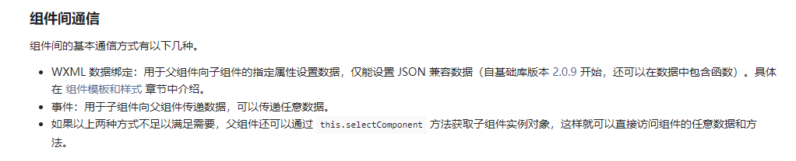
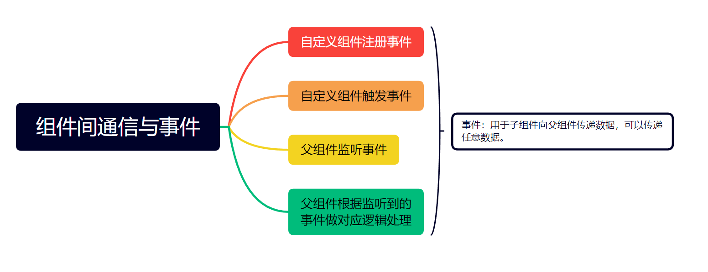
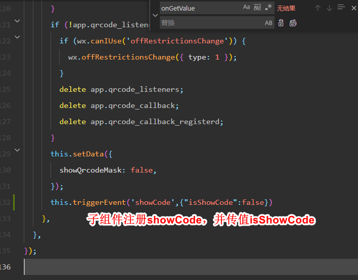

`微信小程序组件间通信可分为 3 种，本文值介绍第 2 种---“事件”`



具体可参考[官方文档](微信小程序父组件监听子组件值的变化/https://developers.weixin.qq.com/miniprogram/dev/framework/custom-component/events.html)



```javascript
// 子组件
this.triggerEvent("showCode", { isShowCode: false });
```


```javascript
// 父组件
// 父组件内bind 子组件注册的字符串（showCode），并自定义一个方法，来处理相应逻辑
// 此处是onGetValue
 <vehicle-speed isWhole="{{true}}" isLockText="{{false}}" showTextLock="{{false}}" bind:showCode="onGetValue"></vehicle-speed>

//  父组件js
// 通过触发父组件自定义的方法，进行逻辑处理
 onGetValue(e) {
    console.log(e.detail.isShowCode, '监听走行限制弹窗关闭');
    this.setData({
      isShowCode: e.detail.isShowCode
    })
  },
```
