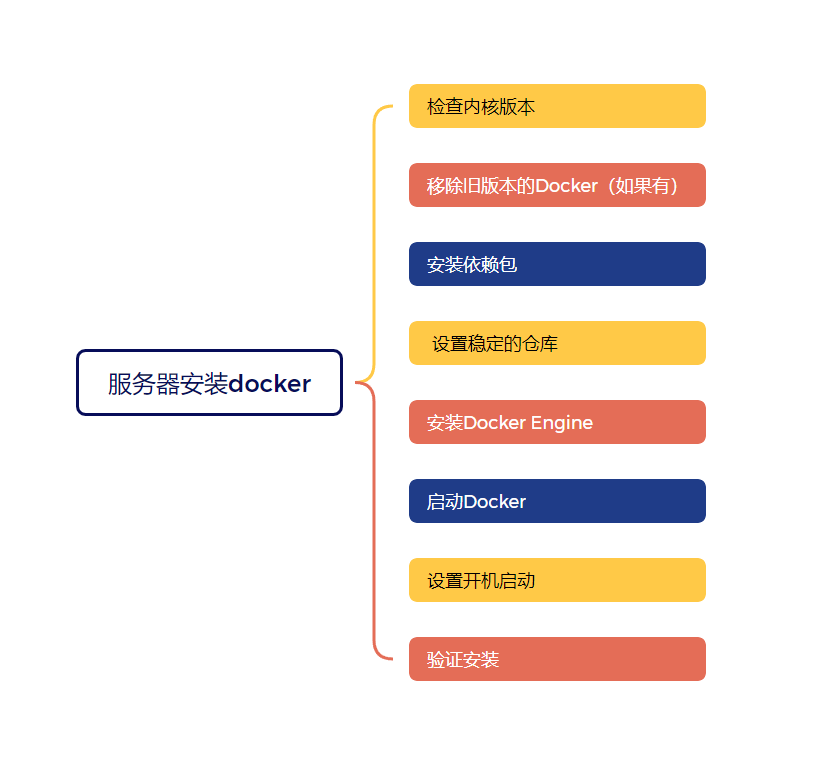

以centos服务器为例，安装docker
## 1、 检查内核版本
通常需要Linux内核版本3.10以上
```shell
uname -r
```
## 2、 移除旧版本的Docker（如果有）
```shell
yum remove docker \
    docker-client \
    docker-client-latest \
    docker-common \
    docker-latest \
    docker-latest-logrotate \
    docker-logrotate \
    docker-engine
```
## 3、 安装依赖包
安装yum-utils、device-mapper-persistent-data和lvm2，这些是Docker安装的依赖包：
```shell
yum install -y yum-utils \
    device-mapper-persistent-data \
    lvm2
```
## 4、 设置稳定的仓库
```shell
# 官方源
yum-config-manager --add-repo https://download.docker.com/linux/centos/docker-ce.repo

# 阿里云镜像源
yum-config-manager --add-repo https://mirrors.aliyun.com/docker-ce/linux/centos/docker-ce.repo
```
## 5、 安装Docker Engine
列出所有可用的Docker版本，并选择一个稳定版本进行安装
```shell
# 列出所有可用的Docker版本
yum list docker-ce --showduplicates | sort -r
# 安装指定版本
yum -y install docker-ce-18.03.1.ce
```
## 6、 启动Docker
```shell
systemctl start docker
```
## 7、 设置开机启动
```shell
systemctl enable docker
```
## 8、 验证安装
```shell
docker --version
```
