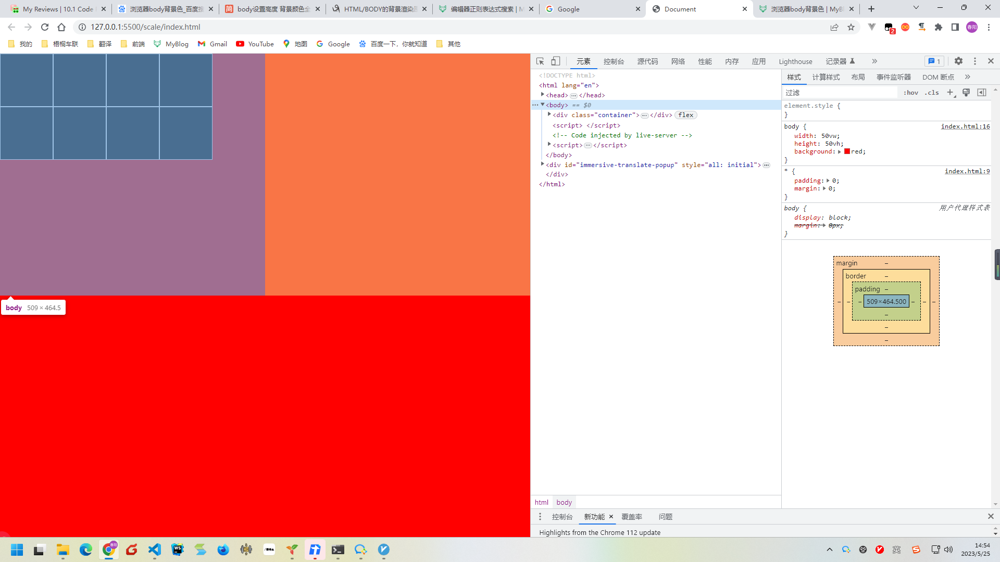
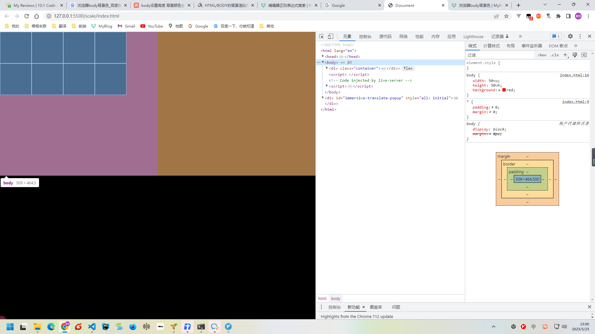

我们给 body 设置背景色，实际我们看见的未必是 body 上的背景色：

1. 当 html 标签没有设置背景色时，我们看见的是作用在浏览器画布上的背景色，不是 body 上的；
2. 当 html 标签被设置了背景色时，我们看见的是真正作用在 body 上的背景色。

```html
<!DOCTYPE html>
<html lang="en">
	<head>
		<meta charset="UTF-8" />
		<meta http-equiv="X-UA-Compatible" content="IE=edge" />
		<meta name="viewport" content="width=200, initial-scale=1.0" />
		<title>Document</title>
		<style>
			* {
				padding: 0;
				margin: 0;
			}
			html {
				/* background: #000; */
			}
			body {
				width: 50vw;
				height: 50vh;
				background: red;
			}
			.container {
				display: flex;
				flex-wrap: wrap;
			}
			.item {
				width: 100px;
				height: 100px;
				background: #000;
				border: 1px solid #fff;
			}
		</style>
	</head>
	<body>
		<div class="container">
			<div class="item"></div>
			<div class="item"></div>
			<div class="item"></div>
			<div class="item"></div>
			<div class="item"></div>
			<div class="item"></div>
			<div class="item"></div>
			<div class="item"></div>
		</div>
		<script></script>
	</body>
</html>
```



`虽然代码已经给body设置了宽高，也设置了背景色，结果却是：宽高已经改变了，背景色却还是全屏显示`
`解决的方法是：给html也设置一个背景色`
`原因是：如果不给html设置背景色，浏览器会将body作为自身的背景色，总是铺满可视区域`

```html
<!DOCTYPE html>
<html lang="en">
	<head>
		<meta charset="UTF-8" />
		<meta http-equiv="X-UA-Compatible" content="IE=edge" />
		<meta name="viewport" content="width=200, initial-scale=1.0" />
		<title>Document</title>
		<style>
			* {
				padding: 0;
				margin: 0;
			}
			html {
				/* 给html设置黑色背景 */
				background: #000;
			}
			body {
				width: 50vw;
				height: 50vh;
				background: red;
			}
			.container {
				display: flex;
				flex-wrap: wrap;
			}
			.item {
				width: 100px;
				height: 100px;
				background: #000;
				border: 1px solid #fff;
			}
		</style>
	</head>
	<body>
		<div class="container">
			<div class="item"></div>
			<div class="item"></div>
			<div class="item"></div>
			<div class="item"></div>
			<div class="item"></div>
			<div class="item"></div>
			<div class="item"></div>
			<div class="item"></div>
		</div>
		<script></script>
	</body>
</html>
```


