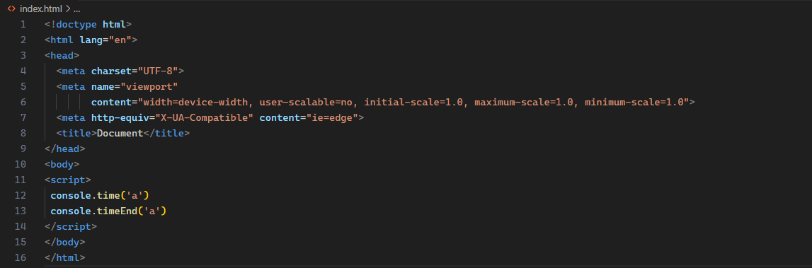
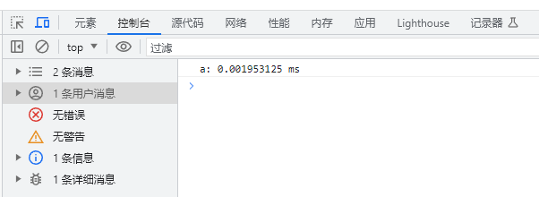

### 1. console.time

`console.time只会测量js代码执行时间`

> console.time('运行时间')
> console.timeEnd('运行时间')

`保证上面的console里面的参数一致即可，在控制台搜索对应的参数，就能看到运行时间`



在 JavaScript 中，console.time() 方法用于创建一个计时器，你可以使用它来测量代码执行的时间。当你调用 console.time() 方法时，它会生成一个计时器标签，你可以在后续的代码中通过 console.timeEnd() 方法来结束计时，并输出经过的时间。

这是一个简单的例子来展示如何使用 console.time() 和 console.timeEnd()：

```javascript
console.time("myTimer"); // 开始计时，并给计时器命名为 "myTimer"

// 这里是你想要测量执行时间的代码
for (let i = 0; i < 1000; i++) {
	// 一些重复的操作
}

console.timeEnd("myTimer"); // 结束计时，并输出 "myTimer" 计时器的耗时
```

在上面的代码中，console.time("myTimer") 开始了一个名为 "myTimer" 的计时器，然后执行了一些重复的操作。当 console.timeEnd("myTimer") 被调用时，计时器停止，并且控制台会输出 "myTimer" 计时器所经过的时间。

这种方法对于性能分析和调试非常有用，因为它可以帮助开发者识别代码中的性能瓶颈。通过测量不同部分的代码执行时间，开发者可以优化那些耗时较长的操作，从而提高程序的整体性能。

---

### 2. 测量浏览器渲染时间

console.time() 和 console.timeEnd() 方法主要用于测量 JavaScript 代码的执行时间，它们并不直接测量页面渲染的时间。页面渲染是一个复杂的过程，涉及浏览器的多个组件，包括 HTML 解析、CSS 计算、JavaScript 执行、布局（layout）、绘制（paint）等步骤。

如果你想要测量页面渲染的时间，你应该关注的是浏览器提供的其他性能 API，如 Performance API。Performance API 提供了更细粒度的计时信息，包括页面加载的各个阶段。

例如，你可以使用 window.performance 对象来访问这些信息。下面是一些常用的性能指标：

navigationStart：浏览器开始加载页面的时间（包括连接和获取资源的时间）。
fetchStart：浏览器发起请求去获取资源的时间。
domLoading：DOM 树开始加载的时间。
domInteractive：DOM 树完全解析完成，并且 JavaScript 脚本已经加载完毕，但是样式、图片和子框架可能还在加载的时间。
domContentLoadedEventStart：所有 DOM 核心处理完毕，不需要等待样式表、图片和子框架完成加载的时间。
loadEventStart：当所有资源加载完毕，页面的 load 事件被触发的时间。
你可以使用 console.time()和 console.timeEnd()来测量 JavaScript 代码的执行时间，同时使用 Performance API 来获取页面加载的各个阶段的时间。这样，你可以更全面地了解页面加载和渲染的性能表现。

例如，你可以这样使用 Performance API 来测量页面的渲染时间：

```javascript
window.onload = function () {
	var loadTime = performance.timing.loadEventEnd - performance.timing.navigationStart;
	console.log("页面加载和渲染完成所用时间：" + loadTime + "毫秒");
};
```

在这个例子中，loadEventEnd 和 navigationStart 是 Performance API 提供的时间戳，它们分别代表页面加载和渲染完成的时间以及页面开始加载的时间。通过计算这两个时间戳之间的差值，你可以得到页面从开始加载到完全渲染完成所需的时间。
