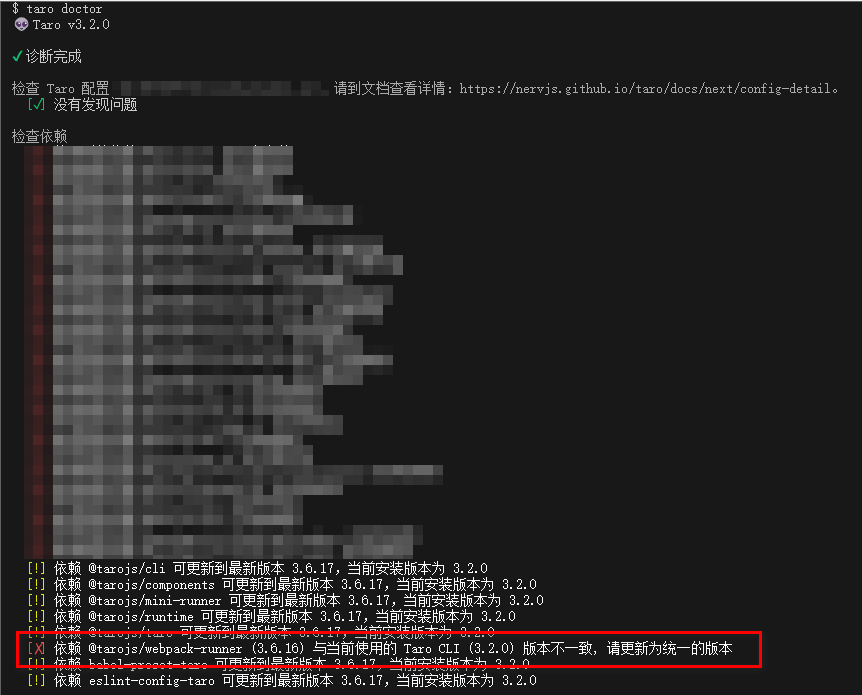

```json
{
	"name": "abcd",
	"version": "1.0.0",
	"private": true,
	"description": "",
	"templateInfo": {
		"name": "default",
		"typescript": false,
		"css": "less"
	},
	"scripts": {
		"build:weapp": "taro build --type weapp",
		"build:h5": "taro build --type h5",
		"dev:weapp": "npm run build:weapp -- --watch",
		"dev:h5": "npm run build:h5 -- --watch",
		"lint-staged": "lint-staged",
		"lint": "eslint --fix **/*{.js,.vue,.ts}"
	},
	"browserslist": ["last 3 versions", "Android >= 4.1", "ios >= 8"],
	"author": "FE",
	"dependencies": {
		"@babel/runtime": "^7.7.7",
		"@tarojs/cli": "^3.2.0",
		"@tarojs/components": "3.2.0",
		"@tarojs/runtime": "3.2.0",
		"@tarojs/taro": "3.2.0",
		"@tarojs/webpack-runner": "^3.3.14",
		"vue": "^2.5.0",
		"vue-template-compiler": "^2.5.0"
	},
	"devDependencies": {
		"@babel/core": "^7.8.0",
		"@commitlint/cli": "^13.1.0",
		"@commitlint/config-conventional": "^13.1.0",
		"@tarojs/mini-runner": "3.2.0",
		"@tarojs/webpack-runner": "^3.3.14",
		"@types/webpack-env": "^1.13.6",
		"babel-preset-taro": "3.2.0",
		"eslint": "^6.8.0",
		"eslint-config-taro": "3.2.0",
		"eslint-plugin-vue": "7.0.0",
		"husky": "^7.0.1",
		"lint-staged": "^11.1.2",
		"prettier": "^2.3.2",
		"stylelint": "9.3.0",
		"vue-loader": "^15.9.2"
	},
	"husky": {
		"hooks": {
			"pre-commit": "lint-staged",
			"commit-msg": "commitlint -e HUSKY_GIT_PARAMS"
		}
	},
	"lint-staged": {
		"{packages,libs}/**": ["eslint --fix", "git add ."]
	}
}
```

本项目依赖 taro3.2.0 版本运行，使用 npm 安装后，报错

```javascript
./examples/app.config.js
Module build failed (from ./node_modules/@tarojs/webpack-runner/node_modules/@tarojs/taro-loader/lib/h5.js):
TypeError: Cannot read property 'creator' of undefined
```

根据报错进入文件内查看显示`import { ${options.loaderMeta.creator} } from '${options.loaderMeta.creatorLocation}'`，判断是版本错误。
运行`taro doctor`显示安装的@tarojs/webpack-runner 版本是 3.6.16，而实际项目中需要的是^3.3.14，重新 npm install @tarojs/webpack-runner@3.3.14，完美运行
