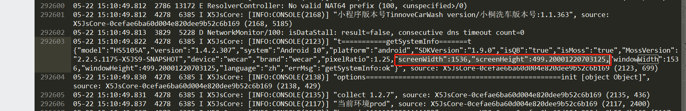
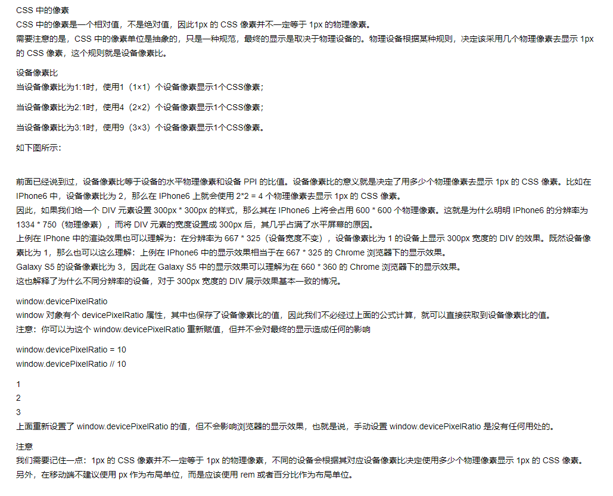
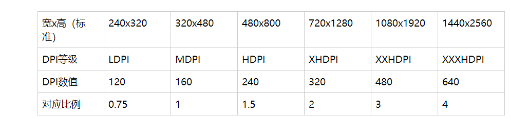

事情的起因是这样：
`项目是加载在android的webview上面，由于andriod端更改了dpi，由160改成了200，造成pixelRatio变成了1.25，而项目内使用的css单位是Px进行的适配，造成整体页面也被放大了1.25倍，导致UI溢出。`

**解决办法：直接将页面缩放为原来的0.8倍，发布到项目上与1.25倍相乘，正好得到原来的1倍值**



由此引发的思考：


## 1、px

PX(pixel):
即传统计算机语言中描述的像素，在Android则代表绝对像素。

之所以Android中不推荐使用这种单位，正是因为不同生产厂商，不同品牌，不同屏幕的设备，其分辨率亦不一。
举例来说，我们现在将某个Button的width设为160px，则会出现如下情况：
> 在分辨率为“320宽”的设备里，该按钮显示占屏幕宽度一半；
> 在分辨率为“640宽”的设备里，该按钮显示占屏幕宽度的四分之一；

## 2、dp

与我们之前谈到的绝对密度“px”对应，Android中引入的“dp”代表的则是“设备独立像素”。
``该单位是为支持WVGA、HVGA和QVGA而使用的，其不再依赖像素本身，而是和屏幕密度相关。``
在Android当中规定：在屏幕密度为“160dpi”的情况下，则刚好“1dp = 1px”。
注：当屏幕密度为“320dpi”时，则“1dp = 2px”，以此类推.......
也正是因此，让我们得以保证了：控件在不同密度的屏幕上显示一致，既完成屏幕适配。
使用场景：
让我们回到上面说到的使用px造成的控件显示问题，此时我们将使用新的单位“dp”。于是：

> 在分辨率320*480（既dpi为160）的设备下，则160dp等价于160px，按钮占屏幕宽的一半。
> 在分辨率640*960（既dpi为320）的设备下，则160dp等价于320px，按钮依然占屏幕宽的一半。

## 3、dp与px之间的换算关系

```javascript
px = dp * (dpi / 160)
dp = px * (dpi / 160)
# dp与px之间的转换公式，dpi随设备分辨率而变化
```



### 3.1 注意事项

`更改dpi只影响Px为单位的css布局，vh/vw是根据屏幕高/宽度来的，不受dpi影响`