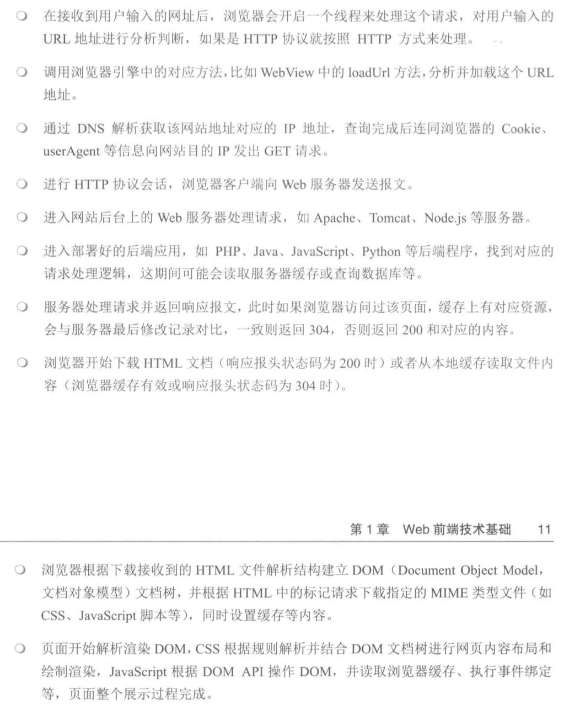

> 1. 开启线程处理请求，分析url，根据协议处理
> 2. 调用引擎对应的方法（例如：loadUrl），分析并加载url地址
> 3. 通过DNS解析获取对应的ip地址，查询后连同cookie、userAgent等信息向ip发出get请求
> 4. 进行http会话，浏览器发送报文到服务器
> 5. 服务器处理请求
> 6. 服务器进入应用程序，找到相应逻辑进行处理（读取缓存或者查询数据等）
> 7. 服务器返回报文（如果有缓存返回304，否则查询返回200或404）
> 8. 浏览器开始处理（200或304）
> 9. 浏览器解析dom，同时设置缓存
> 10. 渲染dom

