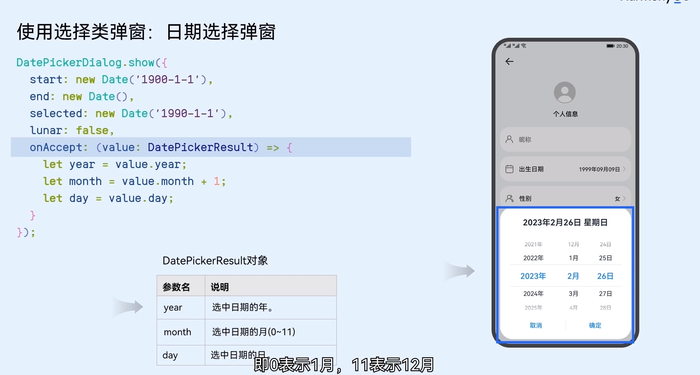

### 1. 警告弹窗

```javascript
AlertDialog.show({
	// title:"密码错误",
	message: "是否需要重新输入",
	// 取消按钮
	primaryButton: {
		value: "取消",
		action: () => {
			console.log("取消了输入");
		},
	},
	// 确定按钮
	secondaryButton: {
		value: "确定",
		action: () => {
			console.log("确认需要");
		},
	},
	// 弹窗位置
	alignment: DialogAlignment.Bottom,
	// 相对偏移量
	offset: { dx: 0, dy: -100 },
});
```

### 2. 选择类弹窗

#### 2.1 日期



```javascript
DatePickerDialog.show({
	start: new Date("2023-01-01"),
	selected: new Date(),
	end: new Date(),
	// 是否是农历
	lunar: false,
	onAccept: (value: DatePickerResult) => {
		let year = value.year;
		let month = value.month + 1;
		let day = value.day;
		console.log(`${year}-${month}-${day}`);
	},
});
```

#### 2.2 文本选择

```javascript
TextPickerDialog.show({
	range: ["1", "2"],
	selected: 1,
	onAccept: (result: TextPickerResult) => {
		console.log(result.value);
	},
	onCancel: () => {
		console.log("取消");
	},
});
```
